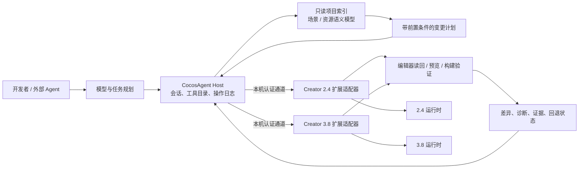

# CocosAgent 设计：以 AI-Native 引擎岗位要求为目标

> 状态：设计基线；两版已验证本地通信、实例与能力目录、单 PNG 场景闭环和节点只读定位。依据是用户提供的四张招聘截图；截图描述的是岗位方向，不等于本仓库已经具备全部能力。版本范围为 Creator 2.4.15 和 3.8.7，不以版本迁移为目标。

**当前实施约束：** 先只开发并验收 Creator 2.4.15 的 CocosAgent 完整工作流，再根据实际形成的能力合同补充 3.8.7。现有 3.8 代码、研究和轨迹保留为历史基线；新增 3.x 功能、示例场景挂接与实机验收暂缓。下文涉及“两版”的表格描述长期目标或既有证据，不代表当前每项工作都要双版本同步推进。共享 Host 合同由 2.x 验证驱动，新增能力不得默认声明 3.x 可用。

## 1. 目标与边界

招聘要求的核心是让引擎、编辑器、资源管线和运行时适应 AI 生成内容的高频生产、导入、修改和运行。CocosAgent 应成为这条生产链的**可执行控制层**：理解项目状态，提出有依据的变更计划，通过各版本编辑器与构建入口执行，验证结果并保留回退能力。模型可以提供意图和内容，但执行必须由确定性的工具完成。

设计不包含模型训练、推理框架或生成算法。也不把“能写场景 JSON”当作编辑器自动化成功：场景、资源、`.meta`、UUID、导入缓存和实际预览必须一起成立。现有仓库缺少完整 Creator 编辑器宿主源码，编辑器 API 与构建钩子的可用性须在对应版本的扩展中实测。

## 2. 招聘条目 → CocosAgent 能力

| 招聘方向 | Agent 必须具备的能力 | 第一批可验收结果 |
| --- | --- | --- |
| 引擎架构的 AI-Native 改造 | 建立版本化的项目、场景、节点、组件、资源语义模型；将操作表示为可组合、可校验的变更；记录引擎能力和平台差异 | 同一任务可分别产出 2.4 与 3.8 的执行计划，能解释对象引用、生命周期及不支持项 |
| 编辑器工作流的 AI 友好化 | 结构化读取场景与资源；通过版本专属扩展提供批处理入口、预览、提交和撤销；把编辑器诊断返回给 Agent | 在两个示例工程中分别完成一次节点/组件操作，编辑器重新打开后仍能正确引用并预览 |
| 资源管线的 AI 适配 | 生成资源的来源、格式、依赖、导入设置和校验结果可追溯；按类型批量导入、失败隔离、自动修复建议 | 一批纹理/材质/动画等资源经过导入校验，失败资源被准确定位，成功资源可在场景中使用 |
| 运行时动态内容承载 | 资源预取、加载、替换、场景更新、引用计数与释放的版本化执行方案；监测帧时间和内存；失败回退 | 在目标平台反复加载、替换、卸载测试内容，留下资源身份、引用与内存轨迹 |
| 工具链与自动化 | 把“生成 → 校验 → 导入 → 组装 → 预览 → 构建”连成批处理流程；每步可重试、可定位失败 | 一条端到端任务可重复执行，不产生重复节点/资源，输出报告与可回退的变更记录 |

岗位提到的 C++、JS/TS、渲染和构建经验，对应深层引擎改造所需的实现能力；Agent 的第一阶段应先发现编辑器和运行时的真实瓶颈，再决定修改 JS/TS、C++ 或构建链路。不要为了“AI-Native”预先重写引擎核心。

## 3. 系统形态



这不是一个横跨两版引擎的通用写入器。规划层可共享**任务语义**和验证协议，执行层必须各自实现、各自测试。2.4 的 `cc.Class`、`.fire`、扩展包和 3.8 的 TypeScript 装饰器、`.scene`、扩展消息体系不可互换；即便任务名称相同，也要检查对象身份、资源引用、导入和销毁规则。

### 核心对象契约

- `ProjectSnapshot`：Creator 精确版本、项目根、目标平台、当前引擎来源、场景列表、资源索引和快照修订号。若引擎来源未知，就明确返回未知。
- `NodeRef`：场景身份、节点身份及可读层级路径。路径只用于展示与定位，不单独作为稳定身份。
- `AssetRef`：源文件、`.meta` UUID、资源类型、导入设置、依赖和内容校验值；主资源与子资源要分别表示。
- `ChangeSet`：带前置条件的批量操作、预期差异、受影响引用、验证步骤和回退记录。重复执行须能识别已经完成的操作。
- `Evidence`：官方手册页、源码符号、编辑器返回、预览/构建日志和平台条件。区分“设计假设”“源码可见”“运行已验证”。

首批工具接口建议为 `inspect_project`、`snapshot_scene`、`find_assets`、`plan_changes`、`apply_change_set`、`import_asset_batch`、`validate_project`、`run_preview_probe`、`build_target`、`revert_change_set`。写入工具统一要求版本、项目快照修订号、操作 ID、预期变更及校验策略；返回实际差异和失败位置。`plan_changes` 默认只读，`apply_change_set` 是显式执行入口。底层不得绕过编辑器导入机制直接伪造 UUID 或修改生成缓存。

### 运行边界与通信职责

模型属于外部 Agent 或其客户端配置；CocosAgent Host 负责把模型给出的意图变成受约束的工具调用；Creator 扩展只负责本版本编辑器 API 的执行与读回。**模型供应商的 API key 不进入 Creator 扩展、项目文件或桥接会话。**本机 WebSocket 的随机会话令牌只认证 Host 与扩展，不是模型凭证，也不提供模型调用能力。

通信协议、传输方式和编辑器操作语义应分层：工具语义定义 `scene.snapshot`、`asset.import` 等操作；当前原型用 loopback WebSocket 承载 Host 与扩展之间的请求；未来可增加 MCP stdio 入口供外部 Agent 调用，但不因此让 Creator 扩展直接连接模型或把 MCP 传输细节写入 2.x/3.x 适配器。Unity 官方从内置 Assistant MCP 转向 Unity CLI 的经验可作参考：把 Agent 接入面与编辑器侧桥接解耦；Unity 旧版 MCP 文档仍可帮助理解工具注册和编辑器连接模型，但不应视为我们需要照搬的当前传输实现。

目前两版已验证本机认证、实例与能力目录、单 PNG 导入及场景写入、持久操作查询、预览回执和补偿；本地 Agent 可通过 CLI 或 JSONL 调用，`scene.node.inspect` 可按路径只读定位节点。这些调用仍使用短时 Host 会话。常驻连接、并行写入、请求取消、可靠队列和 MCP 接入尚未实现。会话文件位于项目 `temp/`，即使当前已忽略且设定了本机权限，正式实现仍应检查符号链接/路径归属、令牌轮换、过期清理和日志脱敏。

### 工具发现与版本能力协商

Host 启动后先取得扩展的 `hello` / `capabilities`，并校验项目根、Creator 精确版本、协议主次版本和适配器身份。版本能力表应描述**实际可用的操作及限制**，例如 `scene.snapshot` 只读、`asset.import.png` 写入、是否支持预览控制；不能仅凭“2.4”或“3.8”推断某能力存在。未知或不匹配的能力默认不可调用，不能降级成通用文件写入。

建议把共同工具定义为稳定的任务语义，并由版本适配器提供实现：

| 工具域 | 代表操作 | 初始权限级别 |
| --- | --- | --- |
| 项目与诊断 | `project.inspect`、`scene.snapshot`、`asset.find`、`project.validate` | 只读 |
| 资源管线 | `asset.import`、`asset.configure`、`asset.remove` | 写入；按操作给出目标路径和冲突策略 |
| 场景编辑 | `scene.create_node`、`scene.attach_component`、`scene.assign_asset`、`scene.remove_node` | 写入；需前置条件与差异预览 |
| 运行与构建 | `preview.start`、`preview.probe`、`build.run` | 有副作用；声明平台、目标和超时 |

每项能力应带稳定 ID、输入/输出 schema 版本、读写类别、可取消性、幂等策略、超时上限和验证方式。首期只开放有类型约束的操作；不提供任意 JavaScript 执行、任意文件路径写入或无约束编辑器 eval。能力缺失时返回结构化 `UNSUPPORTED_CAPABILITY`，并附版本与可用能力，不静默模拟成功。

### 请求、操作与结果

共同协议可先固定以下对象，再逐项落到实现中：

```text
ToolManifest {
  protocolVersion, adapterId, creatorVersion, projectId,
  capabilities[{ id, schemaVersion, access, limits }]
}

OperationRequest {
  requestId, operationId, toolId, projectRevision,
  arguments, deadline, idempotencyKey
}

OperationResult {
  requestId, operationId, status,
  changedItems[], diagnostics[], evidence[], recovery
}
```

`requestId` 用于一次请求/响应关联；`operationId` 标识一个可审计的用户任务，可包含多次工具调用；`idempotencyKey` 防止超时重试造成重复导入或重复建节点。结果状态至少区分 `succeeded`、`partial`、`failed`、`cancelled`、`unsupported` 和 `stale_snapshot`。错误包含稳定错误码、可读说明、失败对象、是否已产生副作用及建议恢复动作，不能只回传日志字符串。

### 写入生命周期与恢复

写入采用“读快照 → 计划 → 校验前置条件 → 应用 → 读回 → 验证”的闭环：

1. Host 读取当前项目修订号和受影响对象身份，生成包含预期差异的 ChangeSet。
2. 应用前检查 Creator 版本、活动场景、资源 UUID/路径和对象修订号；快照已过期则返回 `stale_snapshot`，要求重新规划。
3. 执行前检查目标路径、同名冲突及引用影响。所有写操作均有操作 ID 与幂等键；重试查询操作状态，不盲目重复写入。
4. 编辑器 API 返回后重新从 AssetDB/场景读回，验证 UUID、类型、组件、引用及文件摘要；API 回调成功本身不等于操作验收成功。
5. 记录已完成步骤、部分副作用、验证证据和恢复结果。仅在编辑器 API 明确可逆时自动补偿；否则保留现场并提供具体人工恢复指引。

Creator 并不保证多资源或场景批次具备数据库式原子事务。因此 ChangeSet 的“回退”是逐项补偿与恢复检查点，不宣称跨文件原子回滚。编辑器重载、连接丢失或构建中断后，Host 应先查询操作日志和项目实际状态，再决定继续、重新规划或停止。

并发规则首期采用每个项目一个活动写操作；只读快照可以并行，但必须返回所用修订号。请求需设截止时间、进度事件和取消标记；取消表示尽可能停止后续步骤，若当前 Creator API 无法中断，应回报“停止后续步骤”及已完成副作用。连接重建后通过会话 ID 恢复状态，不依据旧的 socket 连接推断操作完成。

## 4. 一条完整的内容生产链

以“生成一组素材并加入场景，在运行时替换其中一项”为贯穿用例：

1. **检查**：识别 Creator 版本、工程、目标平台、引擎来源、已有资源和场景结构；从对应版本手册确定公开行为。
2. **描述**：把生成物转换为明确的资源清单和场景变更计划，列出类型、尺寸/格式、依赖、导入设置、预期节点与组件。
3. **导入**：交给版本专属编辑器扩展导入；等待 `.meta`、子资源和依赖稳定；记录源文件与导入结果，不以文件存在代替成功。
4. **组装**：通过编辑器事务创建或修改节点、组件、预制体和场景引用；先检查前置条件，再执行批处理。
5. **验证**：重新读取场景与资源图，检查引用和类型；在对应版本预览中检查加载与画面；按目标平台构建时核对实际使用的引擎。
6. **运行时替换**：先加载候选资源并验证可用性，在安全的更新点切换引用，观察旧资源的剩余引用和释放。失败时恢复旧引用并记录原因。

“热更新”须明确是原生 `AssetsManager` 的包更新、Bundle/资源更新，还是场景对象替换；三者的入口、发布条件和回退方式不同。运行时接线在 Web、Mac 原生及其他目标平台分别验收，不把 Web 预览结论直接推广到原生。

## 5. 两版独立实现与共同验收

| 主题 | 2.4.15 路线 | 3.8.7 路线 | 共同验收语义 |
| --- | --- | --- | --- |
| 编辑器入口 | `packages/` 扩展包，先验证菜单/消息，再探索结构化场景和资源 API | `extensions/` 扩展，先验证启用/消息，再探索场景、资源数据库和构建入口 | Agent 可读取、执行和收集确定结果；不把扩展已加载等同于操作成功 |
| 场景与脚本 | `.fire`、`cc.Class`、2.x 节点/组件/预制体规则 | `.scene`、TS 组件、3.x 节点/组件/预制体规则 | 编辑器重开、预览后对象与引用仍成立 |
| 资源 | 按 2.4 手册、`.meta`、Asset Manager 与 Bundle 路径实现 | 按 3.8 手册、`.meta`、Asset Manager 与 Bundle 路径实现 | 源文件、导入资源、依赖和运行时引用可追踪 |
| 动态内容 | 先复用已验证的 2.x 加载、场景切换和释放路径 | 先复用已验证的 3.x 加载、场景切换和释放路径 | 反复替换后功能正确、引用清晰、资源可释放 |
| 原生与构建 | 先补证目标包的引擎来源 | 现有 Mac 包已知使用 Creator 内置引擎；改引擎时需重新接线与核对 | 构建报告指向实际参与构建的引擎，而非邻接源码目录 |

共同协议只规范任务和结果，不承诺两版有相同内部实现。手册和源码不一致时，设计应携带分歧及实际验证条件，让 Agent 停在“需验证”状态。

## 6. 建设顺序与完成条件

| 阶段 | 交付物 | 完成条件 | 当前状态 |
| --- | --- | --- |
| P0：项目理解与桥接 | 两版只读索引、场景/资源快照、能力清单、证据引用和 Host-扩展会话 | 两个示例都能返回可核对快照；能力未知时明确拒绝调用 | 基础接入已验证：双实例目录、四项版本能力、场景快照和节点定位；目录有修订号，Host 中断后可查询持久操作。完整资源索引、常驻目录与自动断线重连仍未实现 |
| P1：编辑器变更闭环 | 两版独立场景适配器；差异计划、节点/组件/资源引用操作、读回验证与补偿 | 同一任务分别在两版可重放；编辑器重开后引用正确，预览通过，重复执行无副作用 | 进行中：单 PNG 场景操作在两版通过保存读回、Web 预览回执、补偿与重放；六阶段 [操作合同 0.1](agent-foundation/cocos-agent-operation-contract-0.1.md)与跨会话记录已验证。通用节点/组件写入、自动预览和写入后重开引用验证仍待做 |
| P2：资源批处理 | 清单、元数据校验、批量导入、依赖检查、错误定位与隔离 | 同一批资源在两版分别完成导入和场景引用；失败项不污染成功项 | 进行中：两版各两张 PNG 的导入与读回已实测；2.4.15 双 Sprite 显式坐标写入、`.fire` 坐标与 UUID 磁盘读回、同屏视觉验收、逆序补偿及新 ID 重放后再次补偿均有记录。通用依赖检查和中断注入仍待做，3.8 批次实现按约束暂缓。见[批量导入合同](agent-foundation/asset-batch-0.1.md)和[场景 Sprite 批次合同](agent-foundation/scene-sprite-batch-0.1.md) |
| P3：动态内容 | 版本专属资源替换与生命周期操作、运行时探针、恢复策略 | Web 与至少一个原生目标记录多轮加载/替换/释放；达到项目定义的帧时间和内存预算 | 进行中：2.4 正常启动 Web 通道已验证 Host 选择、红蓝可见替换、真实导入请求失败后的 `retained`、Host 指针回滚、重试恢复、断线重连与独立 `effective` 回执，见[Web 运行时切片](agent-foundation/content-runtime-web-0.1.md)。3.8 的 Web 记录是旧临时注入路径，不代表当前 2.4 实施；Mac 包验证了资源加载/释放，但原生版本生效、远端内容和性能预算仍待验证 |
| P4：引擎与工具链改造 | 依据前述证据选择结构化数据、导入诊断、场景更新或资源管理改造 | 对应可复现瓶颈，变更前后有性能/稳定性数据，并覆盖目标构建 | 未开始：先确定使用自定义引擎构建的真实接线和测量基线 |

第一条纵向原型 **一个 PNG → 编辑器导入 → 放入场景 → 预览校验 → 补偿/重放** 已在 2.4 和 3.8 分别验证；`scene.node.create`、资源批处理等后续切片也已有各自的局部合同与证据。它们是现有基线，不改变当前只推进 2.4 的实施约束。

当前近期顺序以 2.4 为准：正常启动连接 Host、成功替换、网络加载失败保留旧内容、回滚与重试的 Web 切片已闭环。P2 批量场景引用已有真实 2.4 双项坐标写入、磁盘/引用读回、同屏预览、逆序补偿和重放证据。下一步补通用依赖检查和批次中断注入，验证失败项隔离与 Host 恢复；随后补 2.4 动态内容目标平台验证、资源生命周期与性能基线。不能将 Mac 包的加载/释放轨迹当作原生版本生效证据。2.4 主流程达到目标后，再启动 3.8 的逐项适配和差异验证。上表的 P0–P4 是能力层次，不要求当前并行开发两个版本。

评估时同时记录任务完成率、人工修复次数、引用错误数、重复执行差异、导入耗时、预览/构建成功率，以及动态内容阶段的帧时间、峰值内存和释放结果。性能目标先从 2.4 示例及目标平台测基线；启动 3.8 适配时再测其独立基线，不凭截图推定阈值。

## 7. 与现有研究和 skill 的关系

现有 [研究计划](source-study-plan.md)提供两版独立分析及对照的方法；[场景对象](comparisons/02-objects-and-scenes.md)、[资源系统](comparisons/04-assets-and-loading.md)、[发布与原生](comparisons/10-publishing-and-native.md)、[编辑器扩展](comparisons/12-editor-extension-and-diagnostics.md)是这份设计的首批技术依据。`docs/agent-foundation/skills/` 下的版本专属 skill 主要用于**定位与诊断**；它们不能自动升级为写入工具。每个操作型 skill 还需要明确输入约束、适用版本、编辑器执行证据、失败回退和可重复试用案例。

操作型 skill 建议统一包含：版本与 Creator 精确版本范围、官方手册入口、所需能力 ID、输入 schema、执行前检查、版本专属步骤、成功/部分成功/失败的可观察信号、读回验证、可逆性与补偿方式、已知限制和对应轨迹。2.4 与 3.8 应分别维护实现细节；可以共享任务目标和验收清单，但不得让一个版本的 API 路径被另一个版本的 skill 直接调用。Skill 负责告诉 Agent 如何选择和串联工具，Host 仍负责权限、schema、路径约束、幂等与操作日志。

两版阶段 12 扩展已验证“菜单 → 消息”这一最小链路；CocosAgent bridge 原型已在两版 Creator 中验证本地 WebSocket 握手、`bridge.ping`、真实只读 `scene.snapshot` 和单 PNG 导入。PNG 主机层限制文件大小、尺寸与文件名，以 SHA-256 和会话隔离目录传递文件；Creator 侧按目标 URL 拒绝冲突，并回传 UUID、类型和导入状态。2.4 首轮运行表明暂存 basename 决定 AssetDB 导入文件名，代码据此修正；修正后两版均导入成功并生成各自 `.meta`，同名重试均拒绝且未覆盖。两版原生资源类型字符串不同（2.4 `texture`、3.8 `cc.ImageAsset`），共同协议当前保留原值。3.8 的图片导入器还需产出 SpriteFrame 子资源，场景 Sprite 才能引用；场景操作现使用已导入的 SpriteFrame UUID。两版真实 Creator 已完成单 PNG 的场景放置、自动保存、Web 预览、补偿、重放及再次补偿；Host 核对了内存快照与磁盘中的节点和 SpriteFrame 引用，两个预览均目视看到图片，最终两份场景文件均无 Agent 节点。3.8 在原无 Canvas 的 3D 场景中创建专用 Canvas/UI 相机；2.4 使用原有 Canvas。3.8 首次写入发现保存回执早于磁盘读回，Host 已增加短时轮询。2.4 未核实参数的撤销记录消息引发编辑器错误，现已移除。场景重开、复杂布局、原生预览、批量导入、自动预览和构建钩子仍未验证或实现。现有 3.8 Mac 包使用内置引擎，2.4 包来源仍待确认。已验证运行轨迹见 `docs/agent-foundation/traces/cocos-agent-scene-snapshot-0.1.jsonl` 与 `docs/agent-foundation/traces/cocos-agent-asset-import-0.1.jsonl`；实现入口与运行方式见 `tools/cocos-agent-bridge/README.md`。

### Unity 参考：借鉴分层与工具链，不复制产品绑定

命令发现、实例定位、结果表达与 skill 调用的具体取舍见 [Unity → CocosAgent 对照设计](agent-foundation/unity-to-cocos-agent-design.md)。

Unity 的可借鉴点是把 Agent 可发现的工具、宿主/CLI 生命周期和编辑器内操作桥接作为不同层，并允许外部 Agent 管理模型与任务。Unity 官方目前将内置 Assistant 的 MCP 连接引导至 Unity CLI；因此这里参考的是“Agent 接入面与 Editor Bridge 分离”的架构方向，不把旧内置 MCP 方案定为 CocosAgent 依赖。Unity 的技能包也说明，操作手册/工作流知识可以随工具交付，但 skill 本身不能替代工具的输入校验、能力协商和执行证据。

对 CocosAgent 的落点是：Host 可独立演进协议入口；2.4、3.8 扩展分别注册版本能力；操作以类型化 schema 暴露；执行结果带结构化诊断和可核对证据。当前实现是 Node Host + loopback WebSocket + Creator 扩展，外部 Agent 有 JSONL/CLI 本地入口。MCP、自动化预览、构建和通用场景写入仍属后续阶段。

参考资料：[Unity CLI 替代内置 MCP Server](https://docs.unity.com/en-us/unity-cli/replace-mcp-server-unity-cli)、[Unity MCP 架构说明](https://docs.unity3d.com/Packages/com.unity.ai.assistant@2.0/manual/unity-mcp-overview.html)、[Unity Plugin 概览](https://docs.unity.com/en-us/ai/unity-plugin/about-unity-plugin)。这些链接描述 Unity 产品自身的实现与演进，不构成对 Cocos Creator API 的证据。
