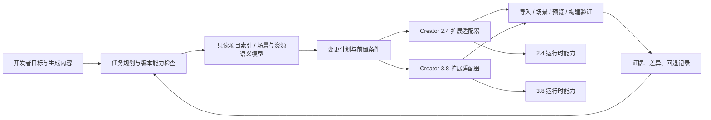

# CocosAgent 设计：以 AI-Native 引擎岗位要求为目标

> 状态：设计基线；本地通信首个原型已实现并在 Creator 2.4.15、3.8.7 分别完成握手与 ping 往返。PNG 导入与场景操作尚未实现。依据是用户提供的四张招聘截图；截图描述的是岗位方向，不等于本仓库已经具备这些能力。版本范围为 Creator 2.4.15 和 3.8.7，不以版本迁移为目标。

## 1. 目标与边界

招聘要求的核心是让引擎、编辑器、资源管线和运行时适应 AI 生成内容的高频生产、导入、修改和运行。CocosAgent 应成为这条生产链的**可执行控制层**：理解项目状态，提出有依据的变更计划，通过各版本编辑器与构建入口执行，验证结果并保留回退能力。模型可以提供意图和内容，但执行必须由确定性的工具完成。

设计不包含模型训练、推理框架或生成算法。也不把“能写场景 JSON”当作编辑器自动化成功：场景、资源、`.meta`、UUID、导入缓存和实际预览必须一起成立。现有仓库缺少完整 Creator 编辑器宿主源码，编辑器 API 与构建钩子的可用性须在对应版本的扩展中实测。

## 2. 招聘条目 → CocosAgent 能力

| 招聘方向 | Agent 必须具备的能力 | 第一批可验收结果 |
| --- | --- | --- |
| 引擎架构的 AI-Native 改造 | 建立版本化的项目、场景、节点、组件、资源语义模型；将操作表示为可组合、可校验的变更；记录引擎能力和平台差异 | 同一任务可分别产出 2.4 与 3.8 的执行计划，能解释对象引用、生命周期及不支持项 |
| 编辑器工作流的 AI 友好化 | 结构化读取场景与资源；通过版本专属扩展提供批处理入口、预览、提交和撤销；把编辑器诊断返回给 Agent | 在两个示例工程中分别完成一次节点/组件操作，编辑器重新打开后仍能正确引用并预览 |
| 资源管线的 AI 适配 | 生成资源的来源、格式、依赖、导入设置和校验结果可追溯；按类型批量导入、失败隔离、自动修复建议 | 一批纹理/材质/动画等资源经过导入校验，失败资源被准确定位，成功资源可在场景中使用 |
| 运行时动态内容承载 | 资源预取、加载、替换、场景更新、引用计数与释放的版本化执行方案；监测帧时间和内存；失败回退 | 在目标平台反复加载、替换、卸载测试内容，留下资源身份、引用与内存轨迹 |
| 工具链与自动化 | 把“生成 → 校验 → 导入 → 组装 → 预览 → 构建”连成批处理流程；每步可重试、可定位失败 | 一条端到端任务可重复执行，不产生重复节点/资源，输出报告与可回退的变更记录 |

岗位提到的 C++、JS/TS、渲染和构建经验，对应深层引擎改造所需的实现能力；Agent 的第一阶段应先发现编辑器和运行时的真实瓶颈，再决定修改 JS/TS、C++ 或构建链路。不要为了“AI-Native”预先重写引擎核心。

## 3. 系统形态

这不是一个横跨两版引擎的通用写入器。规划层可共享**任务语义**和验证协议，执行层必须各自实现、各自测试。2.4 的 `cc.Class`、`.fire`、扩展包和 3.8 的 TypeScript 装饰器、`.scene`、扩展消息体系不可互换；即便任务名称相同，也要检查对象身份、资源引用、导入和销毁规则。

### 核心对象契约

- `ProjectSnapshot`：Creator 精确版本、项目根、目标平台、当前引擎来源、场景列表、资源索引和快照修订号。若引擎来源未知，就明确返回未知。
- `NodeRef`：场景身份、节点身份及可读层级路径。路径只用于展示与定位，不单独作为稳定身份。
- `AssetRef`：源文件、`.meta` UUID、资源类型、导入设置、依赖和内容校验值；主资源与子资源要分别表示。
- `ChangeSet`：带前置条件的批量操作、预期差异、受影响引用、验证步骤和回退记录。重复执行须能识别已经完成的操作。
- `Evidence`：官方手册页、源码符号、编辑器返回、预览/构建日志和平台条件。区分“设计假设”“源码可见”“运行已验证”。

首批工具接口建议为 `inspect_project`、`snapshot_scene`、`find_assets`、`plan_changes`、`apply_change_set`、`import_asset_batch`、`validate_project`、`run_preview_probe`、`build_target`、`revert_change_set`。写入工具统一要求版本、项目快照修订号、操作 ID、预期变更及校验策略；返回实际差异和失败位置。`plan_changes` 默认只读，`apply_change_set` 是显式执行入口。底层不得绕过编辑器导入机制直接伪造 UUID 或修改生成缓存。

## 4. 一条完整的内容生产链

以“生成一组素材并加入场景，在运行时替换其中一项”为贯穿用例：

1. **检查**：识别 Creator 版本、工程、目标平台、引擎来源、已有资源和场景结构；从对应版本手册确定公开行为。
2. **描述**：把生成物转换为明确的资源清单和场景变更计划，列出类型、尺寸/格式、依赖、导入设置、预期节点与组件。
3. **导入**：交给版本专属编辑器扩展导入；等待 `.meta`、子资源和依赖稳定；记录源文件与导入结果，不以文件存在代替成功。
4. **组装**：通过编辑器事务创建或修改节点、组件、预制体和场景引用；先检查前置条件，再执行批处理。
5. **验证**：重新读取场景与资源图，检查引用和类型；在对应版本预览中检查加载与画面；按目标平台构建时核对实际使用的引擎。
6. **运行时替换**：先加载候选资源并验证可用性，在安全的更新点切换引用，观察旧资源的剩余引用和释放。失败时恢复旧引用并记录原因。

“热更新”须明确是原生 `AssetsManager` 的包更新、Bundle/资源更新，还是场景对象替换；三者的入口、发布条件和回退方式不同。运行时接线在 Web、Mac 原生及其他目标平台分别验收，不把 Web 预览结论直接推广到原生。

## 5. 两版独立实现与共同验收

| 主题 | 2.4.15 路线 | 3.8.7 路线 | 共同验收语义 |
| --- | --- | --- | --- |
| 编辑器入口 | `packages/` 扩展包，先验证菜单/消息，再探索结构化场景和资源 API | `extensions/` 扩展，先验证启用/消息，再探索场景、资源数据库和构建入口 | Agent 可读取、执行和收集确定结果；不把扩展已加载等同于操作成功 |
| 场景与脚本 | `.fire`、`cc.Class`、2.x 节点/组件/预制体规则 | `.scene`、TS 组件、3.x 节点/组件/预制体规则 | 编辑器重开、预览后对象与引用仍成立 |
| 资源 | 按 2.4 手册、`.meta`、Asset Manager 与 Bundle 路径实现 | 按 3.8 手册、`.meta`、Asset Manager 与 Bundle 路径实现 | 源文件、导入资源、依赖和运行时引用可追踪 |
| 动态内容 | 先复用已验证的 2.x 加载、场景切换和释放路径 | 先复用已验证的 3.x 加载、场景切换和释放路径 | 反复替换后功能正确、引用清晰、资源可释放 |
| 原生与构建 | 先补证目标包的引擎来源 | 现有 Mac 包已知使用 Creator 内置引擎；改引擎时需重新接线与核对 | 构建报告指向实际参与构建的引擎，而非邻接源码目录 |

共同协议只规范任务和结果，不承诺两版有相同内部实现。手册和源码不一致时，设计应携带分歧及实际验证条件，让 Agent 停在“需验证”状态。

## 6. 建设顺序与完成条件

| 阶段 | 交付物 | 完成条件 |
| --- | --- | --- |
| P0：项目理解 | 两版只读索引器、场景/资源快照、版本能力表、证据引用 | 对两个示例工程各生成可核对的对象与资源图；无法确认的编辑器能力明确标为未知 |
| P1：编辑器事务 | 两版独立扩展适配器；节点/组件/预制体操作；差异预览、撤销/回退 | 在两版示例中分别完成一次可重复的场景编辑，重开编辑器并预览通过；重复执行无副作用 |
| P2：资源批处理 | 资源清单、元数据校验、批量导入、依赖检查、错误定位 | 同一批生成资源在两个版本中分别完成导入、场景引用和失败项隔离 |
| P3：动态内容 | 版本专属资源替换与生命周期操作、运行时探针、回退 | Web 与至少一个原生目标各记录多轮加载/替换/释放轨迹；达到项目定义的帧时间和内存预算 |
| P4：引擎与工具链改造 | 依据前述证据选择的结构化数据、导入诊断、场景更新或资源管理改造 | 与 P0–P3 的可复现瓶颈对应，变更前后有性能/稳定性数据，并覆盖目标构建 |

第一条纵向原型应限制为：**一个生成资源 → 编辑器导入 → 放入场景 → 预览校验 → 撤销/重放**。分别在 2.4 和 3.8 实现同一任务语义。成功后再扩展到批量资源、运行时替换和底层改造。这样可以先验证最关键的编辑器宿主接线、UUID/引用、预览证据和回退协议。

评估时同时记录任务完成率、人工修复次数、引用错误数、重复执行差异、导入耗时、预览/构建成功率，以及动态内容阶段的帧时间、峰值内存和释放结果。性能目标须先从两个示例与目标平台测基线，再设数值，不凭截图推定阈值。

## 7. 与现有研究和 skill 的关系

现有 [研究计划](source-study-plan.md)提供两版独立分析及对照的方法；[场景对象](comparisons/02-objects-and-scenes.md)、[资源系统](comparisons/04-assets-and-loading.md)、[发布与原生](comparisons/10-publishing-and-native.md)、[编辑器扩展](comparisons/12-editor-extension-and-diagnostics.md)是这份设计的首批技术依据。`docs/agent-foundation/skills/` 下的版本专属 skill 主要用于**定位与诊断**；它们不能自动升级为写入工具。每个操作型 skill 还需要明确输入约束、适用版本、编辑器执行证据、失败回退和可重复试用案例。

两版阶段 12 扩展已验证“菜单 → 消息”这一最小链路；新增 CocosAgent bridge 原型也已在两版 Creator 中验证本地 WebSocket 握手和一次请求/响应。它尚未验证结构化场景编辑、PNG 导入、预览控制、批量导入或构建钩子；现有 3.8 Mac 包使用内置引擎，2.4 包来源仍待确认。因此 P1/P2/P4 中未实测的编辑器和引擎接线属于待实现、待验证事项，不能写成已有能力。实现入口与运行方式见 `tools/cocos-agent-bridge/README.md`。
