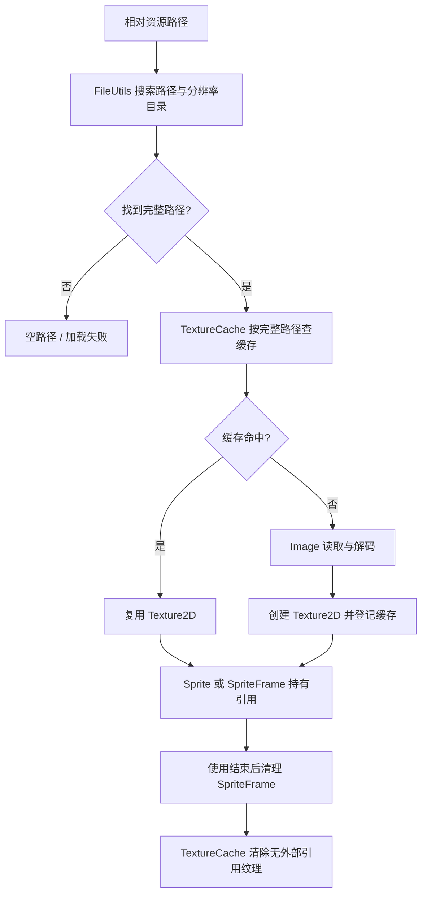

# Cocos2d-x 4.0：资源寻址、缓存与释放

## 证据范围

对象为仓库中的 `engine/cocos2d-x-4/` 本地 Cocos2d-x 4.0 源码快照。本文追踪相对文件名如何解析为磁盘路径、图片如何进入 `TextureCache`，以及 SpriteFrame/Texture 的引用与清理。结论来自静态源码和现有 `cpp-tests` 用例；本轮没有运行资源加载或释放探针，也不把单个平台行为推广到其他平台。

本专题以图片和图集为主。`TextureCache` 是纹理缓存，不是通用资源数据库；任意 JSON、音频或场景文件的读取要分别看其专用加载路径。

## 调用路径

## 文件路径与缓存身份

`FileUtils::fullPathForFilename()` 对绝对路径直接返回；相对路径会先做文件名映射，再按配置的 search path 和 resolution order 查找，并缓存“输入文件名 → 命中完整路径”的结果。查找失败返回空字符串。`TextureCache::addImage()` 先调用该解析，再以完整路径作为纹理 map 的 key；路径未找到或 `Image::initWithImageFile()` 失败会返回空指针。

因此，同一文件的缓存身份是解析后的路径，不是 Creator `.meta` UUID，也不是逻辑资源名。排查“加载错图”时检查 search paths、分辨率目录顺序、文件名映射及最终 full path；排查“文件存在但纹理未命中”时再比较传入路径和缓存 key。

## 单图与图集

- 单图可由 `TextureCache::addImage(path)` 加载；`Sprite::create(path)` 也沿 Sprite 的文件加载路径取得纹理。缓存命中会复用已有 `Texture2D`。
- 图集由 `SpriteFrameCache::addSpriteFramesWithFile(plist)` 解析帧描述，再通过 `TextureCache` 加载配套纹理。若 plist 元数据含 `textureFileName`，纹理路径相对 plist 路径解析；否则当前实现会按 plist 路径改扩展名并尝试 `.png`。
- `SpriteFrame` 持有其 `Texture2D` 引用；`Sprite::setSpriteFrame()` 又持有使用中的帧。Frame cache 与 texture cache 是不同层，移除一个缓存项不等于所有使用者都已释放。

## 异步加载的时序

`TextureCache::addImageAsync()` 对未缓存图片将文件读取/解码放到加载线程，在调度回调中创建纹理并调用完成回调。要覆盖回调所属对象提前销毁的情况；接口提供 `unbindImageAsync()`。但“异步”不保证每次回调都延后：已有缓存时直接用缓存对象调用回调，路径缺失时也会直接以空指针回调。不要假设缓存命中路径一定发生在线程切换之后。

## 引用与清理

- `TextureCache` 由 `Director` 持有；代码注释说明从 3.0 起不再把它作为独立 singleton，应从 `Director::getInstance()->getTextureCache()` 取用。
- `removeUnusedTextures()` 只移除 `Texture2D::getReferenceCount() == 1` 的纹理，即缓存仅剩自身引用的条目。仍被 Sprite、SpriteFrame 或其他持有者引用的纹理会留在缓存。
- `removeTextureForKey()` 从缓存 map 移除匹配项并释放 cache 持有的那一个引用。其他对象若仍 retain 纹理，对象可能继续存活；后续按路径重新加载也可能重新建立缓存项。
- `SpriteFrameCache::removeUnusedSpriteFrames()` 只移除引用计数为 1 的帧；`removeSpriteFramesFromFile()` 则按 plist 记载清理其帧条目。纹理是否可回收还要单独查看 `TextureCache`。
- `removeAllTextures()` 会清空整张纹理缓存表，不是场景切换时的安全“释放未使用资源”替代品。先结束实际使用者，再核对引用和缓存状态。

## 可复核入口与当前限制

- `FileUtilsTest.cpp` 中有修改/恢复 search paths 的用例，可复核相对路径解析入口。
- `SpriteTest.cpp` 中有图集加载、按 plist 移除帧和 `removeUnusedSpriteFrames()` 的用例，可复核帧缓存路径。
- `CCTextureCache.cpp` 中的 `addImage()`、`addImageAsync()` 和 `removeUnusedTextures()` 是本专题的直接实现证据。本轮没有运行上述测试，也没有记录 Cocos2d-x 运行时的缓存命中、引用计数或显存回收结果。

## 源码地图

| 职责 | 本地入口 |
| --- | --- |
| 文件名映射、搜索路径与 full path | [`CCFileUtils.cpp`](../../engine/cocos2d-x-4/cocos/platform/CCFileUtils.cpp#L805)；API 定义见 [`CCFileUtils.h`](../../engine/cocos2d-x-4/cocos/platform/CCFileUtils.h#L327) |
| 同步/异步纹理加载、按完整路径去重 | [`CCTextureCache.cpp`](../../engine/cocos2d-x-4/cocos/renderer/CCTextureCache.cpp#L381)（同步）、[异步入口](../../engine/cocos2d-x-4/cocos/renderer/CCTextureCache.cpp#L138)；接口与清理语义见 [`CCTextureCache.h`](../../engine/cocos2d-x-4/cocos/renderer/CCTextureCache.h#L88) |
| plist 到纹理路径、帧缓存增删 | [`CCSpriteFrameCache.cpp`](../../engine/cocos2d-x-4/cocos/2d/CCSpriteFrameCache.cpp#L278) |
| SpriteFrame 对 Texture 的 retain/release | [`CCSpriteFrame.cpp`](../../engine/cocos2d-x-4/cocos/2d/CCSpriteFrame.cpp#L97) |
| Sprite 对 Texture/SpriteFrame 的持有 | [`CCSprite.cpp`](../../engine/cocos2d-x-4/cocos/2d/CCSprite.cpp#L418)（纹理）、[帧引用](../../engine/cocos2d-x-4/cocos/2d/CCSprite.cpp#L1596) |
| FileUtils search path 用例 | [`FileUtilsTest.cpp`](../../engine/cocos2d-x-4/tests/cpp-tests/Classes/FileUtilsTest/FileUtilsTest.cpp#L54) |
| 图集与帧清理用例 | [`SpriteTest.cpp`](../../engine/cocos2d-x-4/tests/cpp-tests/Classes/SpriteTest/SpriteTest.cpp#L1224) |

Creator 2.4.15 的对照事实与版本边界见[资源加载与释放比较](../comparisons/cocos2d-x-4-vs-creator-2.4/05-assets-loading-and-release.md)；普通 Cocos2d-x 开发只需本源码地图和对应专题 Skill。
