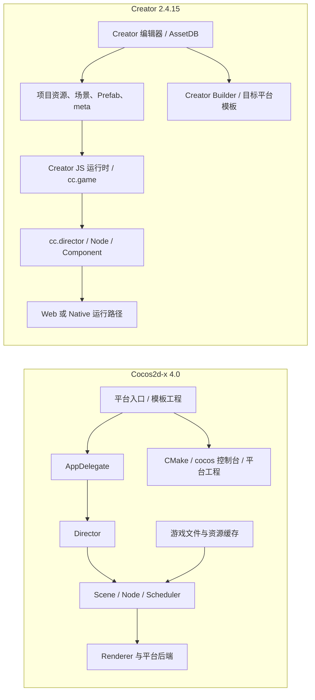

# Cocos2d-x 4.0 与 Cocos Creator 2.4.15：架构起步对照

## 比较范围

本页比较仓库中的 `cocos2d-x-4/` 快照（README/CHANGELOG 标记 4.0）与 `2.4.15engine/`、`2.4.15NewProject/`。包含源码架构对照，以及 2026-10-17 在 macOS 上分别启动两边最小首屏 Demo 的运行时观察。当前运行后端并不相同，因此不将现场 FPS 显示值作为性能排名。

## Demo 构建与运行状态（2026-10-17）

- 选定 macOS 桌面作为共同观察环境。Cocos2d-x v4 使用官方 `cpp-template-default`，通过独立 CMake wrapper 构建为 x86_64 macOS app bundle；Creator 使用 2.4.15 Web 预览。两边画面区域均约为 960×640，场景都显示一个 Sprite 和一个 Label，但素材、背景、标签文本、运行后端和构建模式不同。
- CMake 4.4.4 安装在 `/private/tmp/cocos-cmake-runtime`，Apple Clang 21 编译器探测通过。GitHub 官方 `metal-support-22` 包已下载并通过 ZIP 完整性检查，按引擎脚本布局安装到忽略目录 `cocos2d-x-4/external/`。包大小为 109,325,429 字节，与 `external/config.json` 的旧估值不同；ZIP 检查无错误，所需目录与库文件存在。
- macOS x86_64 的官方 `cpp-tests` 已通过 CMake Unix Makefiles 构建并启动；它验证依赖、链接、窗口创建和基础渲染，但不替代模板 Demo。
- Cocos2d-x 官方 `cpp-template-default` 的 `HelloCpp` 已构建并通过桌面应用启动。启动方式为从桌面会话打开生成的 app bundle；此前在命令行直接运行二进制会在 GLFW/macOS `NSApplication` 注册阶段 abort，这不是场景代码失败。运行窗口显示默认 Cocos2d-x 标志、`Hello World` 标签和实时统计；构建产物是 x86_64，Apple Silicon 上经 Rosetta 运行。
- Creator Dashboard、编辑器窗口和目标工程身份一致：`/Users/youjunmao/WORK/Cocos_Engine/2.4.15NewProject`、Creator 2.4.15。独立场景 `assets/Scene/Cocos2dComparison.fire` 已从 Creator 预览场景列表选择并成功启动，浏览器运行画面显示 Cocos Sprite、`Label` 和深色背景。没有改动原 `helloworld.fire` 或 `settings/project.json`。
- 运行时现场结果：两端均成功显示场景并持续绘制；Creator 预览统计面板显示约 3 个 Draw Call。截图瞬间的两端 FPS 文本分别约为 Cocos2d-x 57 FPS、Creator 116 FPS，但这只是单帧/短时现场读数，且一侧为原生 OpenGL/GLFW app、一侧为 Chrome WebGL 预览，浏览器合成、垂直同步、CPU 架构及统计口径未统一，不作为性能比较结论。
- 构建期间在引擎源码做了两项窄修正以适配当前 Apple SDK：`CCFontAtlas.cpp` 对保存为 `void*` 的 `iconv_t` 调用做显式转换；`AudioCache.h` 显式包含其使用的 `<functional>`。构建时还禁用了 CMake 预编译头以避开 Objective-C++ PCH 冲突。这些修改须与构建证据一并审阅，不是上游 v4 的原样构建。
- 可重现步骤、构建位置和运行限制见[对照 Demo 构建说明](../cocos2d-x-creator2x-demo.md)。现有证据支持“两边 Demo 已运行”的场景和运行链路对照；不支持启动耗时、同后端性能排名或同素材画质比较。

两者不能按“一个 API 对另一个 API”整体比较。Cocos2d-x 4.0 是跨平台 C++ 游戏框架源码及模板/构建/tests；Creator 2.4.15 是带项目资源与场景工作流的 Creator 运行时源码快照。Creator 编辑器完整实现不在本地 `2.4.15engine/` 中，而 Cocos2d-x 没有 Creator 同型的内置场景/资源编辑器。这是产品范围差异，不应被描述成同一层的功能缺失。

## 首屏 Demo 实际比较

比较行为限定为“初始化窗口/运行环境 → 进入首场景 → 显示 Sprite 和 Label → 持续更新并绘制”。Cocos2d-x 采用官方 cpp-template-default；Creator 采用工程内独立 Cocos2dComparison.fire。两边都有场景树与精灵/文字，但项目如何被创建、场景如何保存、帧循环由谁驱动并不相同。

| 环节 | Cocos2d-x 4.0 模板 | Cocos Creator 2.4.15 | 实际差异 |
| --- | --- | --- | --- |
| 应用入口 | proj.ios_mac/mac/main.cpp 创建 AppDelegate 并调用 Application::run()；macOS Application::run() 调用 applicationDidFinishLaunching()，进入窗口事件循环后逐帧调用 Director::mainLoop()。 | Creator Editor/Builder 装配预览或发布工程；Creator Web 路径由 cc.game.run() 初始化。CCGame._prepareFinished() 完成引擎准备后启动动画帧循环。 | Cocos2d-x 的应用入口、窗口、平台事件循环显式进入 C++ 工程；Creator 由 Editor/Builder 管理项目和运行宿主，再交给 JS 引擎循环。 |
| 进入场景 | AppDelegate::applicationDidFinishLaunching() 创建 HelloWorld::createScene()，直接 director->runWithScene(scene)。 | 场景资源先序列化为 cc.SceneAsset；cc.director.runScene() 接受 Scene/SceneAsset，加载并在当前帧绘制结束后切换，激活场景并恢复游戏。 | Cocos2d-x 模板把初始场景写在 C++ 应用启动代码；Creator 首场景属于工程配置和资源身份，运行时由 Creator 资源/场景管线加载。 |
| 构造节点 | HelloWorld::init() 中创建 Sprite/Label，再以 addChild 加入 Scene；布局坐标来自 Director 的可见区域与 origin。 | Canvas、Camera、Sprite、Label 已作为 Node/Component 引用序列化在 .fire 中；改层级、组件和坐标可通过 Creator 场景编辑器完成。 | C++ 模板默认把场景结构编进代码；Creator 把结构存为工程资源，再由 JS runtime 实例化。运行时最终都形成 Node/Scene graph，但可编辑源和工作流不同。 |
| 资源身份 | 示例通过文件名 HelloWorld.png 和字体路径 fonts/Marker Felt.ttf 读取，依赖打包资源目录与文件工具/缓存。 | 对照场景中的资源引用属于 Creator 导入资源体系；.meta UUID 和 .fire 序列化引用把场景与资产关联起来。 | 同名路径可被搬运但不等于迁移完成；Creator 还要保住 UUID、导入类型和序列化引用，Cocos2d-x 要保证目标平台资源路径、字体和打包规则有效。 |
| 帧循环 | macOS Application::run() 自己轮询窗口事件，调用 Director，再按 animation interval 睡眠节流；模板设为 1/60 秒。 | Creator 2.4 Web 路径以 requestAnimationFrame 回调驱动 Director；Director 每帧先组件 start/update/lateUpdate，再更新 scheduler，执行延迟销毁和渲染。 | 两边都有 Director 主循环。Cocos2d-x 桌面模板由原生窗口循环驱动；Creator Web 预览遵循浏览器帧回调，且把 Component 生命周期编排在 JS 更新阶段。 |
| 对象生命周期 | Node/Scene 继承 Ref，依赖 retain/release/autorelease；Node 进入/退出树的回调与对象最终析构是不同事件。 | JS Node/Component 由 Creator 生命周期和对象系统管理；destroy() 延迟到安全阶段回收，Component scheduler 编排 onLoad/start/update/lateUpdate 等。 | 不可把 release() 当作 destroy() 等价替换。移植时要单独检查脱树、停用、回调取消、最终回收和组件回调顺序。 |
| 开发/构建 | CMake、C++ 编译器、平台 launcher 和平台 SDK 直接决定工程构建；源码可与引擎在同一构建图中修改。 | Creator Editor 管理资源导入、场景编辑、预览和目标 Builder；普通业务脚本是 Creator 2.4 JS 组件，发布链路由 Editor 生成。 | Cocos2d-x 给团队更多原生工程和编译链控制；Creator 把场景/资源编辑和构建配置纳入编辑器流程，迭代内容更直接，但依赖具体 Editor 版本和工程资产状态。 |

### 运行时观察与结论

- **运行结果：** Cocos2d-x HelloCpp 原生窗口与 Creator Cocos2dComparison 浏览器预览均已启动，均持续绘制并显示一个精灵和文字。Creator 预览由 Editor 的预览目标下拉框选择 `Cocos2dComparison` 后启动；无需修改工程默认启动场景。
- **可观察差异：** Cocos2d-x 模板的场景入口写在 `AppDelegate`，运行时直接构造 Scene/Sprite/Label；Creator 的场景对象和资源引用存在 `.fire` 资产中，由 Editor 预览宿主加载后交给 JS runtime。画面显示 Cocos2d-x 默认 `Hello World` 与品牌图；Creator 显示 `Label`、Cocos 标志和场景背景。
- **性能状态：** 不下性能胜负结论。当前 Cocos2d-x 使用 x86_64 原生 macOS app（Rosetta），Creator 使用 Chrome WebGL 预览；虽画布同为约 960×640，渲染后端、宿主合成和刷新节奏不一致。两边截图里的瞬时 FPS 只能作现场状态参考，不能当作可复现基准。

- **要直接控制 C++ 生命周期、平台入口、窗口循环和原生工程构建，选 Cocos2d-x。** 代价是团队承担资源打包、平台工程和场景结构代码维护。
- **要在编辑器中搭场景、配置组件/资源引用并用 JS 快速迭代内容，选 Creator 2.4。** 代价是项目结构、导入身份和构建流程与 Creator Editor 绑定更深。
- **从 Cocos2d-x 移植到 Creator 时，优先重建用户行为和资源引用，不要逐个照搬 C++ 类名。** 重点重写应用入口、场景构建、资源寻址、生命周期和更新逻辑。
- **当前可以下运行时链路和首屏行为对照结论，不能下同条件运行性能结论。** 两边 Demo 已分别启动，且 Creator 预览使用独立干净场景；默认 `helloworld` 与原场景保持不变。

证据入口：Cocos2d-x `templates/cpp-template-default/Classes/AppDelegate.cpp`、`HelloWorldScene.cpp`、`proj.ios_mac/mac/main.cpp`、`cocos/platform/mac/CCApplication-mac.mm`；Creator `2.4.15engine/cocos2d/core/CCGame.js`、`CCDirector.js`、`2.4.15NewProject/assets/Scene/Cocos2dComparison.fire`。运行证据为 2026-10-17 桌面会话中两端实际窗口/预览画面；没有录制帧时间序列或完成统一后端基准。

## 架构路径

图示是职责地图，不代表所有平台都沿同一条内部调用路径，也不代表 Creator Editor 的完整实现位于当前引擎目录。

## 同一开发目标下的初步对照

| 开发者目标 | Cocos2d-x 4.0 | Creator 2.4.15 | 对照结论与证据边界 |
| --- | --- | --- | --- |
| 建立项目并运行首屏 | C++ 默认模板在 `AppDelegate::applicationDidFinishLaunching()` 设定 GLView、分辨率和帧率，创建 `HelloWorld::createScene()` 后调用 `Director::runWithScene()`。平台 launcher/工程与 CMake 接入目标。 | 项目由 Creator 工程和编辑器管理；运行时从 `cc.game`/`cc.director` 接入，场景资源由 Creator 项目构建/预览流程提供。 | 一侧从应用委托和平台工程进入；另一侧从编辑器项目、构建/预览宿主和 JS runtime 进入。两端最小 Demo 已在 macOS 桌面分别启动；本轮没有采集同步帧时间序列。详见 `cocos2d-x-4/templates/cpp-template-default/Classes/AppDelegate.cpp`、`2.4.15engine/cocos2d/core/CCGame.js`、`CCDirector.js`。 |
| 构造场景与对象树 | `Scene`/`Node` 是运行时对象；通过 `addChild` 建树并由 Director 运行 Scene。节点类可在 C++ 中直接构造或子类化；v4 也提供 `Component`/`ComponentContainer`。 | `.fire` 场景、Prefab 和编辑器对象树是可编辑/序列化内容；运行时使用 `cc.Node` 和挂载在 Node 上的 `cc.Component`。 | 两边都有 Node、scene graph 和组件概念；Creator 增加的编辑器序列化/资源引用工作流不是 C++ `Scene` 对象的对等格式。不可把 `.fire` 等同于 C++ Scene 类。Creator 手册：[Node & Component](https://docs.cocos.com/creator/2.4/manual/zh/content-workflow/node-component.html)。 |
| 管理对象生命周期 | Cocos2d-x `Ref` 使用引用计数/autorelease；Node 的 `onEnter/onExit/cleanup`、组件容器和 Actions/Scheduler 共同影响对象生命周期。 | Creator Component 生命周期由节点激活状态、组件回调与引擎延迟销毁流程组织；脚本对象由 JS runtime 管理，Native 另有桥接路径。 | 两边都有组件，但回调模型与所有权不等价。任何端口都要从对象创建、入树、移除、延迟销毁直至析构/回调追踪；不可将 `retain/release` 与 JS `destroy()` 直接替换。见[对象生命周期切片](../cocos2d-x/02-objects-and-lifecycle.md)。 |
| 编写游戏逻辑 | 原生主路径为 C++；源码含 Lua bindings。v4 changelog 标记移除 HTML5 engine 和 JSB，因此要以当前快照的 `cocos/scripting/` 内容和构建选项核对具体语言支持。 | Creator 2.4 主路径为 JavaScript，支持 Creator 脚本/组件模型；项目可含 TypeScript，但编译和 Creator 脚本加载需按 2.4 流程确认。 | 语言、代码生命周期与构建链不同。不能仅根据旧 README 功能清单推断 v4 仍有 JSB；本地 changelog、构建文件和入口代码优先。 |
| 加载资源 | 通过文件工具、资源缓存和各类专用缓存/加载器读取游戏资源；资源身份通常由路径和缓存对象关系体现。 | Creator 编辑器 AssetDB 导入资源并维护 `.meta` UUID、资源类型和序列化引用；运行时经 `cc.loader`/Asset Manager 及 Bundle 管线加载。 | Creator 的导入身份与编辑器同步是重要差异；Cocos2d-x 的文件/缓存接口不是 AssetDB。资源迁移须核对路径、打包、缓存、释放和引用规则。Creator 手册：[资源工作流](https://docs.cocos.com/creator/2.4/manual/zh/asset-workflow/)。 |
| 排布与 UI 交互 | 包含 `Sprite`、`Label`、`Menu`、`ui` 等框架对象；布局通常由代码设置坐标、尺寸和对象树。 | UI 主要通过 Canvas、Node、Widget、Button 等组件和编辑器检查器配置；场景/Prefab 保存配置。 | 有同类用途对象，但布局/数据来源和编辑流程不同；应比较具体交互和坐标行为，而不是只比较控件名称。 |
| 构建与跨平台运行 | 仓库含 CMake、模板、平台目录、`cocos` 控制台入口和 `cpp-tests`；依赖与子模块需按本地检出状态核对。 | Creator Builder 读取工程资源和构建配置，生成平台工程/包；本地仓库可观察到的构建代码不等于完整 Creator Editor。 | Cocos2d-x 开发者需直接面对 C++ 工程、toolchain 与平台后端；Creator 管理更多资源导入和项目构建工作流。具体构建时间/包体需实验，不从架构推断。 |
| 查错和验证 | `tests/cpp-tests`、`tests/performance-tests`、日志/调试器和 IDE 工程是本地源码可见验证入口。 | Creator 预览、Console、Creator 扩展、项目工程和平台构建组成验证路径。 | 工具链不对称。对照结论要说明是源码静态证据、单测、编辑器预览还是设备运行，不能把 `cpp-tests` 与 Creator 预览等同。 |

## 首个切片：启动到帧循环

- **Cocos2d-x macOS desktop 模板源码：** `proj.ios_mac/mac/main.cpp` 创建 `AppDelegate` 并调用 `Application::run()`；`CCApplication-mac.mm` 调用 `applicationDidFinishLaunching()`，然后在窗口循环中调用 `Director::mainLoop()`。模板 AppDelegate 设置 GLView/分辨率，创建 HelloWorld Scene 并调用 `runWithScene()`。每帧由 `Director::mainLoop()` → `drawScene()` 驱动 Scheduler、Scene/Renderer 和 autorelease pool 清理。细节见[Cocos2d-x 启动说明](../cocos2d-x/01-startup-and-frame.md)。
- **Creator 2.4.15 浏览器预览：** 已有独立实测记录：Creator Editor `boot.js` 加载预览模块和项目场景后调用 `cc.game.run()`；`CCGame._prepareFinished()` 初始化 engine 并启动主循环；浏览器动画帧驱动 `CCDirector.mainLoop()`，依次执行组件、Scheduler、延迟销毁和 Renderer。详细证据与限制见[Creator 2.4.15 启动分析](../2.x/01-startup-and-frame.md)。
- **静态链路结论：** 两边都用 Director 管理场景流转，但 Cocos2d-x 的桌面平台循环由 C++ `Application` 驱动；Creator Web 预览由 Creator Editor 宿主装配场景，再由 JS runtime 的 animation-frame 循环驱动。它们的 Editor/内容工作流、运行时语言和内存管理不同，不能从相同的 `Director`/`Scene` 名称推导实现等价。
- **运行验证状态：** 本轮已在 Creator Chrome 预览启动独立场景，并通过桌面会话启动 Cocos2d-x `HelloCpp` 原生 app。两端画面可用于首屏与运行链路观察；本轮没有做首帧同步、逐帧业务更新或稳定性能采样。

## 第二个切片：节点与组件生命周期

本地 Cocos2d-x v4 也定义了 `Component`，通过 `ComponentContainer` 挂在 Node 上；其 `onAdd/onEnter/onExit/onRemove/update` 与 Creator 2.4.15 的 `onLoad/start/onEnable/update/lateUpdate/onDisable/onDestroy` 并不相同。更关键的是：Cocos2d-x Node/Component 继承 `Ref`，其实际析构由引用计数决定；Creator `destroy()` 进入延迟销毁队列，生命周期清理由 JS 引擎统一调度。节点从父级移除、停用和对象析构必须分开比较。源码路径和待测矩阵见[对象生命周期切片](../cocos2d-x/02-objects-and-lifecycle.md)。Creator 的对应运行观察已有[2.4 研究与轨迹](../2.x/02-objects-and-scenes.md)；Cocos2d-x 仍只有静态源码证据。

## 移植与诊断时的决策

1. 先判定项目实际是 Creator 工程还是 Cocos2d-x 工程；检查 Creator `project.json`/`assets`/`.meta`/场景，或 Cocos2d-x `CMakeLists.txt`/`Classes`/平台 launcher/`AppDelegate`。
2. 把需求写成用户可见行为（如启动场景、点击按钮、播放动画），再分别找每一侧入口。不要把“移植一个 API”作为成功条件。
3. 识别跨层差异：C++ 与 JS、引用计数与 GC/显式销毁、Creator UUID/序列化与路径/缓存、编辑器构建与直接平台工程。
4. 验收改动要覆盖目标运行平台；用源码/单测/预览/设备构建分别注明证据范围。未执行目标平台就不能宣称移植完成。

## 尚待研究

- 在两边运行相同行为的首帧、节点生命周期、输入到回调、资源加载/释放轨迹。
- Cocos2d-x 4.0 本地快照中 Lua bindings、组件支持、资源缓存/API 与版本文档清单的精确边界；特别核对 README 中语言描述与 v4 移除 JSB 记录的关系。
- Creator 2.4.15 JS 到 Native 的桥接和各平台构建差异；当前本地资料不能覆盖 Creator 编辑器全部实现。
- 相同资产、屏幕尺寸、后端/构建配置下的渲染和性能对照。
- 新引擎目录其他平台的依赖/submodule 和可复现构建状态；Creator 2.4.15 同工程原生构建；相同素材与构建配置下的性能基准。当前 `HelloCpp`/Creator 浏览器预览是运行时行为观察，`cpp-tests` 仍仅作引擎冒烟验证。

## 参考

- [研究计划](../cocos2d-x-creator2x-source-study-plan.md)
- [Cocos2d-x v4 Basic Concepts](https://docs.cocos2d-x.org/cocos2d-x/v4/en/basic_concepts/)
- [Cocos2d-x v4 Director](https://docs.cocos2d-x.org/cocos2d-x/v4/en/basic_concepts/director.html)
- [Cocos2d-x v4 Scene Graph](https://docs.cocos2d-x.org/cocos2d-x/v4/en/basic_concepts/scene.html)
- [Cocos2d-x v4 Release Notes](https://github.com/cocos2d/cocos2d-x/blob/v4/docs/RELEASE_NOTES.md)
- [Creator 2.4 Node & Component](https://docs.cocos.com/creator/2.4/manual/zh/content-workflow/node-component.html)
- [Creator 2.4 Asset Workflow](https://docs.cocos.com/creator/2.4/manual/zh/asset-workflow/)
