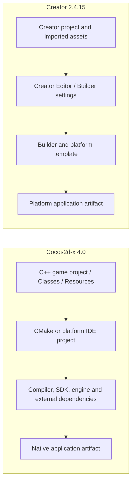

# 工程构建：Cocos2d-x 4.0 与 Creator 2.4.15

## 对照目标

比较开发者从工程源文件得到可运行目标时，两边负责工程组织、依赖和平台构建的部分。这里记录架构事实和本仓库的验证边界，不提供评分。

| 维度 | Cocos2d-x 4.0 | Cocos Creator 2.4.15 |
| --- | --- | --- |
| 工程入口 | C++ 模板/游戏工程，含 `Classes/`、`Resources/`、平台 launcher 与 CMake 或 IDE 项目 | Creator 项目由 Editor 管理资源、场景和构建设置，再由 Builder 生成平台目标 |
| 构建责任 | 开发者选择 CMake/平台工程、编译器与 SDK，处理引擎和外部依赖 | Creator Editor/Builder 管理 Creator 工程资源导入与构建模板；完整 Editor 实现不在本地 `2.4.15engine/` 快照中 |
| 平台接线 | 各平台有自己的 Application/launcher；桌面模板入口不能代替移动平台路径 | Creator 项目构建目标及 Editor 版本参与构建链，平台产物还需对应 SDK/模板 |
| 失败定位 | CMake 配置、依赖、C++ 编译/链接、平台 glue 与 SDK 分层检查 | Editor 导入、脚本编译、Builder 配置和平台构建分层检查 |

## 本地证据

- Cocos2d-x `cpp-tests` 与 `cpp-template-default/HelloCpp` 已在本机用 macOS x86_64 配置、构建并启动。为当前环境准备了 CMake/runtime 和依赖，并对源码做了两处 Apple SDK 编译适配；这不是所有平台的原样构建结论。详见[Demo 构建记录](../../cocos2d-x-creator2x-demo.md)与[架构对照记录](../cocos2d-x-4-vs-creator-2.4.md#demo-构建与运行状态2026-10-17)。
- Creator 2.4.15 对照工程已由 Editor 启动浏览器 Web 预览；这不是 Creator macOS 原生构建结果。

## 结论和缺口

Cocos2d-x 直接暴露 C++ 工程、平台 glue、依赖和工具链；Creator 将资源导入、场景内容与 Builder 配置集中在 Editor 工程里。当前两边运行目标不同（Cocos2d-x macOS 原生 x86_64 与 Creator 浏览器 WebGL），不据此比较构建速度、包体或平台覆盖率。Android、iOS、Windows、Linux 及 Creator 原生目标尚未做本专题同条件构建。
