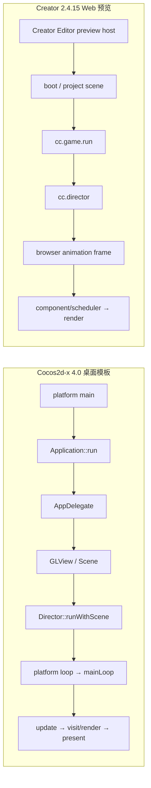

# 启动与帧循环：Cocos2d-x 4.0 与 Creator 2.4.15

## 两侧路径

## 对照

| 项目 | Cocos2d-x | Creator |
| --- | --- | --- |
| 首个场景 | `AppDelegate::applicationDidFinishLaunching()` 创建 Scene 并调用 `runWithScene()` | Creator 工程/预览宿主加载场景资源，再进入 JS runtime |
| 帧循环宿主 | 桌面路径由平台 `Application` 窗口循环驱动 C++ `Director` | Web 预览由浏览器动画帧驱动 JS `Director` |
| 单帧职责 | Scheduler/update、场景 visit、Renderer 提交和 autorelease pool 清理 | Creator JS 组件生命周期、Scheduler、延迟销毁和 Renderer |

## 证据状态

- Cocos2d-x 本地源码追踪见[启动与帧循环记录](../../cocos2d-x/01-startup-and-frame.md)，实际运行证据来自 macOS x86_64 `HelloCpp`。
- Creator 侧使用本地 2.4.15 源码与既有 Chrome 预览轨迹；独立 Cocos2Comparison 场景也已由 Creator 预览运行。
- 两端都观察到场景持续绘制，但一个是原生 macOS 窗口、另一个是 Chrome WebGL 预览。帧率、帧时间、启动耗时未按同平台同后端测量，不能比较性能。
- Cocos2d-x 此处的启动路径描述 macOS desktop 模板，不可推广到 Android/iOS/Windows/Linux。
