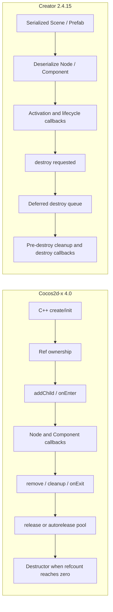

# Scene、Node 与对象生命周期：Cocos2d-x 4.0 与 Creator 2.4.15

## 对照

| 生命周期阶段 | Cocos2d-x 4.0 | Creator 2.4.15 |
| --- | --- | --- |
| 建立对象 | C++ factory/`create`、`init` 构造运行时对象，再通过 `addChild` 建树 | Editor 序列化 Scene/Prefab，运行时反序列化 Node 与 Component |
| 行为挂载 | v4 有 `Component`/`ComponentContainer`，也可用 Node 子类；容器持有组件引用并调用其回调 | JS `Component` 挂到 Node，Editor 可序列化组件和属性，并由 activator/scheduler 调度 |
| 入树/激活 | Node 进入运行态时触发 `onEnter` 等回调；具体顺序受父节点状态影响 | Node 激活状态驱动组件 `onLoad/start/onEnable/update/...` 生命周期 |
| 移除与清理 | 从 parent 脱离可触发 `onExit`、可选 `cleanup`；Action/Scheduler 等清理不等于 C++ 对象释放 | `destroy()` 先进入延迟销毁路径，再执行节点/组件销毁回调和引擎清理 |
| 最终回收 | `Ref` 的 retain/release 与 autorelease pool 决定对象何时析构 | JS 对象系统及 Creator 销毁队列处理对象有效性和清理 |

两端都有 Scene graph 和 Component 概念，但对象所有权、生命周期调度与场景序列化不是一一对应。Node 从 parent 移除不等于 Cocos2d-x C++ 实例析构；Creator 的 `destroy()` 也不等价于一次 `release()`。

## 证据状态

- Cocos2d-x 依据本地 `CCNode`、`CCScene`、`CCRef`、`CCAutoreleasePool`、`CCComponent` 与 `ComponentContainer` 源码；细节见[对象生命周期源码地图](../../cocos2d-x/02-objects-and-lifecycle.md)。Cocos2d-x 析构顺序、引用计数和组件 enabled/update 时序尚无运行轨迹。
- Creator 依据 2.4.15 JS 源码和既有 Chrome 预览生命周期轨迹，见[Creator 对象与场景研究](../../2.x/02-objects-and-scenes.md)。
- 当前 HelloCpp 运行只证明场景、Sprite 和 Label 成功建立并绘制，不证明 detach、cleanup、autorelease 或最终析构行为。

生命周期相关代码更改应单独验证创建、入树、移除、回调取消和最终释放；不可用本页的静态对照替代目标平台实测。
