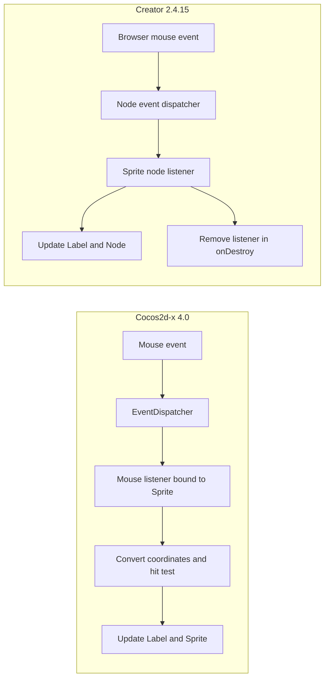

# 输入事件：Cocos2d-x 4.0 与 Creator 2.4.15

## 对照行为

目标行为是：鼠标左键点中 Sprite 后计数加一，并将 Sprite 向右移动 40 个设计单位。

| 步骤 | Cocos2d-x 4.0 | Creator 2.4.15 |
| --- | --- | --- |
| 注册 | 创建 `EventListenerMouse`，设置 `onMouseDown`，以场景图优先级绑定 Sprite | Sprite 上的脚本组件通过 `node.on(Node.EventType.MOUSE_DOWN, ...)` 注册 |
| 目标判定 | 应用回调检查左键；将位置转换到 Scene 坐标，再用 Sprite bounding box 命中测试 | 节点事件系统把事件分发到监听节点；脚本对该节点响应 |
| 状态变化 | 更新 `Label` 文本，并修改 Sprite 的 x 坐标 | 更新 `Label` 文本，并修改节点 x 坐标 |
| 清理 | 依赖监听器 target 与 Node/EventDispatcher 生命周期；需要按实际持有关系核对移除时机 | 组件在 `onDestroy` 解除 `node.on` 监听 |

## 运行证据与边界

- 两侧 Demo 在 2026-10-17 分别进行两次桌面鼠标点击，均观察到 `Clicks: 2`，Sprite 每次右移 40 设计单位。实现与运行步骤见[Demo 记录](../../cocos2d-x-creator2x-demo.md)。
- Cocos2d-x 使用 macOS 原生 x86_64 窗口，Creator 使用 Chrome WebGL 预览；素材不同。该验证比较功能结果和事件链，不比较延迟、吞吐或性能。
- 已验证鼠标路径；触屏、多点触控、事件传播边缘行为与移动平台坐标尚未覆盖。
- Cocos2d-x 实现见 `engine/cocos2d-x-4/templates/cpp-template-default/Classes/HelloWorldScene.cpp`；Creator 实现见 `2.4.15NewProject/assets/Script/ComparisonInteraction.js`。
