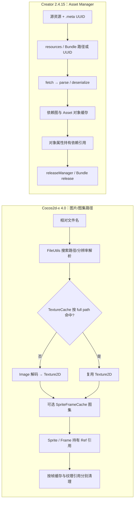

# 资源寻址、加载与释放：Cocos2d-x 4.0 与 Cocos Creator 2.4.15

## 对照问题

以“从项目资源加载一张图片，将它显示为 Sprite，使用结束后回收相关缓存”为共同目标，对照两边的资源身份、加载管线和释放责任。两者的资源系统层次不同，本页不做同名 API 配对或性能排名。

## 主要差异

| 维度 | Cocos2d-x 4.0 | Cocos Creator 2.4.15 | 对照结论 |
| --- | --- | --- | --- |
| 资源身份 | `FileUtils` 将相对文件名解析为完整路径；`TextureCache` 以完整路径作为纹理 key。 | 源资源 `.meta` 提供 UUID；Bundle 配置把路径/UUID 解析成运行时请求和文件地址。 | Cocos2d-x 的路径/缓存 key 不能替代 Creator UUID，也没有 Creator AssetDB 导入身份。 |
| 资源范围 | `TextureCache` 管 `Texture2D`；`SpriteFrameCache` 管图集帧名到 `SpriteFrame` 的映射。 | `AssetManager` 管多类 `Asset`、请求、依赖解析和缓存；`resources` 是内建 Bundle，不是任意工程路径的通配入口。 | 纹理缓存与通用 Asset Manager 不是同一层。 |
| 加载 | `TextureCache::addImage()` 解析路径、读/解码 `Image`、创建并缓存 `Texture2D`；图集 plist 再注册到帧缓存。 | `Bundle.load()`/`cc.resources.load()` 进入 `loadAny`，随后 fetch、解析/反序列化并加载依赖；`preload` 只抓取资源，还要调用 `load` 才完成对象加载。 | Creator 将导入身份、依赖图和多类资产纳入管线；Cocos2d-x 此处是文件到纹理/帧的显式路径。 |
| 缓存与引用 | `TextureCache` 由 `Director` 持有；Frame 和 Sprite 通过 `Ref` 持有使用中的纹理/帧。 | 资源对象按 UUID 缓存；`Asset.addRef/decRef` 与依赖关系共同影响 `releaseManager` 的回收。 | 两边都追踪引用，但 key、对象图和回收策略不同。不能把 `Ref::release()` 当 `cc.assetManager.releaseAsset()` 等价迁移。 |
| 清理 | `removeUnusedSpriteFrames()` 只清掉帧缓存引用数为 1 的条目；`removeUnusedTextures()` 只清掉纹理引用数为 1 的条目。 | `releaseUnusedAssets()` 尝试释放未使用资源；`releaseAsset()`/Bundle `release()` 走强制释放路径，并可能使仍有节点依赖的资源失效。 | Cocos2d-x 的两类缓存要分层清理；Creator 的资源释放还会沿依赖关系处理。强制释放前两边都要核实存活使用者。 |

## 证据与限制

- Cocos2d-x 4.0 的源码路径、缓存身份和回收条件见[专题源码地图](../../cocos2d-x/03-assets-loading-and-release.md)。本轮是静态源码追踪；`cpp-tests` 中有 FileUtils search path 与 SpriteFrameCache 用例，但没有在本轮运行资源回收测试。
- Creator 2.4.15 的运行时管线和历史浏览器/Mac 原生观察见[本地资源研究](../../2.x/04-assets-and-loading.md)。该研究中的 Creator 示例工程已从当前工作树删除，轨迹只作历史证据；本轮未重跑 Creator 预览或原生包。
- 两侧没有在同一个平台、同一素材和相同冷缓存条件下复测加载时间、内存或释放行为；本页不提供速度、峰值内存或回收时延结论。
- Cocos2d-x 的图片查找还受平台 FileUtils、搜索路径和分辨率配置影响；Creator 的完整导入器/编辑器构建实现不在本地 JS 引擎快照内。安卓、iOS、Windows、Linux 和 Creator 各发布后端都需要目标环境单独核对。

## 迁移判断

1. 从 Creator 迁到 Cocos2d-x 时，先确定原资源需要作为单图、SpriteFrame 图集还是其他资源类型；把 UUID/`.meta` 引用转换成目标工程实际文件布局与 search path 规则。
2. 从 Cocos2d-x 迁到 Creator 时，先导入资源并保留 `.meta` 身份，再建立场景/脚本引用或 Bundle 配置；不能把 C++ full path 直接当作 `cc.resources.load()` 的路径。
3. 逐个确认加载完成语义、依赖保持、缓存命中、节点退出和最终回收。只对比显示结果不能证明缓存或依赖释放相同。
