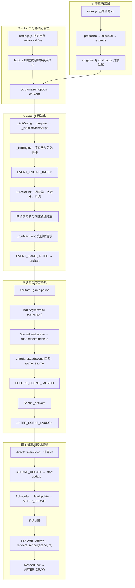
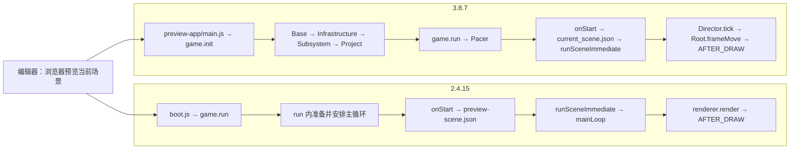

# 阶段 1 流程图：项目启动与首帧

本页只画两套示例在 **Creator 2.4.15 / 3.8.7 编辑器 Chrome 预览当前场景** 的已核对路径。图中的宿主脚本是预览专用接线；游戏脚本公开的场景切换入口仍以各自官网的 [`director.loadScene`（2.4）](https://docs.cocos.com/creator/2.4/manual/zh/scripting/scene-managing.html)和 [`director.loadScene`（3.8）](https://docs.cocos.com/creator/3.8/manual/zh/scripting/scene-managing.html)为准。预览方式分别见[2.4 手册](https://docs.cocos.com/creator/2.4/manual/zh/getting-started/basics/preview-build.html)和[3.8 手册](https://docs.cocos.com/creator/3.8/manual/zh/editor/preview/index.html)。内部调用与事件顺序来自本地源码及下方运行轨迹，不是手册承诺的跨平台时序。

## 2.4.15：`game.run` 内准备，预览宿主加载场景

`_runMainLoop` **安排**帧请求早于 `EVENT_GAME_INITED`，不代表当时已绘出场景。本次[预览轨迹](../agent-foundation/traces/2.4.15-preview-startup.jsonl)中，首次 `mainLoop` 出现在 `AFTER_SCENE_LAUNCH` 之后。`runSceneImmediate` 的第二参数是 `onBeforeLoadScene`，所以宿主传入的 `game.resume()` 回调位于 `BEFORE_SCENE_LAUNCH` 之前。源码主线：`engine/2.4.15engine/index.js`、`cocos2d/core/CCGame.js`、`cocos2d/core/CCDirector.js`，以及 Creator 安装包的 `static/preview-templates/boot.js`；细节见[2.x 独立笔记](../2.x/01-startup-and-frame.md)。

## 3.8.7：`game.init` 四阶段，`Pacer` 驱动首帧

```mermaid
flowchart TD
    subgraph M38[引擎模块与预览宿主]
        m38a["exports/base.ts 等源码构建为引擎模块"] --> m38b["页面加载 SystemJS 与引擎 bundle"]
        m38b --> m38c["window.onload → preview-app/index.js"]
        m38c --> m38d["preview-app/main.js 导入 cc"]
        m38d --> m38e["当前场景标记 current_scene；运行配置清空 launchScene"]
    end

    subgraph I38[Game.init 的异步阶段]
        i38a["PRE_BASE_INIT → Base：日志、sys、settings → POST_BASE_INIT"] --> i38b["PRE_INFRASTRUCTURE_INIT → 画布、设备、资源、Pacer → POST_INFRASTRUCTURE_INIT"]
        i38b --> i38c["PRE_SUBSYSTEM_INIT → 效果、脚本包、Director.init、Root → POST_SUBSYSTEM_INIT"]
        i38c --> i38d["EVENT_ENGINE_INITED"]
        i38d --> i38e["PRE_PROJECT_INIT → 插件、项目脚本、渲染管线、预加载"]
        i38e --> i38f["EVENT_RENDERER_INITED"]
        i38f --> i38h["POST_PROJECT_INIT → EVENT_GAME_INITED"]
        i38h --> i38g["game.init Promise 完成"]
    end

    subgraph P38[Game.run 与预览场景]
        p38a["game.run → Pacer 启动"] --> p38b["_updateCallback 处理启动画面和启动场景分支"]
        p38b --> p38c["无自动 launchScene → startAnimation / onStart"]
        p38c --> p38d["预览回调请求 scene/current_scene.json"]
        p38d --> p38e["assetManager.loadWithJson → runSceneImmediate"]
        p38e --> p38f["BEFORE_SCENE_LAUNCH → Scene 激活 → AFTER_SCENE_LAUNCH"]
    end

    subgraph F38[首个已观测的场景帧]
        f38a["后续 Pacer 回调 → director.tick(dt)"] --> f38b["BEGIN_FRAME → 输入派发"]
        f38b --> f38c["BEFORE_UPDATE → start → update → 系统 update"]
        f38c --> f38d["lateUpdate → AFTER_UPDATE → 延迟销毁 → 系统 postUpdate"]
        f38d --> f38e["BEFORE_DRAW → UI 脏数据更新 → Root.frameMove(dt)"]
        f38e --> f38f["AFTER_DRAW → END_FRAME"]
    end

    m38e --> i38a
    i38g --> p38a
    p38f --> f38a
```

本次[预览轨迹](../agent-foundation/traces/3.8.7-preview-startup.jsonl)测得 `ENGINE_INITED` 先于 `RENDERER_INITED`，符合本地 `game.ts` 中 Subsystem 与 Project 的调用点；事件常量的注释写了相反顺序。启动画面和资源加载的耗时可能改变进入 `tick` 的回调次数，本次是第三次 `_updateCallback` 才进入首次 `tick`，图中不把“三次”写成固定规则。源码主线：`engine/3.8.7engine/exports/base.ts`、`cocos/game/game.ts`、`cocos/game/director.ts`、`pal/pacer/pacer-web.ts`、`cocos/root.ts`；预览宿主为本次请求到的 `/preview-app/index.js` 与 `/preview-app/main.js`，细节见[3.x 独立笔记](../3.x/01-startup-and-frame.md)。

## 同一行为的路径对照

两版预览宿主都显式载入当前场景 JSON，再调用 `runSceneImmediate`；这不等于游戏脚本调用公开的 `director.loadScene(name)`。最关键的排障分叉是 2.4 的 `run/prepare` 与 3.8 的 `init Promise/run/Pacer`。完整差异与源码索引见[阶段 1 对照笔记](../comparisons/01-startup-and-frame.md)。以上仅针对本次编辑器浏览器预览；构建 Web、原生与小游戏宿主应按各自平台另画入口。
