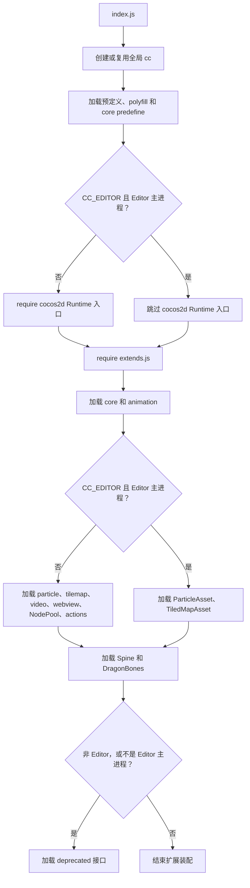
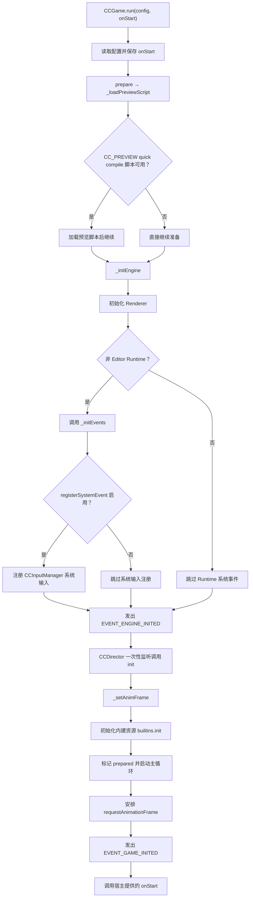
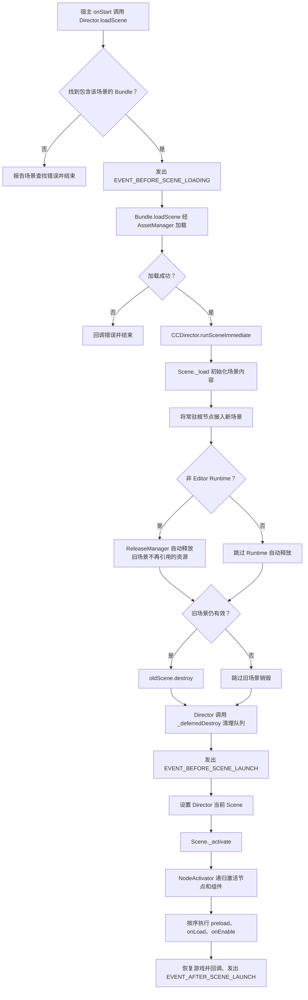
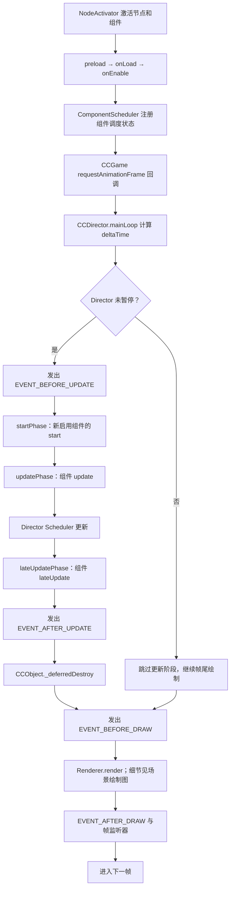
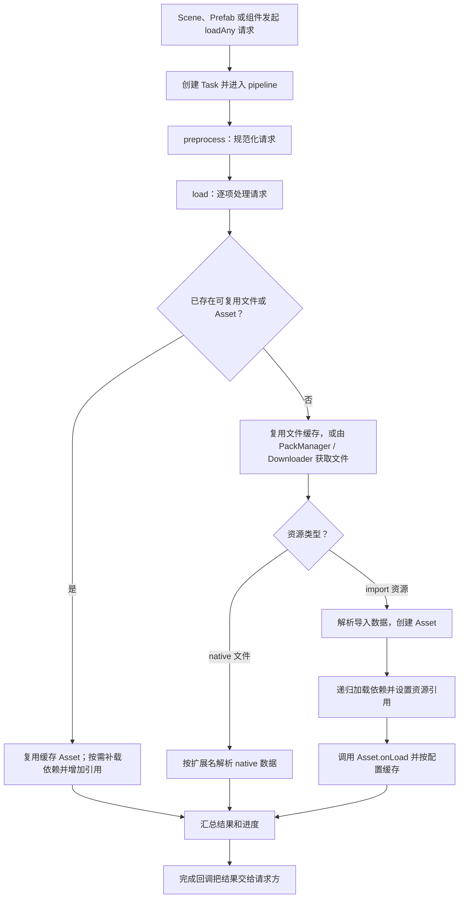
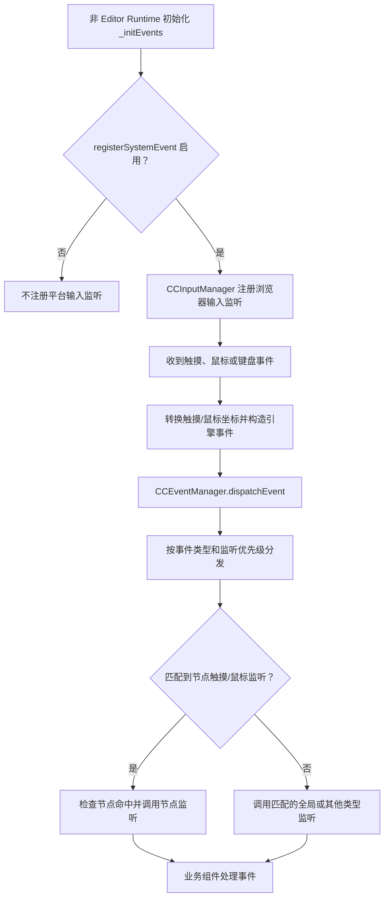
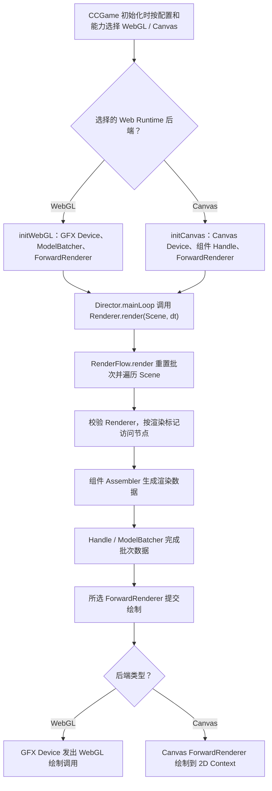
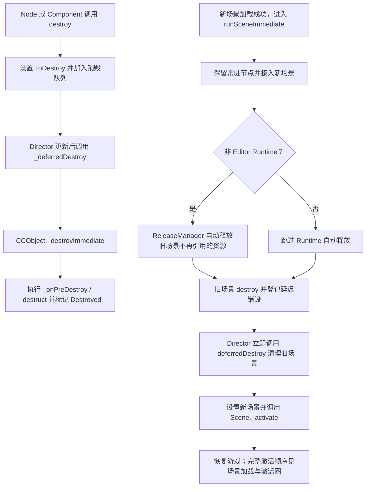

# 第 0 课：Creator 2.4.15 引擎功能流程图索引

**目标：** 依据 Creator 2.4.15 源码，分别追踪模块装配、游戏启动、场景、组件更新、资源、输入、绘制和销毁八项功能；各图是独立的源码职责链，不拼成一张覆盖所有系统的总流程图。

## 阅读范围

本课以 `engine/2.4.15engine/` 的源码为唯一实现依据，主线选择非编辑器主进程的 Web Runtime。课程建立引擎级调用地图，后续课程再深入其中一个子系统。

## 功能流程图

以下各图分别描述一项源码职责。图与图之间通过调用者、事件或共享对象连接；不将它们拼成一条假设所有功能都会经过的串行总流程。

### 模块装配

`modules.json` 描述构建期可选模块及依赖；运行时入口实际执行的是 `index.js`、`extends.js` 中的 `require` 与环境分支。

### 游戏启动

### 场景加载与激活

### 组件生命周期与帧更新

### 资源请求

缓存、打包资源、native/import 类型和 `cacheAsset` 配置会改变具体步骤；图中展示普通 `loadAny` 管线的主要分支。

### 输入与事件派发

### 场景绘制

此图只展开 Web Runtime 的 WebGL 和 Canvas 后端；JSB 原生渲染器由原生侧提供设备与渲染实现，不能套用 WebGL Device 的末端调用。

### 销毁与场景切换

## 源码阅读顺序

| 阶段 | 入口与关键职责 | 主要源码 |
| --- | --- | --- |
| 命名空间与装配 | 建立 `cc`，入口按环境加载核心模块与扩展；`modules.json` 供构建期模块裁剪使用 | [`index.js`](../../engine/2.4.15engine/index.js)、[`extends.js`](../../engine/2.4.15engine/extends.js)、[`modules.json`](../../engine/2.4.15engine/modules.json)、`cocos2d/core/predefine.js` |
| 游戏初始化 | `run`、`prepare`、`_initEngine`、`_prepareFinished`、`_runMainLoop` | [`CCGame.js`](../../engine/2.4.15engine/cocos2d/core/CCGame.js) |
| Director 与场景 | `EVENT_ENGINE_INITED` 监听、`init`、`mainLoop`、`loadScene`、`runSceneImmediate` | [`CCDirector.js`](../../engine/2.4.15engine/cocos2d/core/CCDirector.js)、[`CCScene.js`](../../engine/2.4.15engine/cocos2d/core/CCScene.js) |
| 节点与组件 | 场景树激活、生命周期入队、`start/update/lateUpdate` 调度 | [`node-activator.js`](../../engine/2.4.15engine/cocos2d/core/node-activator.js)、[`component-scheduler.js`](../../engine/2.4.15engine/cocos2d/core/component-scheduler.js)、`CCNode.js` |
| 资源与输入 | AssetManager 规范化请求、获取文件、解析依赖；系统输入经事件管理器分发 | [`CCAssetManager.js`](../../engine/2.4.15engine/cocos2d/core/asset-manager/CCAssetManager.js)、[`preprocess.js`](../../engine/2.4.15engine/cocos2d/core/asset-manager/preprocess.js)、[`load.js`](../../engine/2.4.15engine/cocos2d/core/asset-manager/load.js)、[`pack-manager.js`](../../engine/2.4.15engine/cocos2d/core/asset-manager/pack-manager.js)、[`parser.js`](../../engine/2.4.15engine/cocos2d/core/asset-manager/parser.js)、[`bundle.js`](../../engine/2.4.15engine/cocos2d/core/asset-manager/bundle.js)、[`releaseManager.js`](../../engine/2.4.15engine/cocos2d/core/asset-manager/releaseManager.js)、[`CCInputManager.js`](../../engine/2.4.15engine/cocos2d/core/platform/CCInputManager.js)、[`CCEventManager.js`](../../engine/2.4.15engine/cocos2d/core/event-manager/CCEventManager.js) |
| 绘制与销毁 | Director 调用 Renderer；RenderFlow 遍历场景并交给 WebGL 或 Canvas 后端；对象在安全时机清理 | [`renderer/index.js`](../../engine/2.4.15engine/cocos2d/core/renderer/index.js)、[`render-flow.js`](../../engine/2.4.15engine/cocos2d/core/renderer/render-flow.js)、[`model-batcher.js`](../../engine/2.4.15engine/cocos2d/core/renderer/webgl/model-batcher.js)、[WebGL ForwardRenderer](../../engine/2.4.15engine/cocos2d/renderer/renderers/forward-renderer.js)、[Canvas ForwardRenderer](../../engine/2.4.15engine/cocos2d/core/renderer/canvas/forward-renderer.js)、[`CCObject.js`](../../engine/2.4.15engine/cocos2d/core/platform/CCObject.js) |

## 本课必须保留的机制

- 区分 `EVENT_ENGINE_INITED` 与 `EVENT_GAME_INITED`：前者表示引擎初始化事件，后者在内建资源准备并启动主循环后发出。
- `CCGame` 提供 `onStart` 回调；由宿主决定是否以及何时加载首个场景。
- 场景加载、节点激活、组件生命周期、每帧更新和绘制是相互连接但职责不同的阶段。
- 每张图只说明本功能的调用关系；输入、资源、更新、绘制和销毁不能拼成所有游戏都必经的单一串行路径。

## 最小观察宿主

静态阅读本地 Creator 2.4.15 引擎源码。本课不需要浏览器宿主、示例工程或构建命令；按上表从入口函数追调用关系，并逐张对照八个功能流程图核验各自阶段。

## 模型化简化与 Creator Runtime 边界

流程图概括源码调用关系，不是可执行 Runtime，也不声称覆盖每个目标平台。重点路径是非编辑器主进程的 Web Runtime；`CC_EDITOR`、`CC_PREVIEW`、`CC_JSB`、`CC_RUNTIME` 和 `CC_NATIVERENDERER` 等宏会改变模块装配、输入、帧循环或渲染路径，需要按分支分别追踪。Creator 编辑器本体、AssetDB 导入器和完整 Editor Builder 不在此 Runtime 源码快照中。

## 后续课程

- [第 1 课：模块装配](../s01_module_assembly/README.md)到[第 3 课：Director 主循环](../s03_director_loop/README.md)：拆解入口与启动。
- [第 4 课：节点与场景树](../s04_node_scene_tree/README.md)到[第 10 课：Director 到渲染流程](../s10_render_entry/README.md)：拆解场景、组件和首帧绘制。
- [第 14 课：浏览器输入坐标](../s14_browser_input/README.md)到[第 20 课：节点移除与重新挂载](../s20_node_detachment/README.md)：拆解输入、事件、Prefab 与生命周期。
- [资源元数据补充参考](../asset_meta_reference/README.md)：保留 `.meta`、UUID 和 SpriteFrame 子资源分析，不计入课次。
