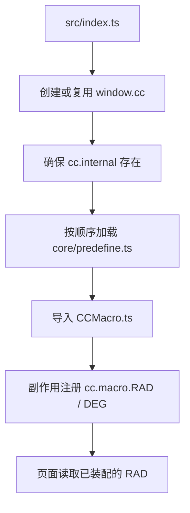

# 第 1 课：模块装配

**目标：** 看清引擎入口如何先建立共享的 cc，再加载模块。

## 流程图

## 本课增量

src/index.ts 创建 window.cc 和 cc.internal，再按顺序加载 core/predefine.ts。predefine.ts 当前只加载 CCMacro.ts；该模块把 RAD、DEG 注册到 cc.macro。

~~~text
src/index.ts
  → src/cocos2d/core/predefine.ts
    → src/cocos2d/core/platform/CCMacro.ts
~~~

## 源码对照

- engine/2.4.15engine/index.js：创建全局 cc、cc.internal，再加载核心预定义模块。
- engine/2.4.15engine/cocos2d/core/predefine.js：按顺序加载引擎模块。
- engine/2.4.15engine/cocos2d/core/platform/CCMacro.js：向 cc.macro 注册常量。

## 本课必须保留的机制

先创建共享 `window.cc`/`cc.internal` 命名空间，再按顺序加载模块；模块通过导入副作用注册职责，不能在命名空间未就绪时提前注册。

## 最小观察宿主

浏览器入口依次加载 `index.ts → predefine.ts → CCMacro.ts`，页面只显示装配状态和 RAD 数值。

## 模型化简化与 Creator Runtime 边界

本课只保留两个宏常量，未装配完整 Creator 核心模块、平台系统或 Runtime 启动链；页面验证的是课程模块注册顺序，不是完整引擎实例。

## 观察结果

页面显示“cc 模块已装配”以及 RAD 数值。先创建共享命名空间，再加载模块；模块通过导入副作用完成注册。这里只保留两个常量作为示例，其余宏和未涉及模块暂不加入。

## 运行

本课目录包含完整工程，独立于其他课程。在本目录运行：

~~~sh
deno task check
deno task build
deno task serve
~~~

打开 <http://localhost:8000> 查看结果。
