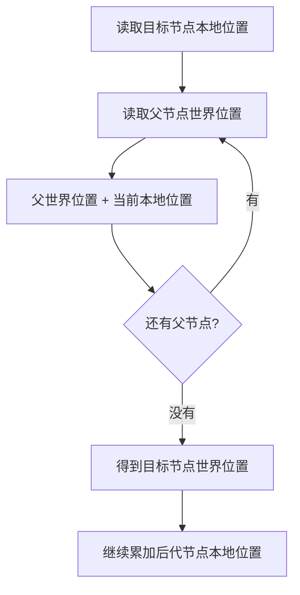

# 第 5 课：本地位置与世界位置

**目标：** 看清子节点的本地位置怎样沿父节点累加成世界位置。

## 流程图

## 本课增量

`Node` 保存本地位置；读取世界位置时，从节点沿父链逐级累加。示例只使用平移：Canvas `(100, 50)`、Player `(12, 7)`，所以 Player 世界位置是 `(112, 57)`。

## 源码位置

- `engine/2.4.15engine/cocos2d/core/CCNode.js:2665`：`setPosition()` 写入父坐标系中的本地位置。
- `engine/2.4.15engine/cocos2d/core/CCNode.js:725`：`updateLocalMatrix2D()` 把 TRS 数据写入局部矩阵。
- `engine/2.4.15engine/cocos2d/core/CCNode.js:3190`、`engine/2.4.15engine/cocos2d/core/CCNode.js:3197`：`_calculWorldMatrix()` 组合父节点世界矩阵与本地矩阵。
- `engine/2.4.15engine/cocos2d/core/CCNode.js:3209`：`_updateWorldMatrix()` 先更新父节点，再计算当前节点。
- `engine/2.4.15engine/cocos2d/core/CCNode.js:3437`：`getNodeToWorldTransform()` 读取节点到世界空间的矩阵。

## 观察结果

页面只显示坐标计算所需的数据：Player 本地位置 `(12, 7)`、世界位置 `(112, 57)`，以及 Weapon 世界位置 `(114, 58)`。节点树展示属于第 4 课，不在本课重复输出。

## 本课必须保留的机制

保留本地位置属于父坐标系，以及世界位置沿父链把局部平移逐级组合的规则。

## 最小观察宿主

浏览器页面创建 Canvas、Player、Weapon 的节点树并显示本地/世界坐标数值。

## 模型化简化与 Creator Runtime 边界

课程用父链逐级相加表示平移组合。旋转、缩放、锚点、矩阵乘法和矩阵脏标记尚未实现；本例不运行 Creator 的完整变换矩阵更新和渲染流程。

## 运行

在本课目录运行：

~~~sh
deno task check
deno task build
deno task serve
~~~

打开 <http://localhost:8000>。

## 同主题课程

- [Creator 3.8.7：本地位置与世界位置](../../learn_3.8cocoscreator/s05_local_world_transform/README.md)
- [Cocos2d-x 4.0：本地位置与世界位置](../../learn_cocos2d-4x/s05_local_world_transform/README.md)
