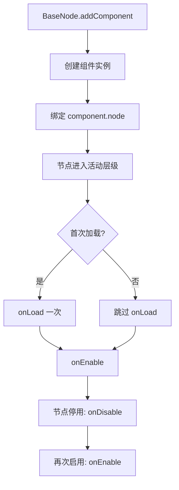

# 第 7 课：组件挂载与生命周期

**目标：** 看清组件怎样挂到 Node 上，以及节点激活时 `onLoad`、`onEnable`、`onDisable` 的调用关系。

## 流程图

## 本课增量

`BaseNode.addComponent()` 创建组件、保存 `component.node`，并在节点已经激活时通知 `NodeActivator`。节点首次激活时调用 `onLoad`，随后调用 `onEnable`；节点停用时调用 `onDisable`，再次激活只重复 `onEnable`。

## 源码位置

- `engine/2.4.15engine/cocos2d/core/utils/base-node.js:892-965`：`addComponent` 创建组件、设置 `node` 并处理已激活节点。
- `engine/2.4.15engine/cocos2d/core/components/CCComponent.js:262-306`：`onLoad`、`onEnable`、`onDisable` 生命周期定义。
- `engine/2.4.15engine/cocos2d/core/node-activator.js:172-181`、`313-350`：节点激活时遍历组件并调用 `activateComp`。
- `engine/2.4.15engine/cocos2d/core/node-activator.js:203-242`：节点反激活及组件停用。

## 本课必须保留的机制

保留 `addComponent()` 创建实例并绑定 `component.node`；首次节点激活按 `onLoad → onEnable`，反激活触发 `onDisable`，再次启用不重复 `onLoad`。

## 最小观察宿主

活动 Scene 挂载一个带日志组件的节点；通过页面状态观察首次激活、停用和重新启用回调。

## 模型化简化与 Creator Runtime 边界

本课沿用前课的 `BaseNode → Scene → Director → NodeActivator`。组件只保留节点引用和三个生命周期回调；省略 `__preload`、`start/update/lateUpdate`、组件自身 `enabled`、销毁队列、编辑器与序列化。下一课再加入每帧调度；此处不是完整 Creator 组件生命周期管线。

## 运行

~~~sh
deno task check
deno task build
deno task serve
~~~

打开 <http://localhost:8000>，页面会显示 `onLoad → onEnable → onDisable → onEnable`，并验证 `component.node === player`。这同时观察组件挂载结果和节点激活生命周期。代码是本课独立快照，不依赖完整 Creator 工程。
