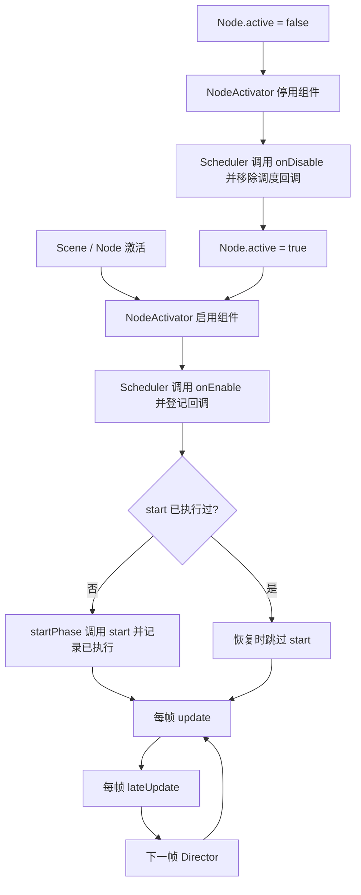

# 第 8 课：组件每帧调度

**目标：** 看清 `ComponentScheduler` 怎样按 `start → update → lateUpdate` 调度组件。

## 流程图

## 本课增量

组件激活时，`Component` 把启用状态交给 `ComponentScheduler`。Director 每帧依次执行三个阶段：`start` 只执行一次，`update` 和 `lateUpdate` 每帧执行。组件停用时 Scheduler 移除后续更新并调用 `onDisable`。

## 源码位置

- `engine/2.4.15engine/cocos2d/core/component-scheduler.js:309-360`、`:404-519`：Invoker 注册和三个生命周期阶段。
- `engine/2.4.15engine/cocos2d/core/node-activator.js:313-350`、`:353-365`：激活组件时启用 Scheduler，反激活时停用。
- `engine/2.4.15engine/cocos2d/core/CCDirector.js:842-858`：Director 每帧调用 start、update、lateUpdate 阶段。

## 本课必须保留的机制

保留 `Director → ComponentScheduler → Component` 的调度链与 `start → update → lateUpdate` 阶段顺序；`start` 每组件只执行一次，节点停用后调度器移除该组件的帧回调，再启用时恢复更新但不重跑 `start`。

## 最小观察宿主

活动 Scene、一个带调度回调的组件、最小帧循环和节点启停按钮；页面显示首次调度顺序，并验证停用期间回调暂停、重新启用后恢复。

## 模型化简化与 Creator Runtime 边界

保留调度职责和阶段顺序。省略 executionOrder、编辑器异常包装、帧内新增组件的延迟处理、通用 invoker 优化和系统调度；示例不包含 Creator 全部组件注册、优先级与系统更新阶段。

## 运行

~~~sh
deno task check
deno task build
deno task serve
~~~

打开 <http://localhost:8000>。页面持续保留首次调度阶段 `start → update → lateUpdate`，另显示最近的回调窗口。等首个调度帧后点击按钮停用/重新启用 Player，观察 `onDisable/onEnable`、帧回调暂停与恢复，以及 `start` 不重复。`onLoad/onEnable` 也用于沿用真实激活路径。
