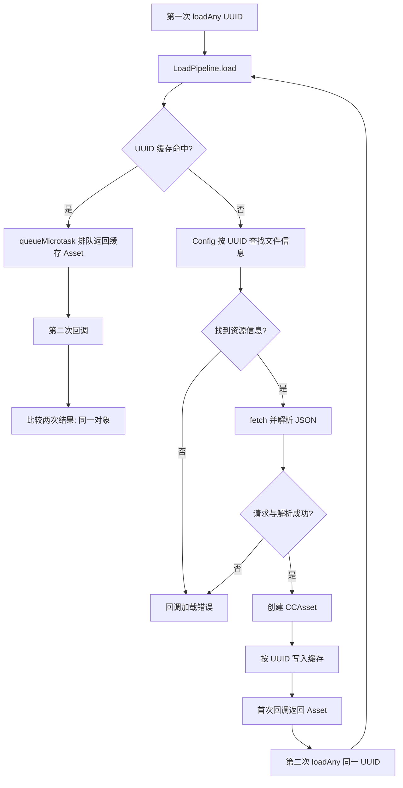

# 第 9 课：资源请求与缓存

**目标：** 看清同一 UUID 的第二次请求怎样复用 Asset 对象。

## 流程图

## 本课增量

`CCAssetManager.loadAny()` 把请求交给加载管线。管线先查 UUID 缓存；未命中时按配置取文件、解析并创建 `CCAsset`，再放进缓存。示例连续请求同一个 UUID，页面显示两次回调拿到同一对象。

## 源码位置

- `engine/2.4.15engine/cocos2d/core/asset-manager/CCAssetManager.js:486-496`：`loadAny` 将请求交给主管线。
- `engine/2.4.15engine/cocos2d/core/asset-manager/load.js:89-145`：单资源管线检查 UUID 缓存，命中时复用 Asset。
- `engine/2.4.15engine/cocos2d/core/asset-manager/load.js:210-222`、`utilities.js:180-185`：加载完成后登记缓存。
- `engine/2.4.15engine/cocos2d/core/assets/CCAsset.js`：资源对象基类。

## 本课必须保留的机制

保留按 UUID 检查 Asset 缓存：首次未命中创建并缓存 Asset，后续同 UUID 请求复用同一对象。

## 最小观察宿主

浏览器页面通过本地配置对同一 UUID 连续发起两次 load 请求，显示缓存命中状态和两次返回对象身份。

## 模型化简化与 Creator Runtime 边界

示例只从本地 JSON 创建一个 `CCAsset`。省略 `.meta`/Bundle 配置、依赖图及引用计数；示例的 UUID 到文件映射由 `Config` 代替，`fetch + response.json()` 只模型化下载和解析边界。因此观察的是缓存规则模型，不是完整 AssetManager 请求管线。课程快照只保留 AssetManager、Config、Cache 和 CCAsset，不装配场景、组件或 Director。

## 运行

~~~sh
deno task check
deno task build
deno task serve
~~~

打开 <http://localhost:8000>，观察首次请求前缓存未命中、第二次请求前缓存已命中，且两次得到同一对象。
