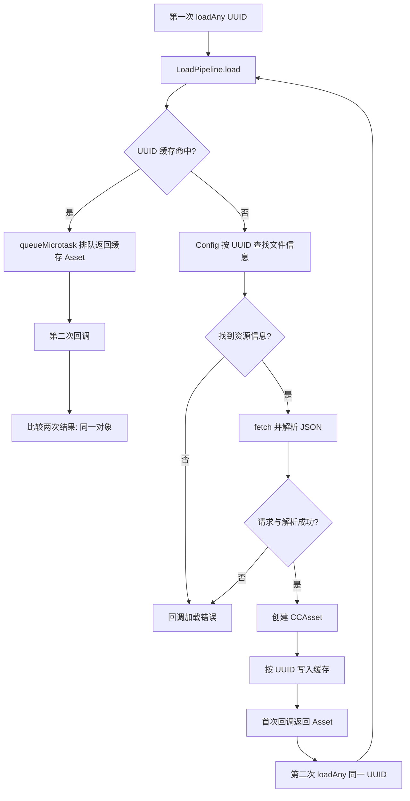

# 第 9 课：资源请求与缓存

**目标：** 认识 Creator 2.4.15 常见 Asset 类型，并看清同一 UUID 的第二次请求怎样复用 Asset 对象。

## 流程图



## 本课增量

`CCAssetManager.loadAny()` 把请求交给加载管线。管线先查 UUID 缓存；未命中时按配置取文件、解析并创建 `CCAsset`，再放进缓存。示例连续请求同一个 UUID，页面显示两次回调拿到同一对象。

## Asset 基类与常见类型

`cc.Asset` 是 Creator 资源对象的基类，提供 UUID、加载状态、原生资源 URL 和引用计数等共同身份/生命周期信息。具体子类则表达不同用途；它们不是“同一种 JSON 对象换个名字”。

Creator 2.4.15 快照中能找到以下直接子类（扩展目录中的 Spine/DragonBones 类型也计入）；JavaScript、TypeScript 则继承 `Script`，属于间接子类：

| 类别 | Asset 类型 | 职责概览 |
| --- | --- | --- |
| 数据 | `JsonAsset`、`TextAsset`、`BufferAsset` | 解析后的 JSON、文本和二进制数据 |
| 场景与节点 | `Prefab`、`SceneAsset` | 节点模板与可加载场景 |
| 2D 图形 | `SpriteFrame`、`SpriteAtlas`、`Texture2D`、`Font` | 帧区域、图集、纹理和字体 |
| 媒体 | `AudioClip`、`VideoClip` | 音频与视频资源 |
| 动画与地图 | `AnimationClip`、`TiledMapAsset`、`ParticleAsset` | 动画片段、瓦片地图和粒子配置 |
| 渲染与 3D | `Material`、`EffectAsset`、`Model`、`Mesh`、`Skeleton` | 材质、Effect、模型、网格和骨骼 |
| 脚本与扩展 | `Script`、`sp.SkeletonData`、`dragonBones.DragonBonesAsset`、`dragonBones.DragonBonesAtlasAsset` | 脚本及 Spine/DragonBones 数据 |

源码入口可从 [`CCAsset.js`](../../engine/2.4.15engine/cocos2d/core/assets/CCAsset.js) 开始，再查 `cocos2d/core/assets/`、`cocos2d/animation/`、`cocos2d/particle/`、`cocos2d/tilemap/`、`cocos2d/core/3d/`、`cocos2d/core/mesh/` 与 `extensions/` 中对应类定义。

## Creator 源码摘读

下面是 Creator 2.4.15 源码中的关键片段，省略了版权头、长注释和与本课无关的代码；标有省略说明的地方不代表引擎源码原文。其余代码保留引擎的 `cc.Class` 结构，不是独立示例的 TypeScript 重写。

### Asset 基类与 JsonAsset

[`CCAsset.js`](../../engine/2.4.15engine/cocos2d/core/assets/CCAsset.js) 基于 `CCObject`，初始化 UUID、加载状态、native URL 和引用计数。[`CCJsonAsset.js`](../../engine/2.4.15engine/cocos2d/core/assets/CCJsonAsset.js) 则只声明自身数据字段并继承它：

```js
cc.Asset = cc.Class({
    name: 'cc.Asset', extends: CCObject,
    ctor () {
        Object.defineProperty(this, '_uuid', {
            value: '',
            writable: true,
        });
        this.loaded = true;
        this._nativeUrl = '';
        this._ref = 0;
    },
    // properties 还定义 nativeUrl、refCount、_nativeAsset 等
});

var JsonAsset = cc.Class({
    name: 'cc.JsonAsset',
    extends: cc.Asset,
    properties: {
        json: null,
    },
});
```

### Prefab 与 Texture2D

[`CCPrefab.js`](../../engine/2.4.15engine/cocos2d/core/assets/CCPrefab.js) 持有模板根节点 `data`，并由 `_instantiate()` 按策略走 JIT 或普通实例化路径；它不是一个泛型 JSON 数据壳：

```js
var Prefab = cc.Class({
    name: 'cc.Prefab',
    extends: cc.Asset,
    ctor () {
        this._createFunction = null;
        this._instantiatedTimes = 0;
    },
    properties: {
        data: null,
        optimizationPolicy: OptimizationPolicy.AUTO,
        asyncLoadAssets: false,
    },
    _instantiate: function () {
        var node, useJit = false;
        if (CC_SUPPORT_JIT) {
            if (this.optimizationPolicy === OptimizationPolicy.SINGLE_INSTANCE) {
                useJit = false;
            }
            else if (this.optimizationPolicy === OptimizationPolicy.MULTI_INSTANCE) {
                useJit = true;
            }
            else {
                useJit = (this._instantiatedTimes + 1) >= Prefab.OptimizationPolicyThreshold;
            }
        }
        if (useJit) {
            node = this._doInstantiate();
            this.data._instantiate(node);
        }
        else {
            node = this.data._instantiate();
        }
        ++this._instantiatedTimes;
        return node;
    },
});
```

[`CCTexture2D.js`](../../engine/2.4.15engine/cocos2d/core/assets/CCTexture2D.js) 继承 Asset 并混入 `EventTarget`；`_nativeAsset` setter 会把压缩像素数据交给 `initWithData()`，普通图片元素交给 `initWithElement()`：

```js
var Texture2D = cc.Class({
    name: 'cc.Texture2D',
    extends: require('../assets/CCAsset'),
    mixins: [EventTarget],
    properties: {
        _nativeAsset: {
            get () { return this._image; },
            set (data) {
                if (data._compressed && data._data) {
                    let format = data.format;
                    this.initWithData(data._data, format ? format : this._format, data.width, data.height);
                }
                else {
                    this.initWithElement(data);
                }
            },
            override: true,
        },
        // filter、wrap、pixel format 等纹理状态
    },
});
```

### 真实加载管线中的缓存与解析

[`load.js`](../../engine/2.4.15engine/cocos2d/core/asset-manager/load.js) 处理的是 `RequestItem` 和多阶段 Pipeline。非 native 资源先检查 UUID 缓存；命中时复用 Asset 并增加引用，未命中则交给 parser 解析 import 数据，之后加载依赖并缓存：

```js
function fetch (task, done) {
    var item = task.output = task.input;
    var { options, isNative, uuid, file } = item;
    if (file || (!options.reload && !isNative && assets.has(uuid))) return done();
    packManager.load(item, task.options, function (err, data) {
        item.file = data;
        done(err);
    });
}

if (!options.reload && assets.has(uuid)) {
    var asset = assets.get(uuid);
    item.content = asset.addRef();
    done();
}
else {
    parser.parse(id, file, 'import', options, function (err, asset) {
        if (err) return done(err);
        asset._uuid = uuid;
        loadDepends(task, asset, done, true);
    });
}
```

最终的通用资源缓存发生在依赖处理和 `onLoad` 后；源码对 `SceneAsset` 等类型还有单独处理，所以不能把所有结果都概括成“JSON 解析后直接放进同一个 Map”。

资源请求的结果取决于资源类型和加载/解析配置：加载 JSON 可得到 `JsonAsset`，Prefab 资源得到 `Prefab`，图像资源进入纹理加载路径后可得到 `Texture2D`。`Texture2D` 不等同于 `SpriteFrame`：前者表示可供采样的纹理，后者持有纹理及矩形区域等帧信息；Sprite 再使用 SpriteFrame 绘制。Prefab 也不是实例节点本身，实例化才产生可挂入场景树的节点副本。

**源码阅读顺序：** 先看 `CCAsset.js` 的公共身份和引用字段，再对照 `CCJsonAsset.js`、`CCPrefab.js`、`CCTexture2D.js` 的真实定义，最后阅读 `asset-manager/load.js` 中 fetch、parse、依赖和缓存阶段。第 13 课会沿 `Texture2D → SpriteFrame → Sprite` 深入，第 17 课会展开 `Prefab → Node` 实例化；本课先建立类型地图与源码入口。

## 源码位置

- `engine/2.4.15engine/cocos2d/core/asset-manager/CCAssetManager.js:486-496`：`loadAny` 将请求交给主管线。
- `engine/2.4.15engine/cocos2d/core/asset-manager/load.js:89-145`：单资源管线检查 UUID 缓存，命中时复用 Asset。
- `engine/2.4.15engine/cocos2d/core/asset-manager/load.js:210-222`、`utilities.js:180-185`：加载完成后登记缓存。
- `engine/2.4.15engine/cocos2d/core/assets/CCAsset.js`：资源对象基类。
- `CCJsonAsset.js`、`CCPrefab.js`、`CCTexture2D.js`：本课独立代码对应的类型化 JSON、节点模板和纹理职责。
- `src/cocos2d/core/assets/asset-subclasses.ts`：其余 Asset 子类的裁剪类模型、主要数据字段和关键行为。

## 本课必须保留的机制

保留 Asset 基类与具体类型的职责区分，以及按 UUID 检查 Asset 缓存：首次未命中时按资源类型解析并创建 Asset，后续同 UUID 请求复用同一对象。

## 最小观察宿主

浏览器页面通过本地配置对同一 UUID 连续发起两次 load 请求，显示类型化 `JsonAsset` 的缓存身份；同时实例化两次 Prefab 模板，并把压缩像素数据交给 Texture2D，观察三类 Asset 的不同职责。

## 模型化简化与 Creator Runtime 边界

独立代码为 Creator 2.4.15 的 Asset 类型补上了源码职责模型：Asset 身份与引用计数、TextAsset 转字符串、BufferAsset 原生缓冲访问、SpriteFrame 的贴图/UV、Atlas 查帧、动画片段的帧数据生成、AudioClip 延迟加载、Material/Effect 实例关系、Model 子节点索引转换、Mesh 二进制区间切片、Skeleton 关节/BindPose 对应，以及 Spine/DragonBones 数据解析与缓存失效。ParticleAsset、TiledMapAsset、SceneAsset、Font、VideoClip、Script 等在当前上游源码中主要声明资源字段或混入通用接口，本课按这个边界保留数据职责，不凭空添加引擎行为。页面实际演示 `JsonAsset` 缓存、Prefab 实例化和 Texture2D nativeAsset 初始化。仍省略 Creator 的 `cc.Class` 注册、完整 `EventTarget`/JIT/编辑器集成、GPU 设备、`.meta`/Bundle 配置、完整 parser/依赖管线和原生后端；UUID 到文件映射由 `Config` 代替。因此这些是源码职责裁剪模型，不是完整 AssetManager 或 Runtime。

## 运行

~~~sh
deno task check
deno task build
deno task serve
~~~

打开 <http://localhost:8000>，观察首次请求前缓存未命中、第二次请求前缓存已命中，且两次得到同一对象。
