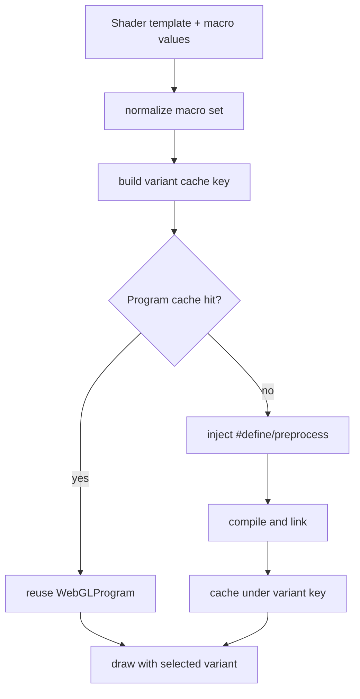

# 第 100 课：宏变体与平台边界

**本课问题：** 宏如何选择程序分支，WebGL 版本限制在哪里？

## 读代码顺序

先看 `src/main.ts`：它建立 WebGL 1 上下文、组织样例输入并发起本课操作。再看下面的模块，最后回到引擎源码核对本版实现。

`ProgramLib` 把宏和值组成变体键；宏放进 Shader 源码后分别编译两个分支，再观察缓存命中。

## 课程代码位置

- `src/main.ts`：浏览器入口与调用顺序。
- `src/cocos2d/renderer/gfx/device.ts`：实际 WebGL 1 编译、属性输入、Uniform、纹理与 drawArrays。
- `src/cocos/` 或 `src/cocos2d/` 下的本课模块：按本版引擎职责拆分；样例逻辑是课程独立实现。

## 本课输入到画面

左右两个 quad 使用同一份 Shader 源码，但分别请求 USE_TINT=1 和 USE_TINT=0。ProgramLib 把宏值写入缓存键，并在编译前插入 #define；USE_TINT=1 的分支输出 u_tint，另一分支输出固定橙色。左边因此显示蓝青色，右边显示橙色；两次请求形成两个 WebGLProgram。再用相同宏请求时应命中缓存。页面还会打印浏览器实际 WebGL / GLSL 版本。

## 对照本版引擎源码

- [`cocos2d/renderer/core/program-lib.js`](../../engine/2.4.15engine/cocos2d/renderer/core/program-lib.js)
- [`cocos2d/renderer/gfx/device.js`](../../engine/2.4.15engine/cocos2d/renderer/gfx/device.js)
- [`cocos2d/renderer/build/chunks/shader/unlit-fs.inc`](../../engine/2.4.15engine/cocos2d/renderer/build/chunks/shader/unlit-fs.inc)

版本要点：**Creator 2.4.15** 的课程目标是浏览器 WebGL 1。不把另一版的 Effect 语法、Shader API 或设备路径套进来。

## 为什么这样设计

宏在编译前选择 Shader 分支，宏组合形成 Program 变体键；ProgramLib 缓存已编译的组合，避免运行时重复编译。把宏放在编译阶段可同时控制代码和程序身份。

## 源码流程图

## 本课必须保留的机制

保留宏和值组成变体缓存键、编译前注入 `#define`、不同宏组合生成不同 WebGLProgram，以及重复键复用缓存程序。

## 最小观察宿主

浏览器 WebGL 1 为左右两个 quad 请求两组 `USE_TINT` 宏，观察两个实际程序、颜色分支、重复请求缓存命中与当前 GLSL 版本。

## 模型化简化与 Creator Runtime 边界

只模拟本例宏键与分支，不覆盖 Creator 完整 ProgramLib 宏标准化、全部 shader chunks、驱动差异或其他图形后端；结论限定 WebGL 1，不外推到 WebGL2/Metal/WebGPU。

## 运行

~~~sh
deno task check
deno task build
deno task serve
~~~

打开 `http://127.0.0.1:8000/`。画布执行真实 WebGL Shader 编译和绘制；页面日志显示本课职责顺序。本课实际使用 Creator 2.4 WebGL 1 Shader 语法；宏仅用于编译时分支。它不宣称同一源码能直接用于 WebGL2、Metal 或 WebGPU。

本课独立运行，不依赖前课目录。下一课：Sprite 接入与调试。
