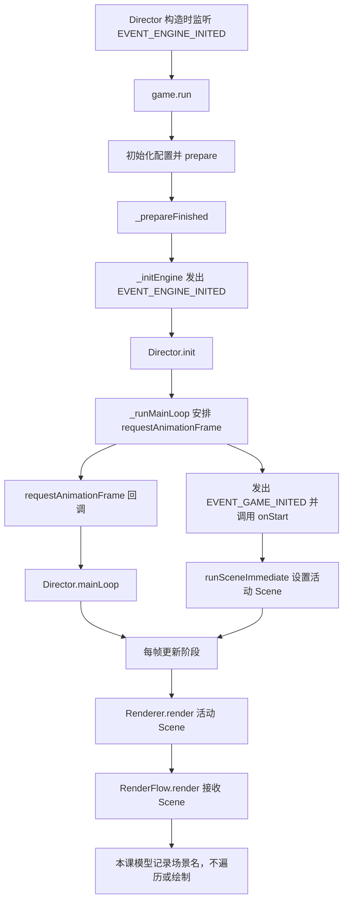

# 第 10 课：Director 到渲染流程

**目标：** 看清每帧更新结束后，当前场景怎样进入 Web 渲染器。

## 流程图

## 本课增量

`game.run()` 完成启动后进入 Director 主循环；Director 每帧完成更新阶段，再调用 Renderer；Renderer 把活动场景交给 RenderFlow。本课让页面显示到达流程的场景名，不遍历子节点、不生成绘制数据；节点遍历留到第 11 课。启动链是观察渲染入口的必要前置条件，保留在本课入口中。

## 源码位置

- `engine/2.4.15engine/cocos2d/core/CCDirector.js:900-906`：Web 主循环更新后调用 `renderer.render(this._scene, deltaTime)`。
- `engine/2.4.15engine/cocos2d/core/renderer/index.js:175-180`：Renderer 将活动场景交给 `_flow.render`。
- `engine/2.4.15engine/cocos2d/core/renderer/render-flow.js:235-245`：RenderFlow 开始批处理、访问根节点并交给 ForwardRenderer。

## 本课必须保留的机制

保留每帧更新后 `Director → Renderer → RenderFlow` 的调用顺序，以及活动 Scene 作为 RenderFlow 输入的职责。

## 最小观察宿主

页面以 `game.run()` 启动课程引擎模型，在 `onStart` 中挂入活动 Scene；每帧经过 Director 后，由 Renderer/RenderFlow 接收该 Scene。页面只显示帧数和场景名，不混入组件生命周期或资源加载演示。

## 模型化简化与 Creator Runtime 边界

保留 `game.run → EVENT_ENGINE_INITED → Director.init → requestAnimationFrame → mainLoop → Renderer → RenderFlow` 的启动到渲染入口链。省略真实初始化中的内建资源/设备创建细节，以及 Canvas/WebGL 设备、模型收集、剔除、批处理和 GPU 提交；课程只验证场景到达 RenderFlow，不等同于实际场景遍历或浏览器绘制。组件调度和 AssetManager 加载不属于本课观察范围。

## 运行

~~~sh
deno task check
deno task build
deno task serve
~~~

打开 <http://localhost:8000>，页面的渲染入口行会显示 `MainScene` 已到达 RenderFlow。
