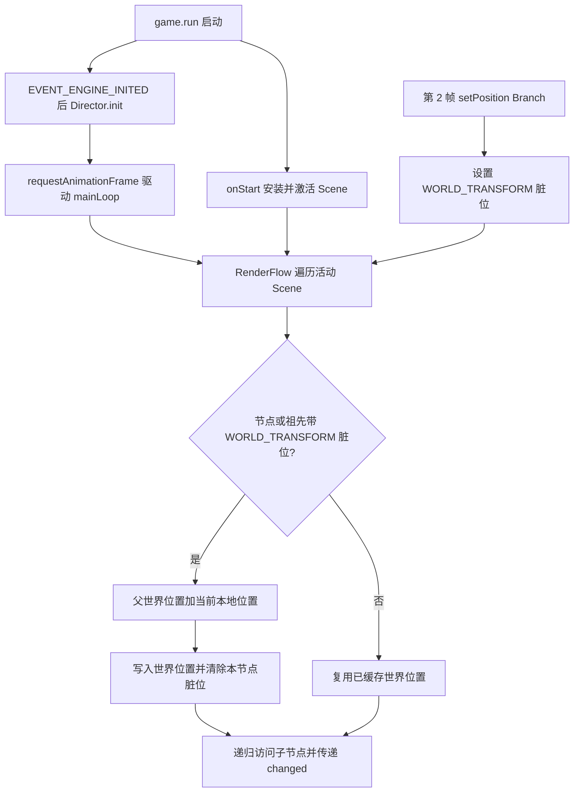

# 第 11 课：渲染脏标记与世界变换

**目标：** 看清节点位置变化后，RenderFlow 如何只重算受影响的世界位置。

## 流程图

## 本课增量

`setPosition` 设置 `WORLD_TRANSFORM` 脏位。RenderFlow 遍历场景树，重算带脏位的节点，并把父节点的变化传给子节点。示例第 2 帧移动 Branch，第 3 帧复用缓存。

## 源码位置

- `engine/2.4.15engine/cocos2d/core/CCNode.js:2665-2695`：位置变化后设置世界变换标记。
- `engine/2.4.15engine/cocos2d/core/renderer/render-flow.js:35-49`：重算节点世界矩阵并清除脏位。
- `engine/2.4.15engine/cocos2d/core/renderer/render-flow.js:85-110`：遍历子节点并传递祖先的变换脏位。

## 本课必须保留的机制

保留 `setPosition` 置 `WORLD_TRANSFORM` 脏位、RenderFlow 消费并清位，以及父节点变换脏状态传给受影响子节点。

## 最小观察宿主

场景树、Director/RenderFlow 观察循环和状态日志；按帧移动 Branch 并读取父子世界位置及是否重算。

## 模型化简化与 Creator Runtime 边界

只实现平移和一个世界变换位；省略旋转、缩放、矩阵乘法、透明度、颜色和渲染组件数据更新。本课记录渲染流程中的变换更新规则，不完整实现 Creator RenderFlow 或 GPU 绘制。

## 运行

~~~sh
deno task check
deno task build
deno task serve
~~~

打开 <http://localhost:8000>，观察首帧初始化、父节点移动时父子节点重算，以及后续帧显示“无变换重算”。
