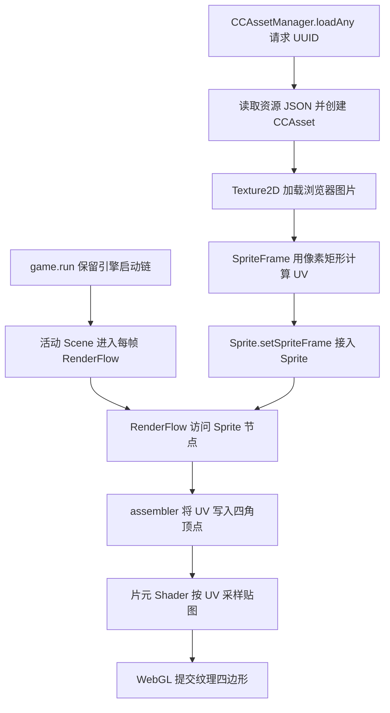

# 第 13 课：SpriteFrame 连接贴图

**目标：** 看清资源、贴图、SpriteFrame 和 Sprite 如何接成一条绘制数据链。

## 流程图

## 本课增量

Asset 描述图集区域；Texture2D 加载浏览器图片；SpriteFrame 把像素矩形换成 UV；Sprite 组装器把 UV 写入四边形顶点；WebGL shader 按 UV 采样贴图。示例只取 128×64 图集左侧 64×64 区域。

## 源码位置

- `engine/2.4.15engine/cocos2d/core/components/CCSprite.js:195-217,518-548`：`spriteFrame` 赋值后切换贴图并应用帧数据。
- `engine/2.4.15engine/cocos2d/core/assets/CCSpriteFrame.js:367-380,458-493`：SpriteFrame 保存 Texture2D 与矩形区域，并处理贴图加载。
- `engine/2.4.15engine/cocos2d/core/renderer/webgl/assemblers/sprite/2d/simple.js:39-50`：将 SpriteFrame UV 写入每个顶点。
- `engine/2.4.15engine/cocos2d/core/renderer/webgl/model-batcher.js:135-164,187-197`：将批次缓冲封装进 Model，并提交缓冲数据。

## 本课必须保留的机制

保留 Asset/Texture2D/SpriteFrame/Sprite 的引用链，SpriteFrame 将矩形转换为 UV，assembler 将 UV 写入顶点，片元 Shader 按 UV 采样纹理。

## 最小观察宿主

浏览器载入单张图集并使用 WebGL 绘制一个 Sprite；状态区显示对象链和 UV，画布结果用来观察贴图采样。

## 模型化简化与 Creator Runtime 边界

独立代码按源码职责拆分，只支持未旋转、未裁剪的单个矩形帧；省略材质切换、动态合图、完整贴图加载队列和 GPU 资源释放。示例接入了浏览器 Image/WebGL 最小路径，但不等同于完整 Creator AssetManager/Renderer Runtime。

## 运行

~~~sh
deno task check
deno task build
deno task serve
~~~

打开 <http://localhost:8000>。画面显示图集左侧的圆形角色；状态栏可读到 Asset → Texture2D → SpriteFrame → Sprite 的连接和计算后的 UV。
