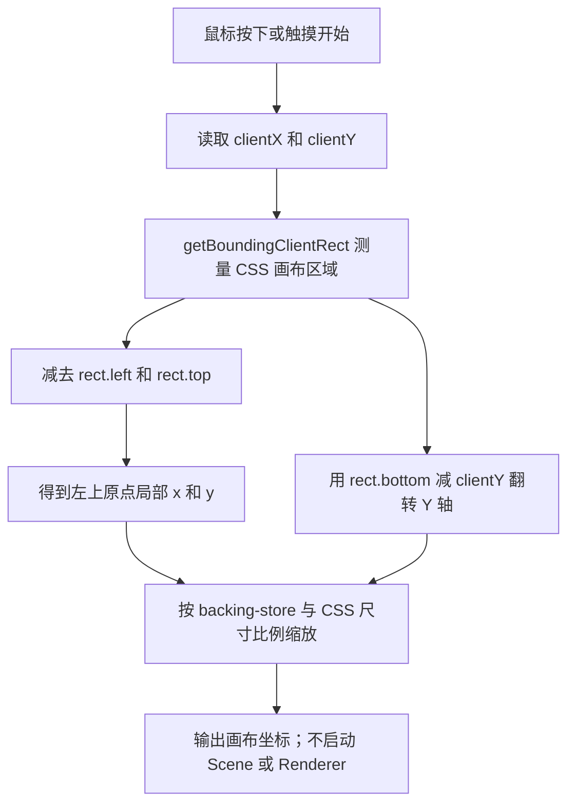

# 第 14 课：浏览器输入坐标换算

**目标：** 解释浏览器鼠标/触摸位置如何从视口坐标变成画布 backing-store 坐标，并理解 Y 轴方向为什么需要翻转。

## 流程图



## 先观察

页面用一个空白 HTML canvas 接收鼠标按下和触摸开始。canvas 的 backing-store 固定为 `320×200`，CSS 展示宽度约为 `480px`；输入后，状态区逐项显示浏览器 `clientX/Y`、画布的 CSS 边界、画布内局部坐标、缩放比例和最终画布坐标。

桌面 CSS 区域恰为 `480×300` 时，画布中心的 client 位置映射为 backing-store 中心 `(160,100)`。页面窄于 480px 时，CSS 区域会缩小，代码使用实际测得的 `getBoundingClientRect()` 尺寸重新计算。

## 本课必须保留的机制

浏览器 `clientX/Y` 是相对视口的 CSS 像素。先用 `getBoundingClientRect()` 得到 canvas 当前的 CSS 展示区域，再计算：

```text
localX      = clientX - rect.left
localYTop   = clientY - rect.top
localYBottom= rect.bottom - clientY
scaleX      = canvas.width / rect.width
scaleY      = canvas.height / rect.height
canvasX     = localX * scaleX
canvasY     = localYBottom * scaleY
```

这里同时包含两件不同的事：CSS 局部位置变成 backing-store 像素，以及从浏览器左上原点改成引擎常用的左下原点。不能把 `clientX/Y` 直接当作画布坐标；画布在页面中的偏移、CSS 尺寸和 backing-store 尺寸都可能不同。

## 最小观察宿主

一个设置了 `320×200` backing-store 的 HTML canvas、鼠标按下/触摸开始监听，以及一个显示中间值的状态区。页面不启动 Scene、Director 或 Renderer，也不在 canvas 上绘制 Sprite；canvas 只作为浏览器输入事件的目标。

## 源码位置

- `src/cocos2d/core/platform/CCInputManager.ts`：只注册本课所需的 `mousedown` 和 `touchstart`，把浏览器坐标及触摸 ID 交给换算函数。
- `src/cocos2d/core/platform/input-point.ts`：测量 CSS 区域、计算局部坐标、比例缩放和 Y 轴翻转。
- `engine/2.4.15engine/cocos2d/core/platform/CCInputManager.js:119-145`：Runtime 更新 canvas 边界信息；`:423-452`：把触摸输入交给 `cc.view` 转换并创建 `Touch`。
- `engine/2.4.15engine/cocos2d/core/platform/CCView.js:946-978`：`convertToLocationInView` 使用设备像素比、翻转 Y 轴并处理旋转；后续视口/设计分辨率缩放由 View 的转换路径处理。

## 模型化简化与 Creator Runtime 边界

本课的换算用 `canvas.width / rect.width` 和 `canvas.height / rect.height` 表示 CSS 到 backing-store 的比例，只处理鼠标按下与触摸开始。它没有实现完整的 Creator 输入系统：不维护 Touch 池/前一点，不处理 move/end/cancel，不做视口与设计分辨率缩放、设备像素比配置或旋转，也不向 `CCEventManager` 派发节点事件。Creator 2.4.15 的真实路径由 `CCInputManager` 读取 canvas 边界并接收事件，再经 `cc.view.convertToLocationInView` 等转换处理；本课只展示坐标变换的核心算式，不等于完整 Runtime 输入链。

## 运行

~~~sh
deno task check
deno task build
deno task serve
~~~

点击画布不同位置，对照状态区的中间值。改变页面宽度后，CSS 区域会变，最终坐标仍按实际显示区域换算。
