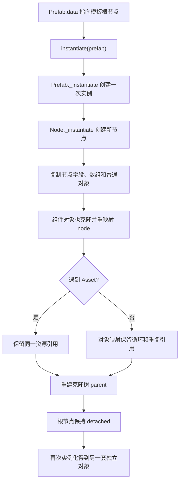

# 第 17 课：Prefab 创建节点树副本

**问题：** 从一个 Prefab 模板实例化两次时，节点、组件、内部引用和 Asset 各自如何处理？

## 流程图

## 观察步骤

- 查看模板 `Enemy → Body → Marker`、组件 `EnemyStats` 与两棵副本。
- 修改 `EnemyA` 的节点和组件嵌套数据，确认模板与 `EnemyB` 不变。
- 核对 `component.node` 和组件对 Marker 的引用指向各自副本中的节点。
- 核对普通对象深拷贝、别名/循环引用保持，以及 Asset 在模板和副本间共享。
- 两个根节点的 parent 都是 `null`：实例化创建对象图，不负责场景挂载。

## 本课必须保留的机制

`Prefab.data` 持有模板根节点；`instantiate(prefab)` 转交 `prefab._instantiate()`；Node 的 `_instantiate()` 经通用对象图克隆创建副本。节点和组件成为新对象，组件的节点引用及树内节点交叉引用指向克隆；数组和普通对象递归复制，同时保留循环/重复引用关系；`cc.Asset` 保持共享。克隆树重建父子关系，但克隆根节点保持 detached。

## 最小观察宿主

一个内存中的 `Enemy → Body → Marker` 模板，Body 挂载带有嵌套数据、Asset 引用和 Marker 引用的 `EnemyStats` 组件。页面实例化两次，修改 A 副本，并检查对象身份、对象图引用和父节点状态。副本不挂入 Scene，也不运行组件生命周期或渲染。

## Creator 2.4.15 源码对照

- [CCPrefab.js](../../engine/2.4.15engine/cocos2d/core/assets/CCPrefab.js#L167-L199)：Prefab 支持 JIT/非 JIT 实例化路径等 Runtime/编辑器关联逻辑。
- [instantiate.js](../../engine/2.4.15engine/cocos2d/core/platform/instantiate.js#L123-L217)：通用克隆维护对象映射以处理循环引用，复制数组/普通对象，并清理临时映射。
- [instantiate.js](../../engine/2.4.15engine/cocos2d/core/platform/instantiate.js#L223-L299)：Asset 保留引用；ValueType、TypedArray、组件/节点引用分别按类型处理。
- [base-node.js](../../engine/2.4.15engine/cocos2d/core/utils/base-node.js#L1178-L1204)：Node 调用通用 `_clone`，重置根 parent 并初始化克隆对象。

## 模型化简化与 Creator Runtime 边界

课程模型补上通用对象图复制、组件复制、内部节点引用重映射、Asset 共享、循环/重复引用处理和根节点 parent 重置。为便于读懂规则，仍省略 Creator 的 `cc.Class` 属性白名单与 ValueType 专用复制、销毁对象/DOM 过滤、持久化标记处理、完整 `_onBatchCreated`、Prefab JIT 代码生成和编辑器链接。克隆仍不调用 `Scene.addChild`、NodeActivator 或组件生命周期，因此不是完整 Creator `instantiate`。

## 运行

~~~sh
deno task check
deno task build
deno task serve
~~~
