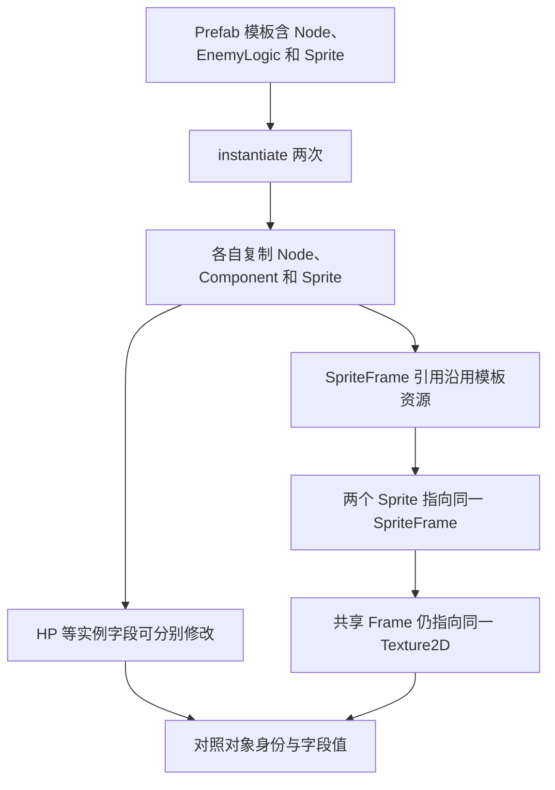

# 第 18 课：组件副本与共享资源引用

**问题：** Prefab 实例化后，哪些对象是实例私有的，哪些资源仍被多个实例引用？

## 流程图

## 观察步骤

- 两次实例化同一模板：Node、`EnemyLogic`、Sprite 与 Body 子节点各自独立。
- 只把 EnemyA 的 HP 改为 60；EnemyB 仍为 100。
- 两个 Sprite 的 `spriteFrame` 指向同一 Frame，Frame 又指向同一 Texture2D 记录；页面显示该 Frame 算出的 UV。

## 本课必须保留的机制

Node/Component/Sprite 实例分别创建；Prefab 复制资源引用时，SpriteFrame/Asset 不深拷贝，而由多个 Sprite 共享。改变 A 的简单组件字段不改变 B 的字段。

## 最小观察宿主

两份 detached Prefab 实例和页面文本；用一个内存对象只提供 texture URL/宽高，让 SpriteFrame 计算 rect 对应的 UV。无需图片、Scene、Director、AssetManager 或 GPU。

## Creator 2.4.15 源码对照

- [instantiate.js](../../engine/2.4.15engine/cocos2d/core/platform/instantiate.js#L223-L299)：递归克隆普通对象并保留 `cc.Asset` 引用。
- [CCPrefab.js](../../engine/2.4.15engine/cocos2d/core/assets/CCPrefab.js#L167-L199)：Prefab 的实例化路径。
- [CCSpriteFrame.js](../../engine/2.4.15engine/cocos2d/core/assets/CCSpriteFrame.js#L62-L65)：SpriteFrame 是 Asset；[CCSprite.js](../../engine/2.4.15engine/cocos2d/core/components/CCSprite.js#L195-L212) 持有 `spriteFrame`。

## 模型化简化与 Creator Runtime 边界

本课的 `CCNode._instantiate()` 手工复制组件和 Sprite，并把 `spriteFrame` 引用赋给新 Sprite；`EnemyLogic` 只演示数字字段，不覆盖嵌套对象、数组或序列化。内存 Texture2D 记录只满足本地 SpriteFrame 读取 URL/尺寸，不是 Creator 资产加载。课程 Sprite 现在只保存 SpriteFrame 引用，不依赖 assembler/RenderComponent；本地内存 Texture2D 仅用于 UV 计算，未加载图片、创建 WebGL context、上传纹理或 draw；这不是完整 Runtime Prefab/AssetManager/Renderer 链路。

## 运行

~~~sh
deno task check
deno task build
deno task serve
~~~
