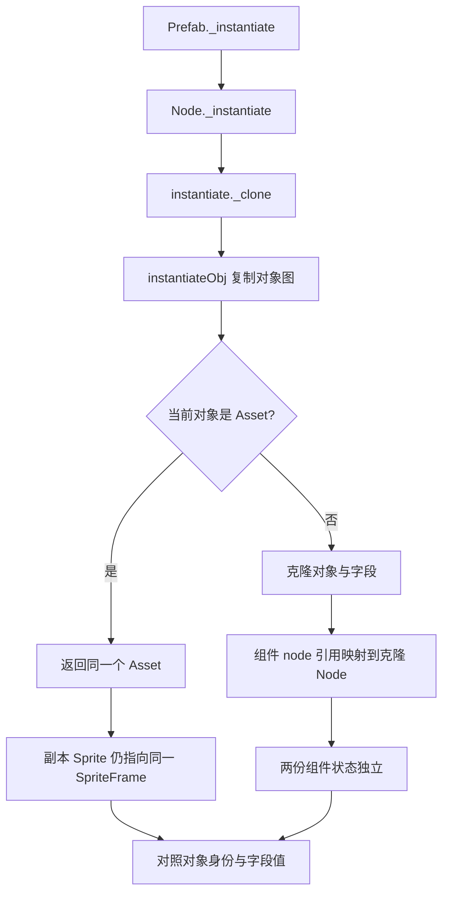

# 第 18 课：组件副本与共享资源引用

**问题：** Prefab 实例化后，哪些对象是实例私有的，哪些资源仍被多个实例引用？

## 流程图

## 观察步骤

- 两次实例化同一模板：Node、`EnemyLogic`、Sprite 与 Body 子节点各自独立。
- 只把 EnemyA 的 HP 改为 60；EnemyB 仍为 100。
- 两个 Sprite 的 `spriteFrame` 指向同一 Frame，Frame 又指向同一 Texture2D 记录；页面显示该 Frame 算出的 UV。

## 本课必须保留的机制

保留 `Prefab._instantiate → Node._instantiate → instantiate._clone → instantiateObj` 的职责链。组件和 Sprite 都是 Component，因此随 Node 对象图克隆；组件的 `node` 引用通过对象映射指向克隆 Node。遇到 `cc.Asset` 时直接复用原对象，因此两个 Sprite 可以共享同一个 SpriteFrame/Texture2D。修改 A 的组件字段不改变 B。

## 最小观察宿主

两份 detached Prefab 实例和页面文本；用一个内存对象只提供 texture URL/宽高，让 SpriteFrame 计算 rect 对应的 UV。无需图片、Scene、Director、AssetManager 或 GPU。

## Creator 2.4.15 源码对照

- [CCPrefab.js](../../engine/2.4.15engine/cocos2d/core/assets/CCPrefab.js#L167-L199)：Prefab 选择实例化路径并调用模板节点。
- [base-node.js](../../engine/2.4.15engine/cocos2d/core/utils/base-node.js#L1178-L1204)：Node 通过通用 `_clone` 建立副本，重置根 parent 并初始化。
- [instantiate.js](../../engine/2.4.15engine/cocos2d/core/platform/instantiate.js#L123-L217)：`doInstantiate`/`enumerateObject` 复制对象图并维护临时对象映射。
- [instantiate.js](../../engine/2.4.15engine/cocos2d/core/platform/instantiate.js#L223-L299)：`instantiateObj` 对 Asset、Node、Component、数组和其他对象分支处理。
- [CCSpriteFrame.js](../../engine/2.4.15engine/cocos2d/core/assets/CCSpriteFrame.js#L62-L65)：SpriteFrame 继承 Asset；[CCSprite.js](../../engine/2.4.15engine/cocos2d/core/components/CCSprite.js#L195-L212) 中 Sprite 组件持有 `spriteFrame`。

## 模型化简化与 Creator Runtime 边界

本课把克隆职责放在 `instantiate._clone()` / `instantiateObj()`，Node 与 Prefab 只负责调用该路径；Asset 在克隆器中直接返回原引用。为突出组件/资源所有权，仍省略 Creator 的 `cc.Class` 属性白名单、ValueType 专用复制、销毁对象过滤、完整 `_onBatchCreated`、Prefab JIT 和编辑器同步。Texture2D 仅是 URL/尺寸记录，不加载图片或创建 GPU 资源；本课不运行完整 AssetManager/Renderer Runtime。

## 运行

~~~sh
deno task check
deno task build
deno task serve
~~~
