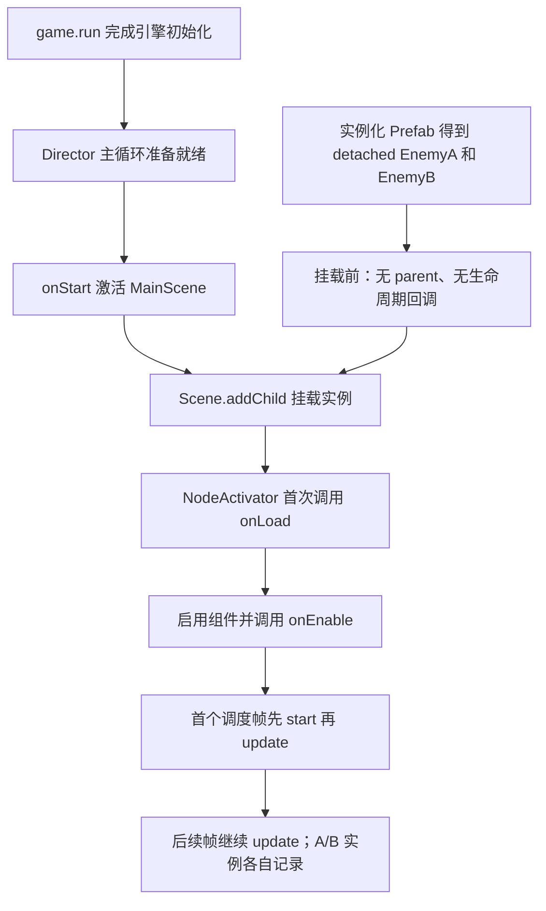

# 第 19 课：实例挂载与组件生命周期

**问题：** 为什么 Prefab 实例化之后没有生命周期回调，挂入活动场景后才有？

## 流程图

## 观察步骤

页面先保存实例化后的快照：parent 为 `null`、Node.active 为 true、activeInHierarchy 为 false、组件 enabled 为 true、enabledInHierarchy 为 false、回调为空。随后加入活动 Scene：观察 `onLoad → onEnable`；首个调度帧再观察 `start → update`。A/B 是独立组件实例。

## 本课必须保留的机制

- `instantiate` 只复制对象，不等同于 `addChild`。
- Node 是否处于活动层级与 Component 自己的 enabled 状态是两组条件；组件进入活动层级时首次 `onLoad` 只调用一次。
- 只有启用的组件进入调度并收到 `onEnable`；首次调度先 `start` 再第一次 `update`。

## 最小观察宿主

一个 Scene、最小 Game/Director 帧循环、两个带同一简单组件的 Prefab 实例，以及一个显示“挂载前快照 / 挂载后实时日志”的文本区。无需按钮、Sprite、贴图或渲染器。

## Creator 2.4.15 源码对照

- [instantiate.js](../../engine/2.4.15engine/cocos2d/core/platform/instantiate.js#L223-L299)：实例化普通数据对象。
- [node-activator.js](../../engine/2.4.15engine/cocos2d/core/node-activator.js#L313-L350)：首次 onLoad 与启用组件激活；[component-scheduler.js](../../engine/2.4.15engine/cocos2d/core/component-scheduler.js#L404-L450) 管理 enable 调度。
- [component-scheduler.js start/update 阶段](../../engine/2.4.15engine/cocos2d/core/component-scheduler.js#L475-L515)：start 在 update 前。
- [CCDirector.js](../../engine/2.4.15engine/cocos2d/core/CCDirector.js#L880-L905)：真实帧阶段顺序与渲染位置。

## 模型化简化与 Creator Runtime 边界

课程只保留 activeInHierarchy、Component.enabled/enabledInHierarchy 与 onLoad/onEnable/start/update 关系；不含序列化、编辑器状态、完整异步加载和复杂调度队列。课程 Director 不渲染；页面的 `EVENT_AFTER_FRAME` 是课程观察信号，不是“实例挂载”的 Creator Runtime API。节点停用/组件独立禁用与销毁队列分别在第 20、21 课观察。

## 运行

~~~sh
deno task check
deno task build
deno task serve
~~~
