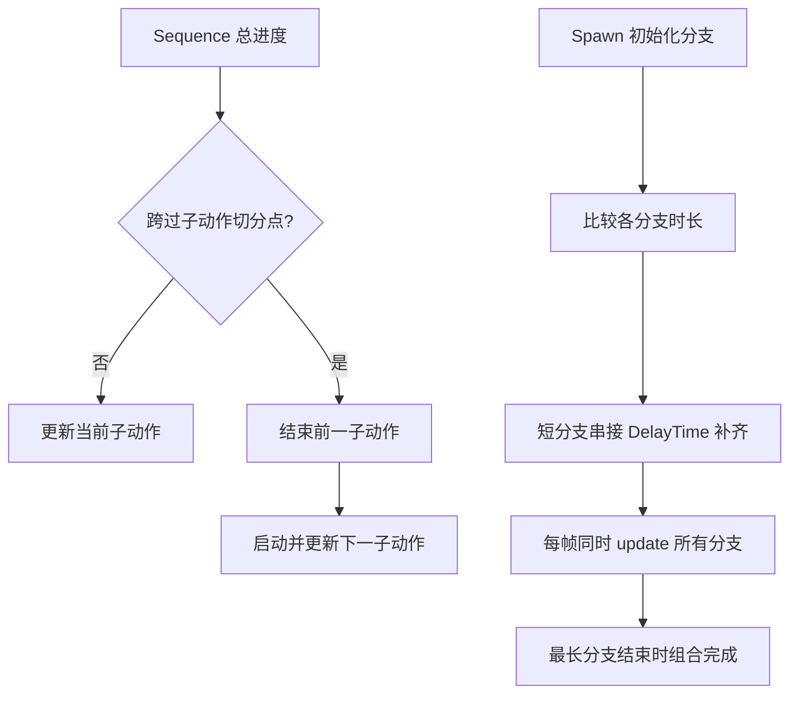

# 第 33 课：串行与并行动作

**目标：** 看懂 `Sequence` 如何按时间切分子动作，以及 `Spawn` 如何并行运行并等待较长分支结束。

## 本课内容

`Spawn` 同时运行两条分支：短分支等待 0.25 秒，长分支等待 0.50 秒。短分支完成时只触发自己的回调；并行组结束后，外层 `Sequence` 才触发最后一个回调。

`Sequence` 将总进度按子动作时长切分；`Spawn` 的持续时间取最长分支，并给较短分支串接一个 `DelayTime` 补齐时长。

## 源码位置

- 引擎 `engine/2.4.15engine/cocos2d/actions/CCActionInterval.js`：[Sequence 计算切分点](../../engine/2.4.15engine/cocos2d/actions/CCActionInterval.js#L364)、[按切分点更新子动作](../../engine/2.4.15engine/cocos2d/actions/CCActionInterval.js#L378)、[Spawn 给短分支补时](../../engine/2.4.15engine/cocos2d/actions/CCActionInterval.js#L777)。
- 引擎 `engine/2.4.15engine/cocos2d/actions/tween.js`：[sequence](../../engine/2.4.15engine/cocos2d/actions/tween.js#L597) 和 [parallel](../../engine/2.4.15engine/cocos2d/actions/tween.js#L609) 链式入口；`parallel` 包装 `cc.spawn`。
- 本课实现：[动作基类](src/cocos2d/actions/CCAction.ts)、[即时动作](src/cocos2d/actions/CCActionInstant.ts)、[间隔与组合动作](src/cocos2d/actions/CCActionInterval.ts)、[演示入口](src/main.ts)。

本课直接构造 `Sequence` / `Spawn`，便于观察引擎动作层；省略 Tween 链式包装、缓动、重复、反向和完整的停止/清理逻辑。

## 运行

需要 Node 22.13+；脚本使用 Node 内置 TypeScript 类型擦除。

~~~sh
deno task check
deno task build
deno task serve
~~~

打开 <http://localhost:8000>。

## 为什么这样设计

组合动作把调度策略做成 Action 本身。`Sequence` 在一个总时长里切分子动作；`Spawn` 统一分支时长，让管理器仍只需更新一个组合动作。

## 源码流程图

## 本课必须保留的机制

- `Sequence` 按时长切分串行进度；`Spawn` 并行运行分支，并用 `DelayTime` 补齐较短分支。

## 最小观察宿主

- 页面上的串行/并行时间线与帧进度显示各分支何时开始、结束。

## 模型化简化与 Creator Runtime 边界

- 直接组合动作类；未实现完整 Tween 包装、easing、repeat、stop 与生命周期清理。
