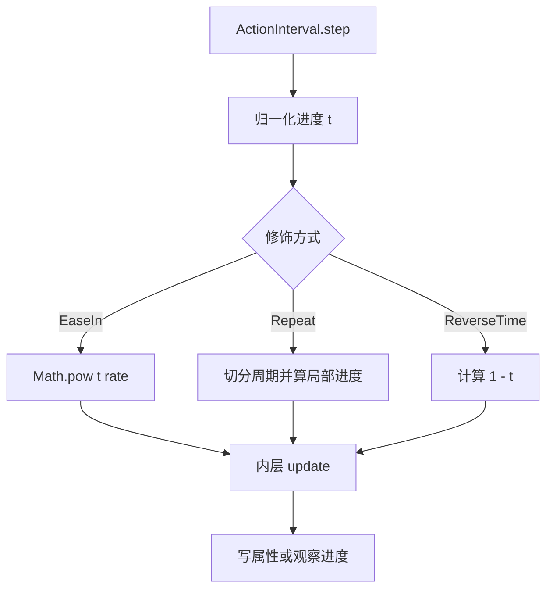

# 第 34 课：缓动、重复与反向时间

**本课问题：** 间隔动作的归一化进度，如何被动作包装器或 Tween 缓动配置改写？

## 观察结果

页面同时运行四条动作：线性进度、t² EaseIn、把 0.4 秒动作重复三次，以及将内层进度映射为 1 - t 的 ReverseTime。总进度为 0.5 时，线性值为 0.5，EaseIn 为 0.25；Repeat 同时显示当前轮次和该轮局部进度。

## 源码位置

- `engine/2.4.15engine/cocos2d/actions/CCActionEase.js`：[`cc.easeIn(rate)`](../../engine/2.4.15engine/cocos2d/actions/CCActionEase.js#L43) 计算 `Math.pow(dt, rate)`。
- `engine/2.4.15engine/cocos2d/actions/tween.js`：[`TweenAction.update(t)`](../../engine/2.4.15engine/cocos2d/actions/tween.js#L85) 先映射 easing，再插值目标属性。
- `engine/2.4.15engine/cocos2d/actions/CCActionInterval.js`：[`Repeat.update`](../../engine/2.4.15engine/cocos2d/actions/CCActionInterval.js#L546) 切分子动作周期；[`ReverseTime.update`](../../engine/2.4.15engine/cocos2d/actions/CCActionInterval.js#L2491) 传入 `1 - dt`。

本课代码：[进度动作](src/cocos2d/actions/CCProgressAction.ts)、[重复与反向包装器](src/cocos2d/actions/CCActionInterval.ts)、[演示入口](src/main.ts)。

## 简化范围

进度动作只把收到的进度写入页面条形图；引擎 TweenAction 实际处理对象属性、逐属性 easing 和 progress。本课只保留 Repeat 对间隔动作的时间切分，省略即时动作、克隆、反向复制、引用计数和完整停止流程。暂停、停止及节点离场清理属于动作管理器与节点生命周期，本课只研究进度映射。

## 运行

需要 Deno 和 Node.js 22.13 或更新版本。在本目录执行：

~~~sh
deno task check
deno task build
deno task serve
~~~

打开 <http://localhost:8000>。

## 为什么这样设计

把时间变换封装为动作修饰器，可以复用同一个间隔动作并组合不同节奏，而不必在业务属性更新代码里重复实现 easing、循环或反向逻辑。

## 源码流程图

## 本课必须保留的机制

- 修饰器把归一化进度映射为 easing、重复局部进度或反向时间进度。

## 最小观察宿主

- 页面进度条随动作推进显示 Linear、EaseIn、Repeat 和 Reverse 的差异。

## 模型化简化与 Creator Runtime 边界

- 仅演示标量进度变换；未实现完整 Tween 属性复制、引用计数、停止与组合更新路径。
