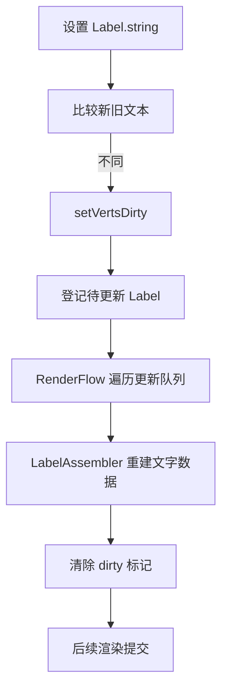

# 第 38 课：Label 文本更新

**本课问题：** 修改 `Label.string` 后，文本何时进入可绘制数据？

## 观察结果

页面先显示 `Score 9`。点击按钮后，Creator 2.4 Web 路径把 Label 标记为待更新；RenderFlow 再调用 assembler，更新文本和示意宽度。固定字宽只是教学模型，不是引擎字体测量。

## 源码位置

- [CCLabel.string](../../engine/2.4.15engine/cocos2d/core/components/CCLabel.js#L208)：字符串变化后调用 `setVertsDirty`。
- [CCLabel.setVertsDirty](../../engine/2.4.15engine/cocos2d/core/components/CCLabel.js#L671)：Web 路径继续标记组件更新。
- [RenderFlow 更新数据](../../engine/2.4.15engine/cocos2d/core/renderer/render-flow.js#L52)：调用 assembler 更新并清除更新标记。

本课代码按源码职责拆分：[CCLabel](src/cocos2d/core/components/CCLabel.ts)、[RenderFlow](src/cocos2d/core/renderer/render-flow.ts)、[LabelAssembler](src/cocos2d/core/renderer/label-assembler.ts)、[入口](src/main.ts)。

## 简化范围

只保留 Web 路径的字符串变更、dirty 标记和 assembler 刷新。省略字体资源、字形缓存、顶点缓冲和 Canvas/WebGL 提交；本地网页用 DOM 展示状态，不是 Creator 引擎运行时。

## 运行

需要 Deno 和 Node.js 22.13 或更新版本。在本目录执行：

~~~sh
deno task check
deno task build
deno task serve
~~~

打开 <http://localhost:8000>。

## 为什么这样设计

Label 的文本属性与 GPU 顶点数据分开维护。字符串变化先标脏，渲染阶段再重建文字几何，避免业务代码直接操作底层缓冲，也避免无变化时重复生成顶点。

## 源码流程图

## 本课必须保留的机制

- 修改 `Label.string` 标记渲染数据脏；RenderFlow 后续调用 assembler 重建文字顶点数据。

## 最小观察宿主

- 文本输入框改变字符串，页面显示脏状态和模拟的刷新结果。

## 模型化简化与 Creator Runtime 边界

- 固定字宽与 DOM 文本只用于观察更新时机；没有字体/字形缓存、RenderData 缓冲或 Canvas/WebGL 绘制。
