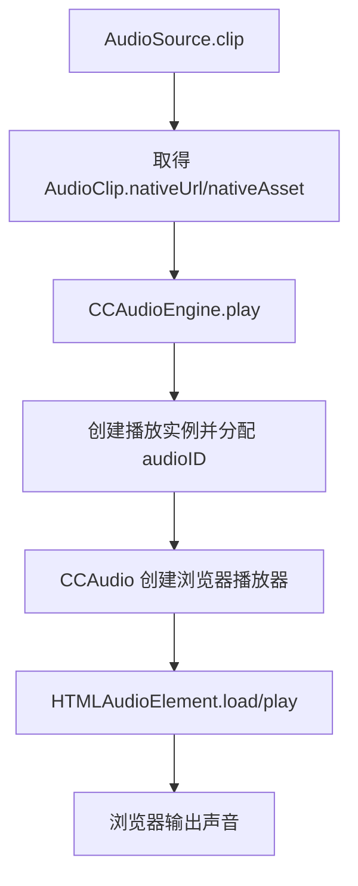

# 第 40 课：AudioClip 进入浏览器音频引擎

**本课问题：** 一个 AudioClip 怎样从引擎入口到达浏览器播放器？

## 观察结果

点击播放后，AudioClip 的 nativeUrl 交给音频引擎；引擎建立音频实例，再由浏览器 HTMLAudioElement 读取文件并播放。

## 源码位置

- [CCAudioSource.clip setter](../../engine/2.4.15engine/cocos2d/core/components/CCAudioSource.js#L93) / [play](../../engine/2.4.15engine/cocos2d/core/components/CCAudioSource.js#L253)：组件把 AudioClip 设为内部音频对象的 src，再配置并播放。
- [cc.audioEngine.play](../../engine/2.4.15engine/cocos2d/audio/CCAudioEngine.js#L153)：从 AudioClip 取得 nativeUrl，创建音频实例并确保资源已加载。
- [CCAudio 浏览器实现](../../engine/2.4.15engine/cocos2d/audio/CCAudio.js#L127)：根据 AudioClip 的 nativeAsset 建立 HTMLAudioElement 或 WebAudioElement。
- [AudioClip.nativeAsset](../../engine/2.4.15engine/cocos2d/core/assets/CCAudioClip.js#L67)：保存解码后的浏览器音频数据。

本课代码：[AudioClip](src/cocos2d/core/assets/CCAudioClip.ts)、[浏览器音频实例](src/cocos2d/audio/CCAudio.ts)、[音频引擎入口](src/cocos2d/audio/CCAudioEngine.ts)、[页面入口](src/main.ts)。

## 简化范围

示例使用一个短 WAV 和 HTMLAudioElement；省略资源管理器、解码模式选择、音频实例池、状态同步与 native 平台替换。实际播放由按钮点击触发，符合浏览器的用户手势限制。

## 运行

~~~sh
deno task check
deno task build
deno task serve
~~~

打开 http://127.0.0.1:8000，点击“播放 AudioClip”。

## 为什么这样设计

AudioClip 保存资源侧的浏览器音频数据/地址，AudioSource 和 audioEngine 负责播放控制，底层播放器负责浏览器 API。拆层后可以替换浏览器或原生后端而保留上层组件接口。

## 源码流程图

## 本课必须保留的机制

- AudioClip 的 `nativeUrl` 交给 `audioEngine`，浏览器端由 HTMLAudioElement 发起实际播放。

## 最小观察宿主

- 用户点击按钮播放课程内的短 WAV，并观察播放调用链。

## 模型化简化与 Creator Runtime 边界

- 浏览器音频是真实输出，但 HTMLAudioElement 替代引擎后端；未实现资源管理、解码模式、实例池或 native 平台。
