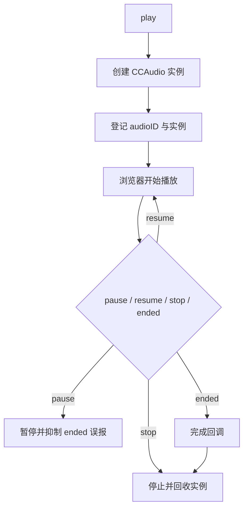

# 第 41 课：音频播放生命周期

**本课问题：** 音频开始后，怎样暂停、恢复、停止，并识别自然播放结束？

## 观察结果

点击播放会得到 audioID。暂停和恢复都用这个 ID；停止会回收实例；短音频自然结束时触发完成回调并从活动实例表移除。

## 源码位置

- [cc.audioEngine.play](../../engine/2.4.15engine/cocos2d/audio/CCAudioEngine.js#L153) 创建音频实例并返回 ID。
- [setFinishCallback 与 ended 处理](../../engine/2.4.15engine/cocos2d/audio/CCAudioEngine.js#L86) 连接浏览器结束事件和完成回调。
- [getState](../../engine/2.4.15engine/cocos2d/audio/CCAudioEngine.js#L292)、[pause](../../engine/2.4.15engine/cocos2d/audio/CCAudioEngine.js#L333)、[resume](../../engine/2.4.15engine/cocos2d/audio/CCAudioEngine.js#L371)、[stop](../../engine/2.4.15engine/cocos2d/audio/CCAudioEngine.js#L403) 按 ID 管理播放实例。
- [CCAudio.pause/resume/stop](../../engine/2.4.15engine/cocos2d/audio/CCAudio.js#L182) 操作底层播放器；暂停时会临时解绑结束事件，避免把暂停误判为播放完成。

独立代码：[页面入口](src/main.ts)、[CCAudioEngine](src/cocos2d/audio/CCAudioEngine.ts)、[CCAudio](src/cocos2d/audio/CCAudio.ts) 和本课短 WAV。

## 简化范围

示例用 HTMLAudioElement 展示一个实例的状态与结束回调；省略音频池、全局音量、批量控制和 WebAudio 后端。浏览器播放由按钮点击触发。

## 运行

~~~sh
deno task check
deno task build
deno task serve
~~~

打开 http://127.0.0.1:8000，点击播放后试用暂停、恢复和停止。

## 为什么这样设计

一次播放实例用 `audioID` 标识，让暂停、恢复、停止和自然结束都作用于同一实例；结束回调负责把实例从活动表移除，避免组件只能操纵全局播放器。

## 源码流程图

## 本课必须保留的机制

- `audioID` 关联一次播放实例；暂停、恢复、停止及浏览器 `ended` 回调驱动该实例状态。

## 最小观察宿主

- 一条 HTMLAudioElement 音轨和播放/暂停/恢复/停止按钮显示单实例生命周期。

## 模型化简化与 Creator Runtime 边界

- 仅使用浏览器单实例，不含 Creator 音频池、全局音量、多实例管理或 WebAudio 后端。
