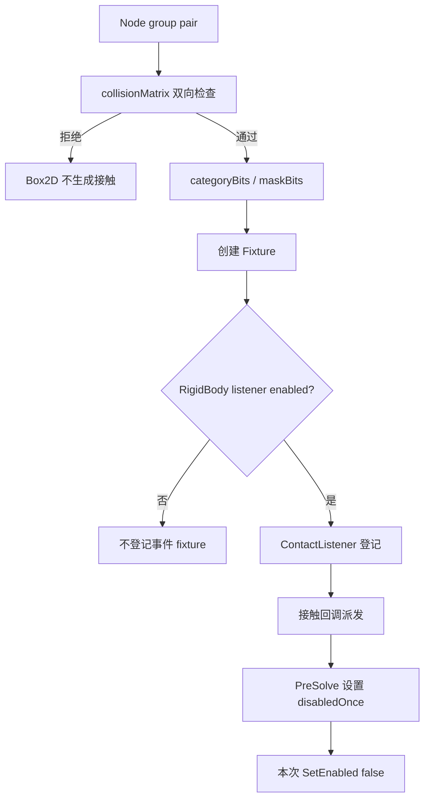

# 第 45 课：碰撞分组、接触回调与响应

**本课问题：** 哪些碰撞会进入物理世界，什么条件下脚本能收到接触，以及如何临时跳过碰撞响应？

## 观察结果

Creator 2.4 把节点分组转换成 Box2D 的 `categoryBits` 和 `maskBits`。碰撞矩阵先过滤不允许的组合；启用 `RigidBody.enabledContactListener` 后，Collider 的 fixture 才登记到接触监听器。`onPreSolve` 可设置 `contact.disabledOnce`，只跳过当前步的求解。

## 源码位置

- [PhysicsCollider 从节点组和碰撞矩阵生成 fixture filter](../../engine/2.4.15engine/cocos2d/core/physics/collider/CCPhysicsCollider.js#L179)；[只为启用监听的刚体登记 fixture](../../engine/2.4.15engine/cocos2d/core/physics/collider/CCPhysicsCollider.js#L210)。
- [PhysicsManager 安装 Box2D 接触监听器](../../engine/2.4.15engine/cocos2d/core/physics/CCPhysicsManager.js#L421)；[监听器只报告登记过的 fixture](../../engine/2.4.15engine/cocos2d/core/physics/platform/CCPhysicsContactListner.js#L47)。
- [PhysicsContact.emit 派发到刚体节点上的脚本回调](../../engine/2.4.15engine/cocos2d/core/physics/CCPhysicsContact.js#L342)；[disabledOnce 在 PreSolve 后转为本步 SetEnabled(false)](../../engine/2.4.15engine/cocos2d/core/physics/CCPhysicsContact.js#L390)。

独立代码：[刚体监听开关与回调](src/cocos2d/core/physics/CCRigidBody.ts)、[碰撞器 filter](src/cocos2d/core/physics/collider/CCPhysicsCollider.ts)、[接触对象](src/cocos2d/core/physics/CCPhysicsContact.ts)、[PhysicsManager](src/cocos2d/core/physics/CCPhysicsManager.ts) 和 [浏览器入口](src/main.ts)。

## 简化范围

浏览器样例按源码顺序模拟一次接触，不运行 Box2D、重力或几何检测。碰撞矩阵、监听 fixture 登记、回调派发和单步禁用仍按 Creator 2.4 的职责划分实现。

## 运行

~~~sh
deno task check
deno task build
deno task serve
~~~

打开 http://127.0.0.1:8000，观察双向矩阵通过后才派发回调，且 `disabledOnce` 只阻止本步响应。

## 为什么这样设计

碰撞资格、事件订阅和碰撞响应分开管理：过滤器减少不需要的接触；只为订阅者登记 fixture；PreSolve 提供仅影响当前时间步的响应控制。

## 源码流程图

## 本课必须保留的机制

- collisionMatrix 双向过滤、fixture contact listener 登记、接触回调派发以及 `disabledOnce` 的单步效应。

## 最小观察宿主

- 页面预设的一对 Collider 和一次模拟接触展示矩阵判断与回调结果。

## 模型化简化与 Creator Runtime 边界

- 仅模拟一次接触报告；不运行 Box2D 几何碰撞、接触生成或 PreSolve 求解。
