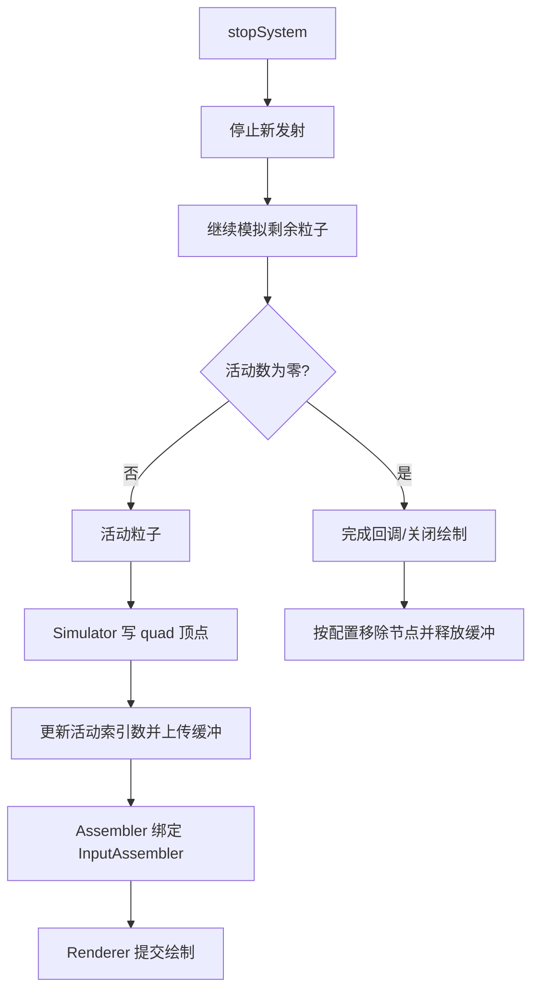

# 第 49 课：粒子绘制与结束

**本课问题：** 粒子状态怎样变成绘制数据？停止发射后，已有粒子何时结束并清理？

## 观察结果

Simulator 把每个活动粒子写成四边形顶点，更新索引数量并上传顶点缓冲；Assembler 再把 InputAssembler 提交给 Renderer。`stopSystem` 只停止新发射，已有粒子继续模拟；活动数归零后调用完成回调，关闭绘制并按配置移除节点、销毁缓冲。

## 源码位置

- [Simulator 设置活动索引数并上传缓冲](../../engine/2.4.15engine/cocos2d/particle/particle-simulator.js#L450)；[无活动粒子时检测结束](../../engine/2.4.15engine/cocos2d/particle/particle-simulator.js#L456)；[Assembler 提交 InputAssembler](../../engine/2.4.15engine/cocos2d/particle/particle-system-assembler.js#L59)。
- [stopSystem](../../engine/2.4.15engine/cocos2d/particle/CCParticleSystem.js#L962)；[模拟结束、关闭渲染和自动移除](../../engine/2.4.15engine/cocos2d/particle/CCParticleSystem.js#L1268)；[销毁时释放缓冲](../../engine/2.4.15engine/cocos2d/particle/CCParticleSystem.js#L924)。

独立代码：[ParticleSystem](src/cocos2d/particle/CCParticleSystem.ts)、[顶点缓冲与 Assembler](src/cocos2d/particle/particle-renderer.ts)、[Simulator](src/cocos2d/particle/particle-simulator.ts) 和 [浏览器入口](src/main.ts)。

## 简化范围

保留活动粒子到 quad、IA 计数、上传、提交和结束清理的职责；用 TypedArray 与计数器代替真实 WebGL 缓冲和绘制。停止发射后，示例继续推进剩余粒子直到清空。

## 运行

~~~sh
deno task check
deno task build
deno task serve
~~~

打开 `http://127.0.0.1:8000`，观察顶点/索引数随活动粒子变化，最后缓冲清空并标记节点移除。

## 为什么这样设计

模拟状态、顶点数据、绘制提交和系统结束各自分层。停止发射不等于立即销毁：已有粒子仍需模拟和绘制，清空后才结束并释放绘制资源。

## 源码流程图

## 本课必须保留的机制

- 活动粒子生成 quad 顶点/索引数据并提交 InputAssembler；停止发射后继续更新，全部结束才清理缓冲。

## 最小观察宿主

- 页面显示 TypedArray 缓冲数量、粒子活动状态以及停止后清理的顺序。

## 模型化简化与 Creator Runtime 边界

- TypedArray 与计数器只呈现数据流，不执行 WebGL 上传或实际 draw。
