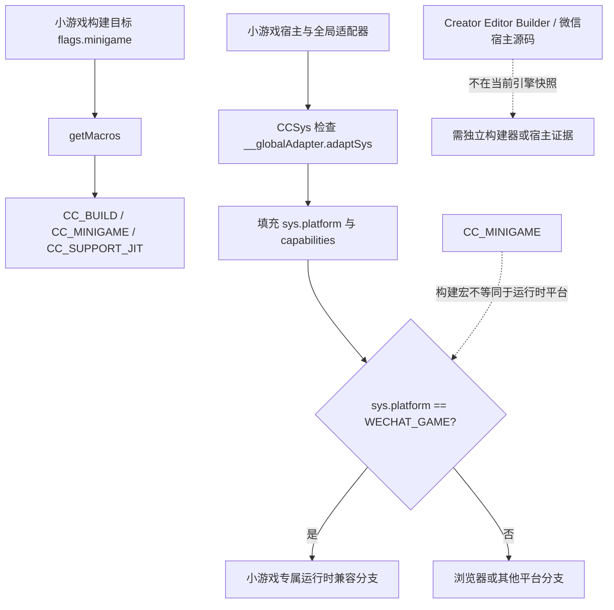

# 第 50_1 课：微信小游戏平台分支

**本课问题：** `CC_MINIGAME`、微信平台识别和小游戏运行时适配分别发生在哪一层？

## 观察结果

页面把小游戏 Release 的构建宏与运行时系统识别分开展示：`CC_MINIGAME` 是构建 flag；具体运行时平台通过 `__globalAdapter.adaptSys(sys)` 写入 `cc.sys.platform`，再用 `cc.sys.WECHAT_GAME` 判断。页面还复现一个 2.4.15 的实际兼容分支：微信 iOS 高性能模式下的 MeshBuffer 修正。

## 源码位置

- [`getMacros` 的 minigame 与 JIT flags](../../engine/2.4.15engine/gulp/util/utils.js#L8)：`CC_MINIGAME` 来自 `flags.minigame`；JIT 默认值会在 Runtime/MiniGame 下关闭。
- [`CCSys.js` 先让全局适配器填系统信息](../../engine/2.4.15engine/cocos2d/core/platform/CCSys.js#L708)：小游戏宿主适配器可以先于常规分支设置平台和能力。
- [`WECHAT_GAME` 平台枚举](../../engine/2.4.15engine/cocos2d/core/platform/CCSys.js#L365)，[`predefine.js` 的旧宏检测](../../engine/2.4.15engine/predefine.js#L124)：旧 `CC_WECHATGAME` 通过 `wx` API 探测并提示迁移到 `cc.sys.platform`。
- [MeshBuffer 的微信/iOS 兼容判断](../../engine/2.4.15engine/cocos2d/core/renderer/webgl/mesh-buffer.js#L28)：按微信平台、Apple 系统、系统高性能模式和 UA 判断。

独立代码：[小游戏构建宏](src/cocos2d/core/WechatBuildProfile.ts)、[Sys 适配入口](src/cocos2d/core/CCSys.ts)、[MeshBuffer 兼容判断](src/cocos2d/core/renderer/MeshBufferCompatibility.ts) 和 [页面入口](src/main.ts)。

## 为什么这样设计

编译宏用于构建期裁剪和常量分支；`cc.sys.platform` 表示运行时实际平台；`__globalAdapter` 则把小游戏宿主的系统信息接到引擎接口。它们分层后，普通 Web、微信小游戏和不同宿主的能力差异不会被误写成同一个“平台开关”。

## 源码流程图

## 模型范围与证据边界

课程代码对照 2.4.15 的宏规则、Adapter 优先级及 MeshBuffer 条件，但没有调用 Creator Editor Builder，也不包含微信小游戏完整 `__globalAdapter`、开发者工具或真机宿主。因此页面输出是源码机制模型，不是小游戏包构建或运行证据。想验证包体、分包、微信 API 和真机兼容，必须用对应 Creator 2.4.15 编辑器构建并在微信开发者工具/真机运行。

## 运行

在本目录执行：

~~~sh
deno task check
deno task build
deno task serve
~~~

打开 <http://127.0.0.1:8000> 查看构建期与运行时两条路径。
