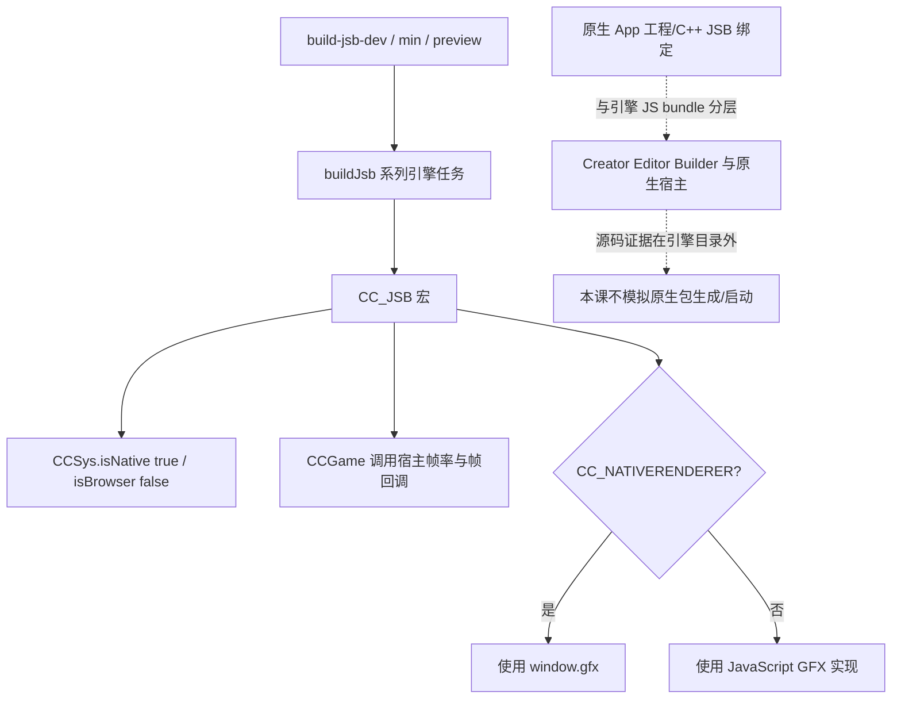

# 第 50_2 课：原生 JSB 平台

**本课问题：** 原生目标怎样从 JSB 构建任务进入引擎宏、系统识别、帧调度与渲染后端？

## 观察结果

页面对比 `build-jsb-dev`、`build-jsb-min`、`build-jsb-preview` 三个引擎任务；随后展示 `CC_JSB`、`CC_NATIVERENDERER` 如何区分 JSB 系统识别、宿主帧率入口和 GFX 设备路由。即使 `window/document` 存在，`CC_JSB=true` 时仍是 `isNative=true`、`isBrowser=false`。

## 源码位置

- [Gulp JSB 构建任务](../../engine/2.4.15engine/gulpfile.js#L67)：生成开发、压缩和预览引擎 bundle；开发/压缩任务可选 `--native-renderer`。
- [`CC_JSB` / `CC_NATIVERENDERER` 宏](../../engine/2.4.15engine/gulp/util/utils.js#L8)；[Release JSB 专用 JSC 压缩路径](../../engine/2.4.15engine/gulp/util/utils.js#L51)。
- [`CCSys.isNative` 与 `isBrowser`](../../engine/2.4.15engine/cocos2d/core/platform/CCSys.js#L654)：JSB 宏决定原生身份，不能以 DOM 全局判断 Web。
- [`CCGame` 的 JSB 帧率设置](../../engine/2.4.15engine/cocos2d/core/CCGame.js#L566) 和 [宿主 Canvas 初始化分支](../../engine/2.4.15engine/cocos2d/core/CCGame.js#L727)。
- [`gfx` 在 native renderer 与 JavaScript GFX 间选择](../../engine/2.4.15engine/cocos2d/renderer/gfx/index.js#L6)。

独立代码：[Gulp 任务模型](src/build/NativeEngineTasks.ts)、[系统身份判断](src/cocos2d/core/CCSys.ts)、[帧循环与渲染路由模型](src/cocos2d/core/NativeRuntime.ts) 和 [页面入口](src/main.ts)。

## 为什么这样设计

原生包的 JS 运行在 JSB 提供的宿主中，平台能力不等于浏览器能力。`CC_JSB` 控制 JavaScript 分支，`CC_NATIVERENDERER` 决定是否交给宿主 `window.gfx`；帧率接口也由 `jsb.setPreferredFramesPerSecond` 提供。把这几条路径分开，才能解释“有 DOM 对象但仍是原生”和“JSB 但使用 JS Renderer”这类配置。

## 源码流程图

## 模型范围与证据边界

课程代码对照引擎 Gulp 任务和 JavaScript 分支，不执行 Gulp 构建或原生 App 构建。当前引擎快照不包含完整 Creator Editor Builder、C++ JSB 绑定和原生帧回调实现；因此不能用页面模型声称已生成或启动 iOS/Android/macOS 包。跨层产物证据和已有 Mac 启动轨迹见[发布与原生研究](../../docs/2.x/10-publishing-and-native.md)。

## 运行

在本目录执行：

~~~sh
deno task check
deno task build
deno task serve
~~~

打开 <http://127.0.0.1:8000> 查看 JSB 任务和运行时分支。
