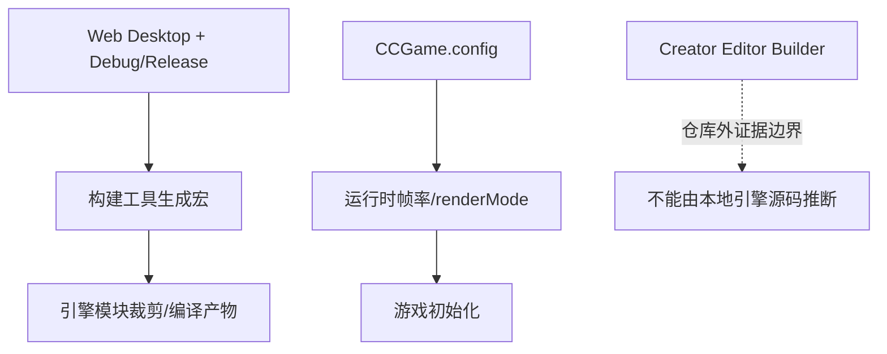

# 第 50 课：目标选择与构建入口

**本课问题：** Web 目标和 Debug/Release 模式怎样影响构建宏？它们与游戏启动参数有什么区别？

## 观察结果

课程固定目标为 Web Desktop。构建配置先决定 `CC_BUILD`、`CC_DEBUG`、`CC_JSB` 等宏；`CCGame.config` 的帧率和 `renderMode` 是运行时设置，不负责选择目标。Creator 完整 Editor Builder 不在引擎源码目录，本课不推断它的内部构建步骤。

## 源码位置

- [宏说明：构建调试/发行的条件](../../engine/2.4.15engine/predefine.js#L47)；[构建工具按平台和 flags 生成宏](../../engine/2.4.15engine/gulp/util/utils.js#L8)；[压缩选项区分发行模式](../../engine/2.4.15engine/gulp/util/utils.js#L51)。
- [CCGame 运行时配置](../../engine/2.4.15engine/cocos2d/core/CCGame.js#L198)；[默认帧率和 Web renderMode 检查](../../engine/2.4.15engine/cocos2d/core/CCGame.js#L660)；[运行环境的 isNative](../../engine/2.4.15engine/cocos2d/core/platform/CCSys.js#L654) 与 [isBrowser](../../engine/2.4.15engine/cocos2d/core/platform/CCSys.js#L660)。
- [仓库中的 Builder 证据边界](../../docs/2.x/10-publishing-and-native.md#L18)：完整 Creator Editor Builder 不在本地引擎目录。

独立代码：[目标/模式选择](src/build/build-profile.ts)、[宏生成模型](src/cocos2d/core/predefine.ts)、[运行时配置归一化](src/cocos2d/core/CCGame.ts) 和 [浏览器入口](src/main.ts)。

## 简化范围

用一个固定 Web Desktop profile 演示“目标 → 构建宏”和“启动选项”两条配置线。宏生成代码是教学模型，不调用 Creator Editor Builder，也不代表引擎包已构建。

## 运行

~~~sh
deno task check
deno task build
deno task serve
~~~

打开 `http://127.0.0.1:8000`，查看目标、宏和运行时设置分别输出。

## 为什么这样设计

构建目标和运行参数处于不同阶段：目标/模式影响构建宏，帧率和渲染模式在运行时读取。分开说明可以避免把 Editor 构建选项误当作游戏启动配置。

## 源码流程图

## 本课必须保留的机制

- Web Desktop 目标选择影响构建宏；`CCGame.config` 的帧率/renderMode 是运行时配置，不是构建目标。

## 最小观察宿主

- 页面固定展示一个 Web Desktop profile，并分别列出宏和运行时设置。

## 模型化简化与 Creator Runtime 边界

- 配置仅用于区分概念；不调用 Creator Editor Builder，也不实际生成构建产物。
