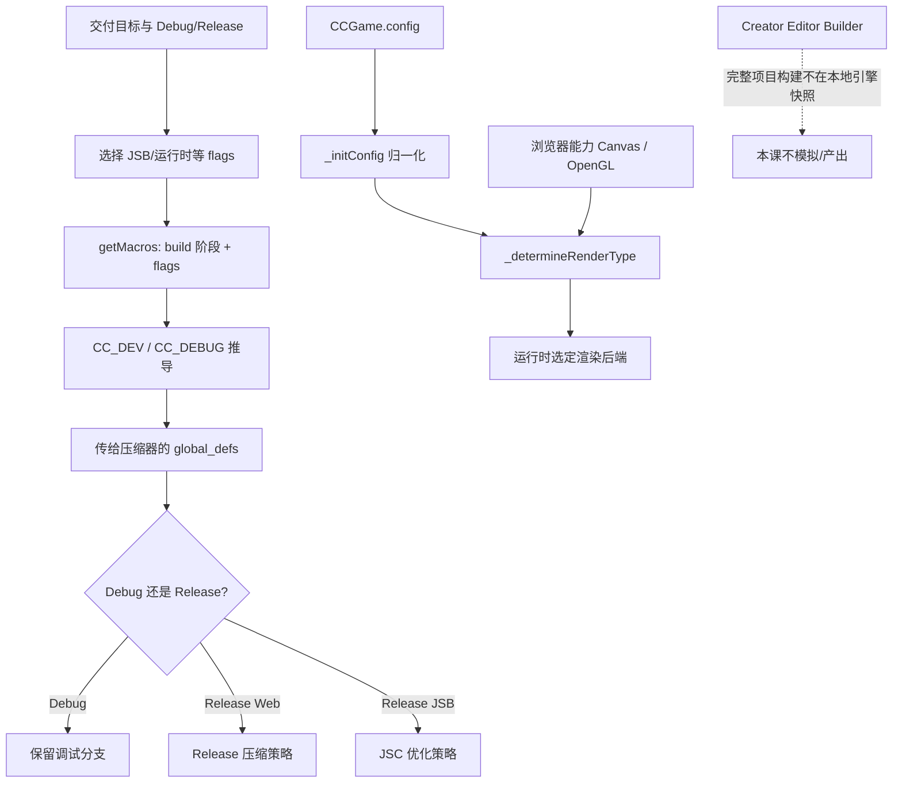

# 第 50 课：目标选择与构建入口

**本课问题：** Web 目标和 Debug/Release 模式怎样影响构建宏？它们与游戏启动参数有什么区别？

## 观察结果

页面对比 Web Desktop Debug、Web Desktop Release 和 Native JSB Debug 三组输入，逐项生成构建宏并展示调试分支是否会在压缩阶段被裁剪。另展示 Preview 阶段即使未传 `debug` flag，`CC_DEV` 仍会使 `CC_DEBUG` 为 true。最后单独归一化 `CCGame.config`，按运行环境能力将 `renderMode` 解析成 Canvas 或 WebGL。

课程把“项目交付目标”和引擎 Gulp 的 `platform` 参数分别建模：`web-desktop`/`native-jsb` 是展示用目标标识；`editor`/`preview`/`build`/`test` 才是 `getMacros()` 接收的构建阶段。Native 目标通过 `jsb` flag 影响宏。

## 源码位置

- [宏说明：构建调试/发行的条件](../../engine/2.4.15engine/predefine.js#L47)；[`getMacros` 生成阶段和 flags 宏](../../engine/2.4.15engine/gulp/util/utils.js#L8)；[`getUglifyOptions` 根据 CC_DEBUG/CC_JSB 选择压缩策略](../../engine/2.4.15engine/gulp/util/utils.js#L51)。
- [`CCGame._initConfig` 配置归一化](../../engine/2.4.15engine/cocos2d/core/CCGame.js#L654)；[`_determineRenderType` 按能力解析 renderMode](../../engine/2.4.15engine/cocos2d/core/CCGame.js#L679)。
- [仓库中的 Builder 证据边界](../../docs/2.x/10-publishing-and-native.md#L18)：完整 Creator Editor Builder 不在本地引擎目录。

独立代码：[目标/模式和压缩策略](src/build/build-profile.ts)、[宏生成](src/cocos2d/core/predefine.ts)、[运行时配置与渲染后端选择](src/cocos2d/core/CCGame.ts) 和 [对比页面入口](src/main.ts)。

## 简化范围

宏生成逻辑按本地快照 `gulp/util/utils.js:getMacros` 的宏集合、`CC_DEV/CC_DEBUG` 规则、JIT 默认值和 `CC_NATIVERENDERER` 规则建模；压缩只归纳 Debug、Web Release、JSB Release 三条策略，不调用 Terser。运行时配置实现 `_initConfig` 的关键默认值和 `_determineRenderType` 的 Canvas/WebGL 能力选择。示例不调用 Creator Editor Builder，不代表生成了 Creator 引擎包或游戏产物。

## 运行

~~~sh
deno task check
deno task build
deno task serve
~~~

打开 `http://127.0.0.1:8000`，查看目标、宏和运行时设置分别输出。

## 为什么这样设计

构建阶段宏决定哪些平台/调试分支存在，并成为压缩器的全局定义；`CCGame.config` 则在启动期归一化，再结合当前环境能力选择渲染器。把阶段、交付目标和运行配置拆开，才能看出每项设置实际在哪个阶段生效。

## 源码流程图

## 本课必须保留的机制

- 构建阶段和 flags 生成宏；`CC_DEBUG` 影响压缩分支，JSB Release 可走 JSC 专用优化。
- `CCGame.config` 运行时归一化，`renderMode` 再由平台能力决定实际 Renderer。

## 最小观察宿主

- 页面比较三个构建配置、Preview 宏和一组运行时渲染能力，输出实际决策过程。

## 模型化简化与 Creator Runtime 边界

- 宏和运行时配置按引擎源码建模，但页面不调用 Gulp/Terser/Creator Editor Builder，也不生成 Creator 构建产物。
