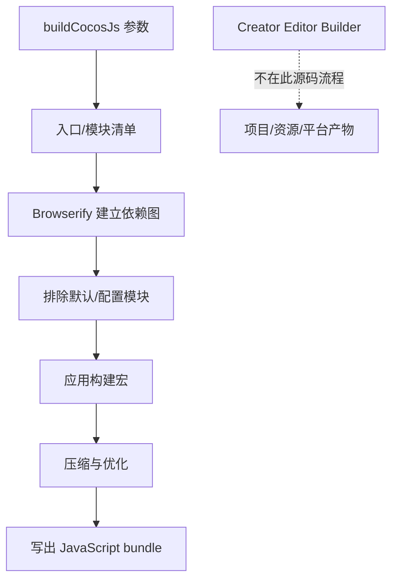

# 第 51 课：代码与引擎构建

**本课问题：** Creator 2.4 的引擎源码怎样变成 Web 运行时 JavaScript？

## 观察结果

`buildCocosJs` 接收调用方给出的入口和输出路径；Browserify 解析模块，构建器排除默认跳过项和指定模块，再用构建宏压缩代码、优化并写出 bundle。它展示的是引擎代码 bundle 流程，不是完整 Creator Editor Builder。

## 源码位置

- [`buildCocosJs` 的 bundle、宏压缩与写出](../../engine/2.4.15engine/gulp/tasks/engine.js#L108)；[默认模块排除](../../engine/2.4.15engine/gulp/tasks/engine.js#L121)；[模块排除的依赖展开](../../engine/2.4.15engine/gulp/tasks/engine.js#L499)。
- [`createBundler` 将入口交给 Browserify](../../engine/2.4.15engine/gulp/util/create-bundler.js#L150)；[构建宏定义](../../engine/2.4.15engine/gulp/util/utils.js#L8)。
- [引擎模块清单](../../engine/2.4.15engine/modules.json)；[完整 Builder 的证据边界](../../docs/2.x/10-publishing-and-native.md#L18)。

独立代码：[引擎 bundle 阶段模型](src/build/engine-bundle-plan.ts) 和 [浏览器输出](src/main.ts)。

## 简化范围

课程代码现已实现可观察的构建计划模型，而不是只打印预写阶段：`expandExcludedModules()` 按 `modules.json` 的依赖方向递归查找“依赖被排除模块”的模块，并用集合处理重复/循环；`createMacroTable()` 将 Web、debug/release、Runtime/minigame、物理后端折成 Creator 2.4 风格宏；`createEngineBundlePlan()` 把 entry、输出路径、排除文件、宏和每个 Gulp 阶段的输入/输出组织成结构化计划。页面比较 debug（含 sourcemap）和 release（无 sourcemap）两种计划。

模型记录的源码职责：`buildCocosJs` 调用 `createBundler`，套用默认/调用者排除项，执行 Browserify bundle、`Utils.uglify('build', flags)`、Optimizejs、可选 sourcemap 写出，最后 `Gulp.dest(dirname(outputFile))`。模块示例是从 `modules.json` 结构裁剪出的少量记录，不是全量模块表。

代码不运行 Browserify、Gulp 或 Creator Editor Builder，不读取本机完整 `modules.json`，也不生成引擎 bundle。默认入口是为页面观察设定的教学输入；真实 `buildCocosJs` 的入口和输出由调用方提供。完整 Editor Builder 如何选择项目入口仍在本地 Runtime 快照之外。

## 运行

~~~sh
deno task check
deno task build
deno task serve
~~~

打开 `http://127.0.0.1:8000` 查看阶段顺序。

## 为什么这样设计

引擎源码打包和 Creator Editor 项目构建不是同一责任。`buildCocosJs` 聚焦模块入口、排除规则、宏裁剪和 bundle 输出；编辑器还负责资源与项目目标等流程。

## 源码流程图

## 本课必须保留的机制

- Web 引擎构建由 Browserify 组织源码，构建宏参与裁剪，再经过压缩优化并写出 bundle。

## 最小观察宿主

- 页面分别显示 debug/release 的宏开关、反向依赖排除文件、各阶段输入/输出，以及可选 sourcemap。

## 模型化简化与 Creator Runtime 边界

- 页面运行的是构建计划模型，不运行 Browserify、Gulp 或 Creator Builder，也不会生成真实引擎 bundle。
