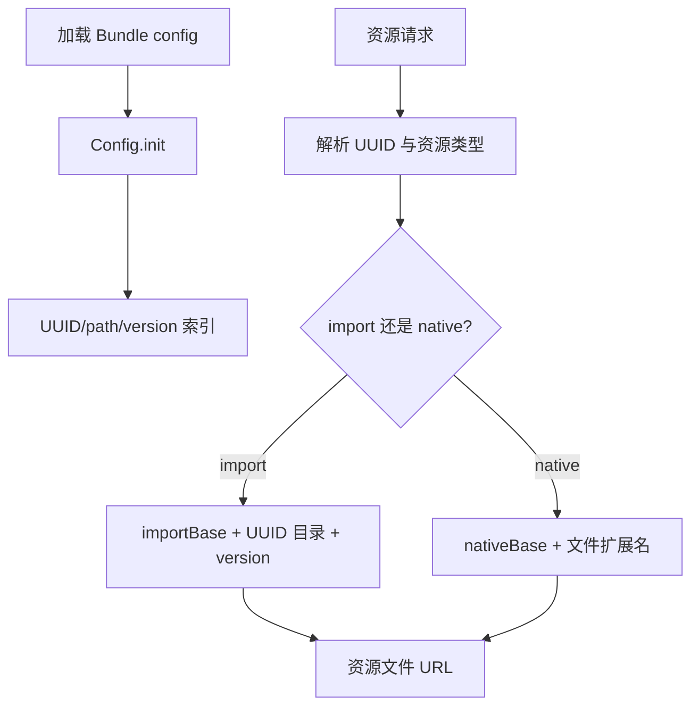

# 第 52 课：资源处理与产物结构

**本课问题：** Creator 2.4 的 Bundle 元数据怎样把资源身份映射到浏览器文件地址？

## 观察结果

Bundle 配置保存 `importBase`、`nativeBase`、UUID、路径和版本信息。运行时把已解析的 UUID 按“基址 + UUID 前两位目录 + UUID + 版本 + 扩展名”组成文件 URL；导入数据与原生资源使用不同基址和扩展名。

## 源码位置

- [`Config.init` 接收 Bundle 基址与索引表](../../engine/2.4.15engine/cocos2d/core/asset-manager/config.js#L53)；[`loadBundle` 读取 Bundle 配置与版本](../../engine/2.4.15engine/cocos2d/core/asset-manager/CCAssetManager.js#L677)。
- [`urlTransformer.combine` 选择 import/native 基址并组成 URL](../../engine/2.4.15engine/cocos2d/core/asset-manager/urlTransformer.js#L143)。
- [Creator 编辑器导入与 Bundle 构建不属于本地引擎运行时源码](../../docs/2.x/04-assets-and-loading.md#L7)。

独立代码：[Bundle 文件映射](src/asset/BundleFileLayout.ts) 和 [浏览器输出](src/main.ts)。

## 简化范围

示例用占位 UUID 和版本演示运行时 URL 规则，不声称这些是实际项目生成的文件名；不还原 `.meta` 导入、`library/` 生成或 Builder 打包步骤。

## 运行

~~~sh
deno task check
deno task build
deno task serve
~~~

打开 `http://127.0.0.1:8000` 查看 import 与 native 路径。

## 为什么这样设计

资源身份与文件 URL 分开：Bundle Config 负责把 UUID 映射到索引和版本，urlTransformer 再按 import/native 类型选基址和扩展名。这样同一身份可对应不同存储布局。

## 源码流程图

## 本课必须保留的机制

- Bundle 的 UUID 索引与版本信息参与 import/native 资源 URL 的组合。

## 最小观察宿主

- 页面使用示例 Bundle 记录显示两类路径的中间值。

## 模型化简化与 Creator Runtime 边界

- 数据是占位结构；不解析 `.meta`、library 或 Builder 产物，也不执行 Runtime 下载。
