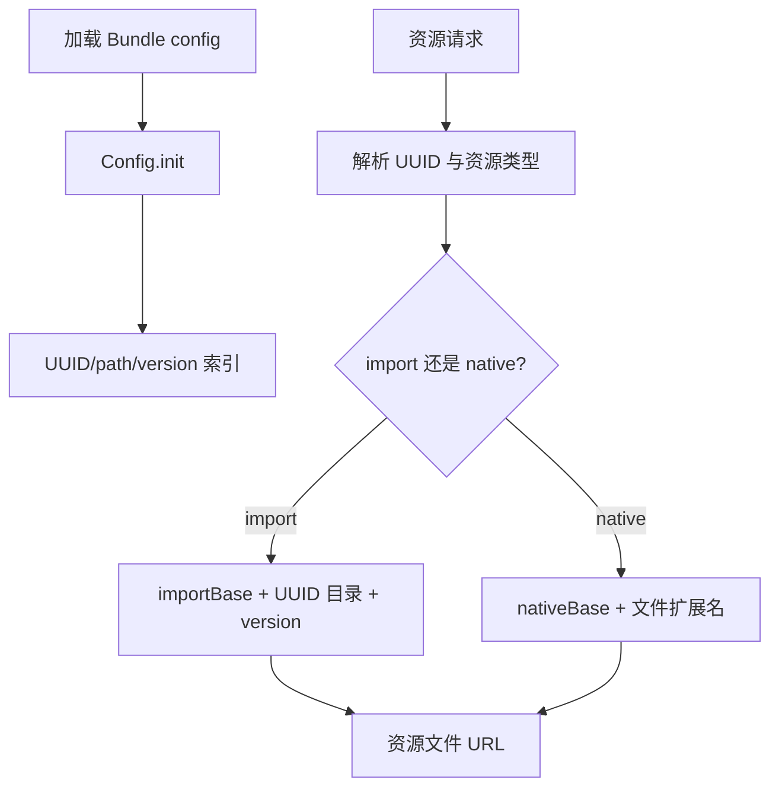

# 第 52 课：资源处理与产物结构

**本课问题：** Creator 2.4 的 Bundle 元数据怎样把资源身份映射到浏览器文件地址？

## 观察结果

Bundle 配置保存 `importBase`、`nativeBase`、UUID、路径和版本信息。运行时把已解析的 UUID 按“基址 + UUID 前两位目录 + UUID + 版本 + 扩展名”组成文件 URL；导入数据与原生资源使用不同基址和扩展名。

## 源码位置

- [`Config.init` 接收 Bundle 基址与索引表](../../engine/2.4.15engine/cocos2d/core/asset-manager/config.js#L53)；[`loadBundle` 读取 Bundle 配置与版本](../../engine/2.4.15engine/cocos2d/core/asset-manager/CCAssetManager.js#L677)。
- [`urlTransformer.combine` 选择 import/native 基址并组成 URL](../../engine/2.4.15engine/cocos2d/core/asset-manager/urlTransformer.js#L143)。
- [Creator 编辑器导入与 Bundle 构建不属于本地引擎运行时源码](../../docs/2.x/04-assets-and-loading.md#L7)。

独立代码：[Bundle 文件映射](src/asset/BundleFileLayout.ts) 和 [浏览器输出](src/main.ts)。

## 简化范围

课程代码实现 `Config.init` 的可观察子集：按 UUID 建 AssetInfo；将路径及类型写回 AssetInfo，并让同一路径的主资源优先于子资源；建立 Scene 名称索引；建立 pack 内容关系；把 import/native 版本对分别写入 `ver` 与 `nativeVer`；最后通过 `resolvePath` 和 `combineUrl` 查询。URL 组合区分 import/native 基址、版本、扩展名，并包含源码里 WeChat 对 `.ttf` 文件的特殊目录规则。页面显示索引状态和四种请求结果。

示例 UUID、class id、版本和 pack 均为教学数据，不是实际构建输出。代码没有解析 `.meta`，也不读取 `library/`、请求真实 bundle config、展开 pack JSON 或启动 Editor Builder，因此只能证明本课实现覆盖的 Runtime 索引/地址规则。

## 运行

~~~sh
deno task check
deno task build
deno task serve
~~~

打开 `http://127.0.0.1:8000` 查看 UUID/path/scene/pack/version 索引，再观察 import、native、字体和 path+type 查询的 URL。

## 为什么这样设计

资源身份与文件 URL 分开：Bundle Config 负责把 UUID 映射到索引和版本，urlTransformer 再按 import/native 类型选基址和扩展名。这样同一身份可对应不同存储布局。

## 源码流程图

## 本课必须保留的机制

- Bundle 的 UUID 索引与版本信息参与 import/native 资源 URL 的组合。

## 最小观察宿主

- 页面创建一份 BundleConfig 并显示四种查询的索引中间值与结果 URL。

## 模型化简化与 Creator Runtime 边界

- Bundle 数据是显式示例记录；代码实现 Config 索引与 URL 组合子集，但不解析 `.meta`、library/Builder 产物，也不执行 Runtime 下载。
