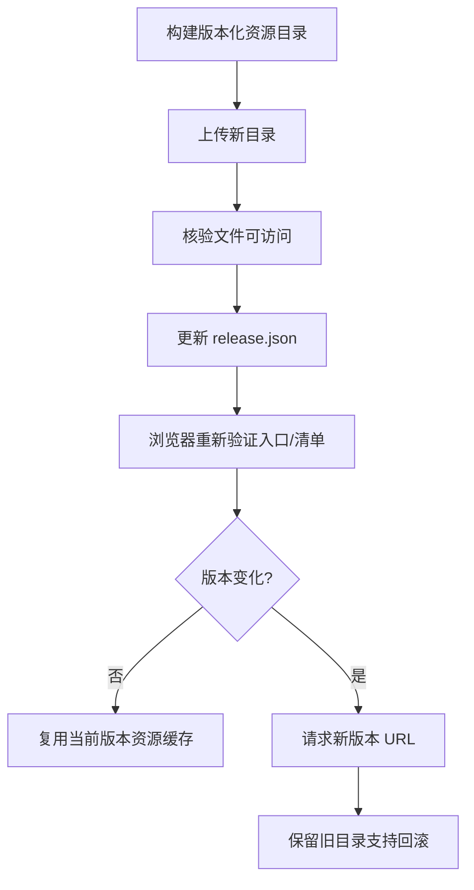

# 第 54 课：Web 缓存与版本更新

**本课问题：** 怎样让浏览器发现新版本，同时长期复用旧版本资源？

## 核心流程

本例让 `/index.html` 和 `/release.json` 使用 `Cache-Control: no-cache`：浏览器可以保存文件，但使用前要向服务器重新验证。每次发布把资源放入新的 `/releases/<版本>/` 目录，并为这些不变的 URL 设置长缓存和 `immutable`。先上传并核验新目录，再替换 `release.json`；旧目录保留用于回滚。

## 源码位置

- [Config.init 读取 Bundle 基址和版本表](../../engine/2.4.15engine/cocos2d/core/asset-manager/config.js#L53)。
- [urlTransformer.combine 组合基址、UUID、版本与扩展名](../../engine/2.4.15engine/cocos2d/core/asset-manager/urlTransformer.js#L143)。
- [Creator 发布与原生边界](../../docs/2.x/10-publishing-and-native.md#L1)：完整 Editor Builder 不在本地引擎源码中。
- 前置课：[第 52 课：资源处理与产物结构](../s52_resource_artifacts/README.md)、[第 53 课：启动与交付](../s53_startup_delivery/README.md)。

独立代码对应 `urlTransformer.ts` 的 UUID/version URL 组合；`ReleasePublishPlan` 校验 releaseId/base、要求先上传再验证所有预期文件、只允许验证通过后切换 active，并限制回滚状态转换；`CachePolicy` 单独决定入口指针和不可变资源的 HTTP 缓存策略。页面加载教学 manifest 后模拟一条资源 URL 的 publish/verify/activate/rollback 状态路径。

## 简化范围

`release.json` 和 Nginx 规则是教学用部署示例，不是 Creator 自动生成的产物。页面中的上传、验证和回滚只在内存中模拟，不访问 CDN、不修改真实部署指针，也不接入缓存清除服务。

## 运行

~~~sh
deno task check
deno task build
deno task serve
~~~

页面会读取 `release.json`，显示资源 URL、缓存策略、发布顺序和回滚目标。Nginx 示例见 [deploy/nginx.conf](deploy/nginx.conf)。

## 为什么这样设计

入口指针需要尽快发现更新，版本化资源 URL 应长期缓存。先上传并核验不可变的新目录，再切换短缓存清单，可以避免客户端读到尚未上传完整的资源。

## 源码流程图

## 本课必须保留的机制

- 入口与发布指针短缓存/不缓存，版本化资源目录长期缓存；发布清单支持切换和回滚。

## 最小观察宿主

- 页面读取教学用 `release.json` 并展示 URL、缓存策略、发布顺序和回滚目标。

## 模型化简化与 Creator Runtime 边界

- `release.json` 与 Nginx 仅示意部署设计；不接入 Editor Builder、CDN 或真实缓存清除服务。
