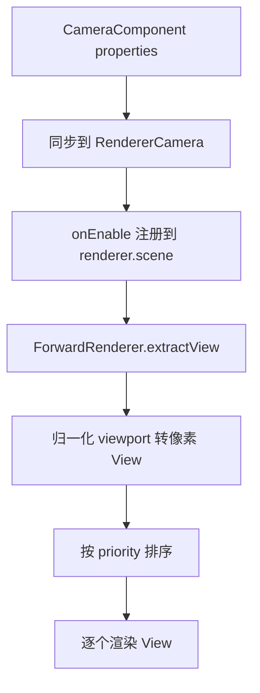

# 第 56 课：Camera 配置转成渲染 View

**本课问题：** Creator 2.4 的 CameraComponent 如何进入 WebGL 前向渲染器的一次 View 绘制？

## 本版路径

2.4 的 CameraComponent 持有 Renderer 层 Camera；初始化时同步优先级、视口、可见层和目标纹理等状态，启用后把相机加入 `renderer.scene`。ForwardRenderer 逐台相机调用 `extractView`，将归一化视口换算为像素 View，再按 priority 排序并渲染 View。

## 源码位置

- `engine/2.4.15engine/cocos2d/core/camera/CCCamera.js:581-616`：初始化 RendererCamera 并在启用时注册到 `renderer.scene`。
- `engine/2.4.15engine/cocos2d/renderer/scene/camera.js:305-373`：计算相机矩阵并把相机配置提取到 View。
- `engine/2.4.15engine/cocos2d/renderer/renderers/forward-renderer.js:57-87`：逐相机提取 View、排序并渲染。
- `engine/2.4.15engine/cocos2d/renderer/core/view.js:12-54`：View 保存优先级、视口、矩阵、Framebuffer 和裁剪掩码。
- 前置课：[第 13 课：SpriteFrame UV](../s13_sprite_frame_texture/README.md)。

## 独立代码与简化

代码镜像 2.4 的 `CameraComponent → RendererCamera → View → ForwardRenderer`。它用两个相机展示视口像素换算和 View 排序，不计算真实相机矩阵，也不创建 WebGL 上下文；目标平台仍是 Web 浏览器。

## 运行

~~~sh
deno task check
deno task build
deno task serve
~~~

打开 `http://127.0.0.1:8000/s56_camera_view/`，输出应按 `Main`、`Overlay` 顺序显示两个 View。

## 为什么这样设计

CameraComponent 只负责组件侧属性和生命周期，RendererCamera 保存渲染所需状态，View 是排序和绘制阶段的工作单元。ForwardRenderer 按 View 处理，让多相机有统一输入格式。

## 源码流程图

## 本课必须保留的机制

- CameraComponent 注册 RendererCamera，ForwardRenderer 将相机参数整理成按顺序处理的 View。

## 最小观察宿主

- 页面输出 Main 与 Overlay 两个视口的优先级和处理顺序。

## 模型化简化与 Creator Runtime 边界

- 只显示 View 组织关系；不创建真实相机矩阵、WebGL context 或完整渲染目标。
