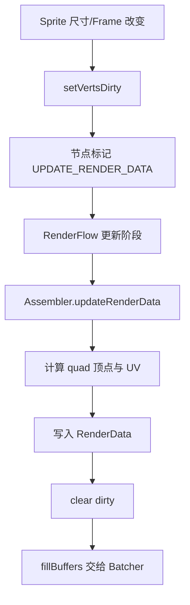

# 第 58 课：Sprite assembler 更新 RenderData

**本课问题：** Creator 2.4 的 Sprite 尺寸变化如何经过 assembler，把 quad 写入 RenderData？

## 本版路径

Sprite 和节点尺寸变化调用 RenderComponent.setVertsDirty，设置 _vertsDirty 并标记节点渲染标志。RenderFlow 看到 UPDATE_RENDER_DATA 后调用 assembler.updateRenderData；SimpleSpriteAssembler 计算四角位置、UV 并清除顶点脏标记。之后 fillBuffers 把 RenderData 交给 Batcher。本课固定 WebGL SIMPLE Sprite 路径。

## 源码位置

- engine/2.4.15engine/cocos2d/core/components/CCSprite.js:228-237、427-433、502-515：Sprite 类型、尺寸和节点尺寸事件触发顶点失效。
- engine/2.4.15engine/cocos2d/core/components/CCRenderComponent.js:84-103、122-125：初始化 assembler，并通过 setVertsDirty 标记渲染。
- engine/2.4.15engine/cocos2d/core/renderer/assembler.js:24-47：按组件类取得并初始化 assembler。
- engine/2.4.15engine/cocos2d/core/renderer/webgl/assemblers/sprite/2d/simple.js:28-35、39-85：刷新 UV 与顶点。
- engine/2.4.15engine/cocos2d/core/renderer/render-flow.js:52-57、78-82：先更新 RenderData，再调用 fillBuffers。
- engine/2.4.15engine/cocos2d/core/renderer/webgl/render-data.js:30-67：RenderData 保存网格和四边形索引。
- 前置课：第 57 课：Camera cullingMask 与绘制阶段（../s57_camera_culling_queue/README.md）。

## 独立代码与简化

目录保留 RenderComponent、Assembler、RenderFlow、RenderData 的职责路径，用固定的四顶点数据代替动态 WebGL Buffer。页面显示本帧刷新的本地顶点与索引，不创建 WebGL 上下文。

## 运行

~~~sh
deno task check
deno task build
deno task serve
~~~

打开 http://127.0.0.1:8000/。把 Sprite 尺寸改为 80 × 40 后，RenderFlow 只在顶点脏时让 assembler 重算数据。

## 为什么这样设计

RenderData 是组件几何与批处理之间的边界。属性变化只设脏，RenderFlow 在绘制前统一调 assembler 更新，避免组件 setter 同步重建顶点。

## 源码流程图

## 本课必须保留的机制

- Sprite 尺寸变化标脏；RenderFlow 在渲染更新阶段调用 assembler 更新 RenderData。

## 最小观察宿主

- 页面尺寸控件改变 Sprite 尺寸，显示脏标记和重算后的固定顶点/索引数据。

## 模型化简化与 Creator Runtime 边界

- 保留 RenderComponent/Assembler/RenderFlow/RenderData 职责但不创建 WebGL Buffer，不执行 GPU 绘制。
