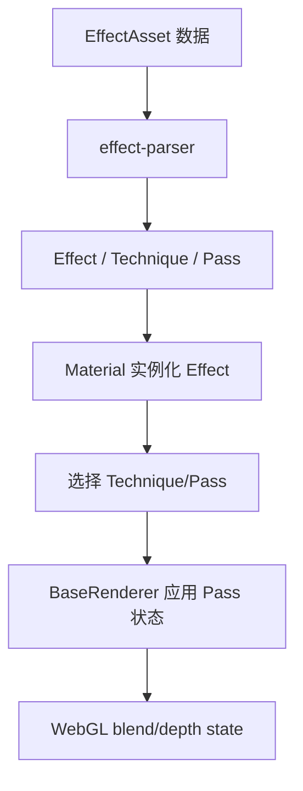

# 第 60 课：Creator 2.4 Material、Effect 与 Pass

**本课问题：** 2.4 的材质如何从 Effect 资源得到 Technique/Pass，并把 Pass 状态交给 WebGL？

## 本版渲染路径

`CCEffectAsset` 解析出 `Effect → Technique → Pass`。`Material` 持有实例化 Effect，可切换 Technique；Pass 保存混合、深度等绘制状态，渲染器在绘制前应用这些状态。本课只跟踪混合状态。

## 源码位置

- [CCEffectAsset.js](../../engine/2.4.15engine/cocos2d/core/assets/material/CCEffectAsset.js)：初始化 Effect 和创建实例。
- [effect-parser.ts](../../engine/2.4.15engine/cocos2d/core/assets/material/effect-parser.ts)：`parseTechniques`、`parseEffect` 生成 Technique 与 Pass，并读取 Pass 的 blend state。
- [CCMaterial.js](../../engine/2.4.15engine/cocos2d/core/assets/material/CCMaterial.js)：`effectAsset`、`techniqueIndex` 和 Effect 实例。
- [pass.js](../../engine/2.4.15engine/cocos2d/renderer/core/pass.js)：Pass 保存混合参数。
- [base-renderer.js](../../engine/2.4.15engine/cocos2d/renderer/core/base-renderer.js)：绘制前应用 Pass 的混合和深度状态。

## 独立代码与简化

`src/cocos2d/` 按 2.4 的资产、材质、Technique/Pass、渲染器职责拆文件。浏览器 WebGL 只执行混合状态切换并输出日志；Shader 编译、顶点输入和 draw 调用留给后续课程。

## 运行

~~~sh
deno task check
deno task build
deno task serve
~~~

打开 `http://127.0.0.1:8000/`。日志显示 EffectAsset 到 Pass 的对象关系，以及 WebGL 收到的混合状态。

## 为什么这样设计

EffectAsset 描述可解析的 Technique 和 Pass，Material 保存具体实例与选择项，Pass 把资源声明的渲染状态交给 Renderer。这样通用资源定义与场景材质实例分开。

## 源码流程图

## 本课必须保留的机制

- EffectAsset 解析 Technique/Pass；Material 选择 Pass，并把混合状态交给 WebGL 状态层。

## 最小观察宿主

- 页面显示对象关系和 WebGL blend-state 调用日志。

## 模型化简化与 Creator Runtime 边界

- 覆盖材质/Pass 状态交接，不编译 Shader、不建立顶点输入、不发出绘制，也不是完整 GFX 后端。
