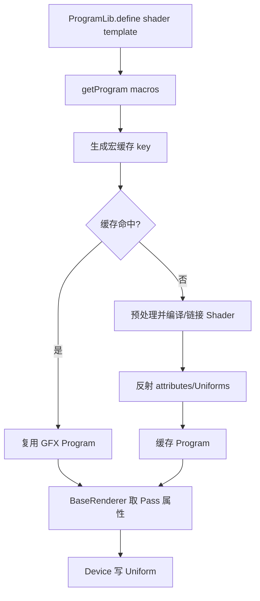

# 第 61 课：Creator 2.4 ProgramLib 宏变体与 Uniform

**本课问题：** 2.4 如何把 Pass 的宏定义变成可复用的 WebGL 程序，并把属性和 Uniform 接入绘制？

## 本版渲染路径

ProgramLib.define() 保存 Shader 模板和宏信息。getProgram() 把宏值编码成缓存键，生成顶点/片元源码并创建 GFX Program。绘制时 BaseRenderer 取出程序，交给 Device，再按程序记录的 Uniform 列表读取 Pass 属性并设置值。

## 源码位置

- [program-lib.js](../../engine/2.4.15engine/cocos2d/renderer/core/program-lib.js)：define()、getKey()、getProgram() 注册模板、生成宏变体并缓存程序。
- [program.js](../../engine/2.4.15engine/cocos2d/renderer/gfx/program.js)：Program.link() 编译并链接 Shader，收集属性与 Uniform 信息。
- [pass.js](../../engine/2.4.15engine/cocos2d/renderer/core/pass.js)：Pass 保存 Shader 名称、宏定义和属性。
- [base-renderer.js](../../engine/2.4.15engine/cocos2d/renderer/core/base-renderer.js)：device.setProgram() 后读取程序 Uniform 并应用 Pass 属性。
- [device.js](../../engine/2.4.15engine/cocos2d/renderer/gfx/device.js)：WebGL Device 管理当前程序及 Uniform 写入。

## 独立代码与简化

src/cocos2d/renderer/ 按 ProgramLib、GFX Program、Device、Pass 和 BaseRenderer 分层。浏览器使用 WebGL 1 实际编译/链接两个宏变体，并设置 u_tint；没有顶点缓冲和 draw 调用。宏键采用可读字符串，省略源码中的位掩码与 Shader 预处理细节。

## 运行

~~~sh
deno task check
deno task build
deno task serve
~~~

打开 http://127.0.0.1:8000/。日志应显示两种变体分别链接、重复请求命中缓存，以及 Renderer 写入 u_tint。

## 为什么这样设计

Shader 模板与宏值会形成多个程序变体；ProgramLib 用宏键缓存已链接的程序，避免每个绘制项重复编译。Pass 属性随后按程序反射出的 Uniform 信息写入。

## 源码流程图

## 本课必须保留的机制

- ProgramLib 根据宏定义生成并缓存程序；Renderer 为当前程序写入 Uniform。

## 最小观察宿主

- 浏览器 WebGL 编译/链接两个宏变体、重复请求并设置 `u_tint`。

## 模型化简化与 Creator Runtime 边界

- 有真实 WebGL 1 编译/链接与 Uniform 调用，但没有顶点 Buffer、InputAssembler 或 draw；宏缓存键简化为可读字符串。
