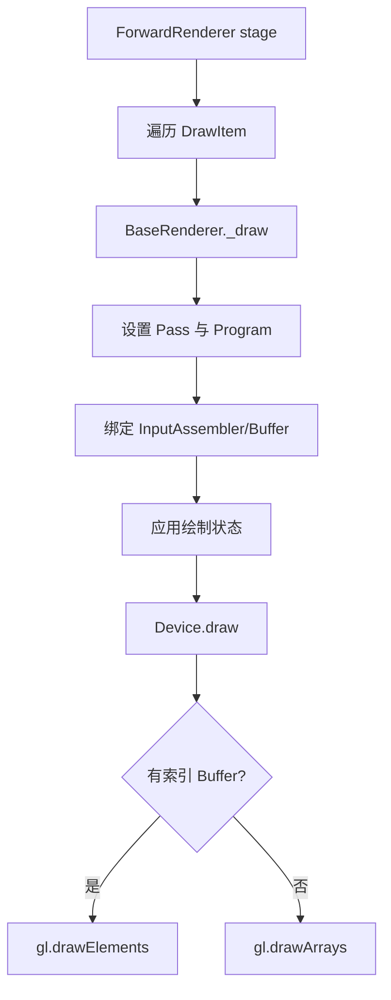

# 第 64 课：Creator 2.4 ForwardRenderer 到 WebGL Device

**本课问题：** 已经排好阶段的绘制项，怎样变成一次 WebGL draw？

## 本版渲染路径

ForwardRenderer 遍历当前阶段的 draw item，BaseRenderer 为每个 Pass 绑定顶点/索引缓冲、图元、程序和状态，再调用 GFX Device.draw。2.4 的 WebGL Device 应用缓存状态后直接执行 gl.drawElements 或 gl.drawArrays；这里没有 3.8 GFX CommandBuffer 的调用链。

## 源码位置

- [forward-renderer.js](../../engine/2.4.15engine/cocos2d/renderer/renderers/forward-renderer.js)：按 opaque/transparent stage 遍历 draw item 并调用 _draw。
- [base-renderer.js](../../engine/2.4.15engine/cocos2d/renderer/core/base-renderer.js)：_draw 设置 InputAssembler、Pass、程序和绘制状态，最后调用 device.draw。
- [device.js](../../engine/2.4.15engine/cocos2d/renderer/gfx/device.js)：draw 提交到 WebGL drawElements/drawArrays。

## 独立代码与简化

src/cocos2d/renderer/ 保留 ForwardRenderer、BaseRenderer、GFX Device 三层。示例用一个 opaque draw item 和一个索引输入汇集器；Device 以日志代替浏览器 WebGL 上下文，不创建真实 GPU 资源。

## 运行

~~~sh
deno task check
deno task build
deno task serve
~~~

打开 http://127.0.0.1:8000/，观察阶段遍历后由 BaseRenderer 设置状态，并在 WebGL Device 层记录 drawElements 请求（非真实 GPU 调用）。

## 为什么这样设计

ForwardRenderer 负责按阶段遍历，BaseRenderer 绑定当前 Pass、程序和输入，Device 适配到底层 WebGL。职责分层让上层不直接依赖浏览器绘制函数。

## 源码流程图

## 本课必须保留的机制

- ForwardRenderer 遍历绘制阶段，BaseRenderer 设置 Pass/InputAssembler，再把绘制请求交给 Device。

## 最小观察宿主

- 页面按调用顺序记录阶段遍历、状态设置与 Device 绘制请求。

## 模型化简化与 Creator Runtime 边界

- Device 仅记录 drawElements/drawArrays 请求，不调用真实 WebGL 或 GPU；此页不是完整 ForwardRenderer。
