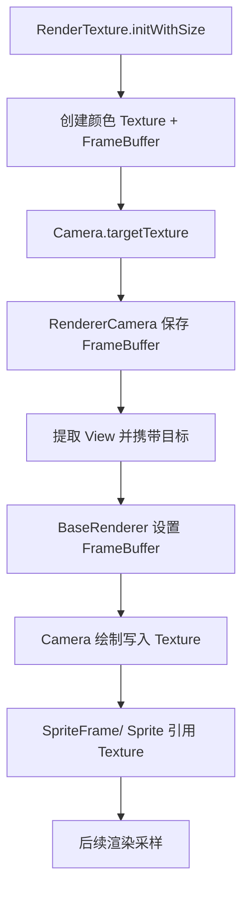

# 第 65 课：Creator 2.4 Camera 输出到 RenderTexture

**本课问题：** 2.4 怎样把一台 Camera 的绘制结果变成可采样纹理？

## 本版渲染路径

RenderTexture.initWithSize 创建颜色 Texture 和 GFX FrameBuffer。Camera.targetTexture 把 FrameBuffer 交给内部 RendererCamera；渲染时 View 携带该 FrameBuffer，BaseRenderer 调用 Device.setFrameBuffer。后续 Sprite 可把 RenderTexture 当普通 Texture 使用。

## 源码位置

- [CCRenderTexture.js](../../engine/2.4.15engine/cocos2d/core/assets/CCRenderTexture.js)：initWithSize 创建颜色纹理与 gfx.FrameBuffer。
- [CCCamera.js](../../engine/2.4.15engine/cocos2d/core/camera/CCCamera.js)：targetTexture setter 和 _updateTargetTexture 设置 Camera FrameBuffer。
- [camera.js](../../engine/2.4.15engine/cocos2d/renderer/scene/camera.js)：setFrameBuffer 并将目标带入 View。
- [base-renderer.js](../../engine/2.4.15engine/cocos2d/renderer/core/base-renderer.js)：render 时调用 device.setFrameBuffer(view._framebuffer)。
- [device.js](../../engine/2.4.15engine/cocos2d/renderer/gfx/device.js)：setFrameBuffer 绑定 WebGL framebuffer。

## 独立代码与简化

src/cocos2d/core/ 与 src/cocos2d/renderer/ 保留资源、相机、View 和 Device 的分层。示例只记录一个相机输出与一次后续采样，不创建真实纹理或 WebGL FrameBuffer。

## 运行

~~~
deno task check
deno task build
deno task serve
~~~

打开 http://127.0.0.1:8000/，观察相机目标从屏幕切到 FrameBuffer，完成渲染后纹理交给 Sprite 采样。

## 为什么这样设计

RenderTexture 把相机输出改为可复用资源：Camera 只需携带目标 FrameBuffer，View/Renderer 负责绑定；之后 Sprite 把同一颜色纹理当采样输入。

## 源码流程图

## 本课必须保留的机制

- RenderTexture 提供颜色 Texture/FrameBuffer；Camera 把目标带入 View，渲染后 Sprite 采样该纹理。

## 最小观察宿主

- 页面按顺序显示相机目标切换、View 绘制与 Sprite 采样关系。

## 模型化简化与 Creator Runtime 边界

- 仅呈现一次输出链路；不创建真实 GPU Texture、FrameBuffer 或完整相机渲染流程。
