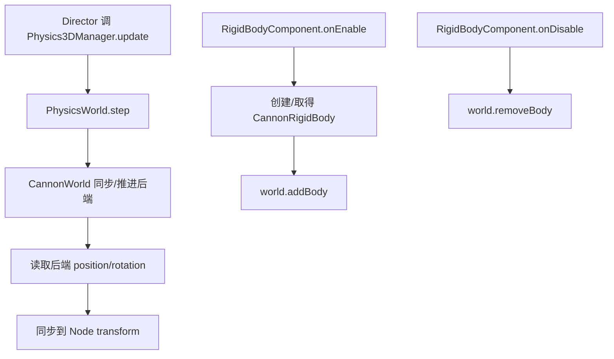

# 第 66 课：Creator 2.4.15 刚体生命周期与节点同步

**本课问题：** 刚体何时加入物理世界，模拟结果如何回写节点变换？

## 本版路径

Physics3DManager → RigidBodyComponent.onEnable → CannonRigidBody → 节点回写。

## 源码位置

- [`rigid-body-component.ts`](<../../engine/2.4.15engine/cocos2d/core/3d/physics/framework/components/rigid-body-component.ts>)：核对 Physics3DManager → RigidBodyComponent.onEnable → CannonRigidBody → 节点回写。
- [`cannon-rigid-body.ts`](<../../engine/2.4.15engine/cocos2d/core/3d/physics/cannon/cannon-rigid-body.ts>)：核对 Physics3DManager → RigidBodyComponent.onEnable → CannonRigidBody → 节点回写。
- [`cannon-world.ts`](<../../engine/2.4.15engine/cocos2d/core/3d/physics/cannon/cannon-world.ts>)：核对 Physics3DManager → RigidBodyComponent.onEnable → CannonRigidBody → 节点回写。

前置课程：[第 55 课](<../s55_physics3d_world_step/README.md>)。

## 为什么这样设计

刚体组件管生命周期，PhysicsWorld 管世界注册，CannonRigidBody 保存后端对象；世界步进后的物理变换再集中回写 Node。分开后组件启停与后端模拟互不耦合。

## 源码流程图

## 本课必须保留的机制

保留 `RigidBodyComponent.onEnable()` 将刚体注册到物理世界、物理步进结果写回节点，以及 `onDisable()` 将刚体移出世界的顺序。这是本课对应的 Creator 2.4.15 源码规则。

## 最小观察宿主

`src/main.ts` 只调用一次 `runLesson()`，把日志写入页面；无需场景、按钮或渲染循环。

## 模型化简化与 Creator Runtime 边界

独立代码按组件生命周期建模：onEnable 幂等创建并登记 backend body；dynamic 只读物理结果回写节点，kinematic 将节点位置推给物理对象；onDisable 幂等移除。CannonWorld 演示重力步进，验证注册、步进、回写和清理。模型没有接入 Creator Director/Physics3DManager，也没有运行 Cannon/Builtin。
## 运行

~~~sh
deno task check
deno task build
deno task serve
~~~

打开 `http://127.0.0.1:8000`。页面会显示：组件激活时加入世界；一步模拟后将后端位置同步回节点，停用时移除刚体。
