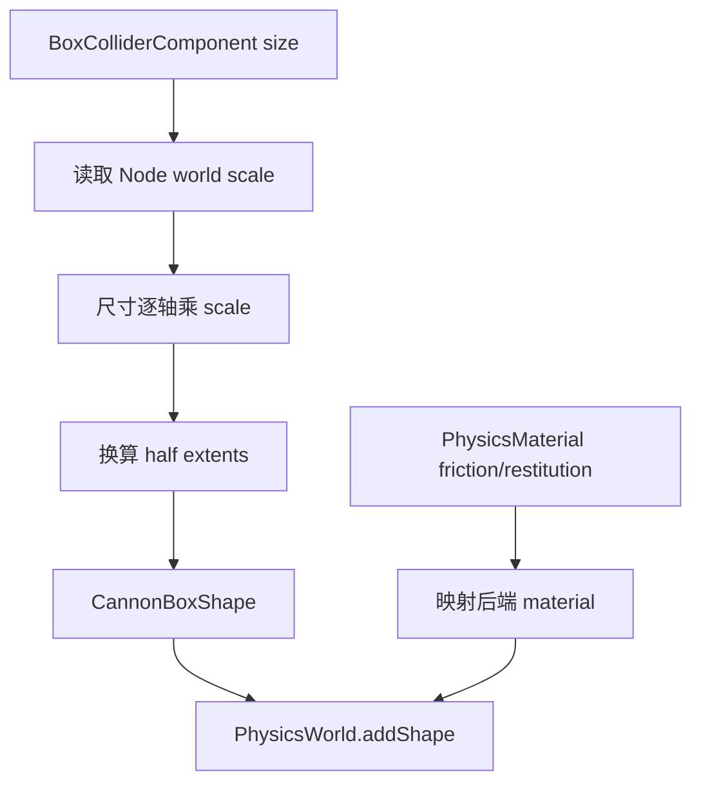

# 第 67 课：Creator 2.4.15 碰撞体形状与物理材质

**本课问题：** 节点上的形状、缩放和材质如何变成物理形状？

## 本版路径

ColliderComponent → BoxColliderComponent → CannonBoxShape；缩放换算由形状层完成。

## 源码位置

- [`collider-component.ts`](<../../engine/2.4.15engine/cocos2d/core/3d/physics/framework/components/collider/collider-component.ts>)：核对 ColliderComponent → BoxColliderComponent → CannonBoxShape；缩放换算由形状层完成。
- [`box-collider-component.ts`](<../../engine/2.4.15engine/cocos2d/core/3d/physics/framework/components/collider/box-collider-component.ts>)：核对 ColliderComponent → BoxColliderComponent → CannonBoxShape；缩放换算由形状层完成。
- [`cannon-box-shape.ts`](<../../engine/2.4.15engine/cocos2d/core/3d/physics/cannon/shapes/cannon-box-shape.ts>)：核对 ColliderComponent → BoxColliderComponent → CannonBoxShape；缩放换算由形状层完成。
- [`physics-material.ts`](<../../engine/2.4.15engine/cocos2d/core/3d/physics/framework/assets/physics-material.ts>)：核对 ColliderComponent → BoxColliderComponent → CannonBoxShape；缩放换算由形状层完成。

前置课程：[第 66 课](<../s66_rigidbody_sync/README.md>)。

## 为什么这样设计

通用 Collider 保存尺寸/材质，具体 BoxCollider 负责把盒形转换成后端 half-extents；后端 Shape 与 PhysicsMaterial 分开，避免组件直接依赖 Cannon 的具体类。

## 源码流程图

## 本课必须保留的机制

保留盒形尺寸乘节点缩放后换算为 half extents，以及 PhysicsMaterial 的摩擦系数等属性随形状接入的规则；这是本课观察的源码职责边界。

## 最小观察宿主

`src/main.ts` 只调用一次 `runLesson()` 并显示日志；无需场景、按钮或渲染循环。

## 模型化简化与 Creator Runtime 边界

独立代码：[课程实现](<src/cocos2d/core/3d/physics/framework/PhysicsStudy.ts>)。示例仅计算数值，不创建 Creator ColliderComponent、后端 Shape 或实际 PhysicsMaterial 资源；未实现组件启用时的 `PhysicsSystem → IPhysicsWorld.addShape → CannonWorld` 调用阶段，也不加载 Cannon/Builtin。

## 运行

~~~sh
deno task check
deno task build
deno task serve
~~~

打开 `http://127.0.0.1:8000`。页面会显示：先按节点缩放计算 box 半尺寸，再创建形状并保存材质摩擦系数。
