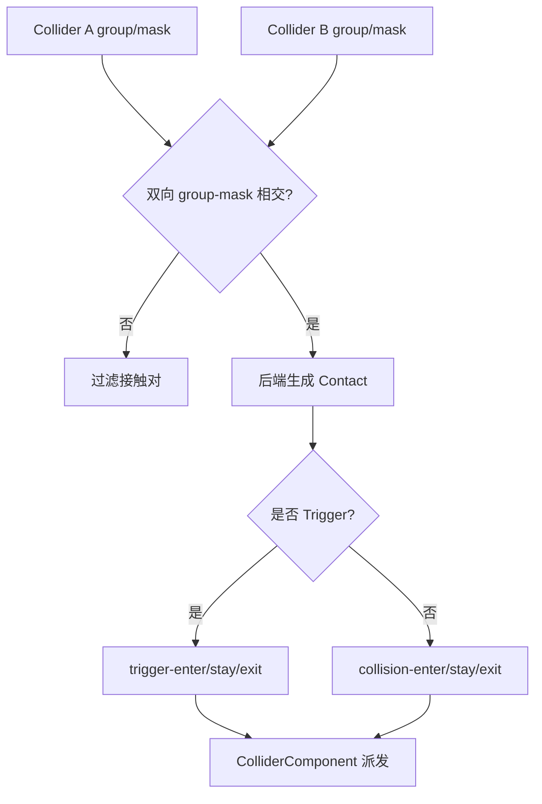

# 第 68 课：Creator 2.4.15 接触事件与碰撞过滤

**本课问题：** 接触或触发如何变成组件事件，过滤条件在哪一层生效？

## 本版路径

ColliderComponent.on 注册 collision/trigger 回调；后端事件回到组件事件入口。

## 源码位置

- [`collider-component.ts`](<../../engine/2.4.15engine/cocos2d/core/3d/physics/framework/components/collider/collider-component.ts>)：核对 ColliderComponent.on 注册 collision/trigger 回调；后端事件回到组件事件入口。
- [`physics-interface.ts`](<../../engine/2.4.15engine/cocos2d/core/3d/physics/framework/physics-interface.ts>)：核对 ColliderComponent.on 注册 collision/trigger 回调；后端事件回到组件事件入口。
- [`cannon-world.ts`](<../../engine/2.4.15engine/cocos2d/core/3d/physics/cannon/cannon-world.ts>)：核对 ColliderComponent.on 注册 collision/trigger 回调；后端事件回到组件事件入口。

前置课程：[第 67 课](<../s67_collider_shapes/README.md>)。

## 为什么这样设计

过滤、接触生成和脚本通知是不同阶段：先用 group/mask 排除不可能的组合，再让后端生成接触，最后按 trigger/collision 类型派发事件。

## 源码流程图

## 本课必须保留的机制

保留 group/mask 双向相交的过滤规则，以及通过 trigger 标志选择 `trigger-enter` 或 `collision-enter` 通知的职责划分。

## 最小观察宿主

`src/main.ts` 只调用一次 `runLesson()` 并显示结果；无需场景、按钮或帧循环。

## 模型化简化与 Creator Runtime 边界

代码使用双向 `(group & other.mask) !== 0` 过滤接触对，并跨帧保留活动 pair，从而区分 collision/trigger 的 enter、stay、exit；事件桥将结果双向送到两个 Collider 监听器。后端接触生成、Creator 组件事件队列和完整碰撞回调参数仍由引擎实现。
## 运行

~~~sh
deno task check
deno task build
deno task serve
~~~

打开 `http://127.0.0.1:8000`。页面会显示：用 group/mask 过滤一对碰撞体，再按 trigger 标志选择 trigger-enter 或 collision-enter。
